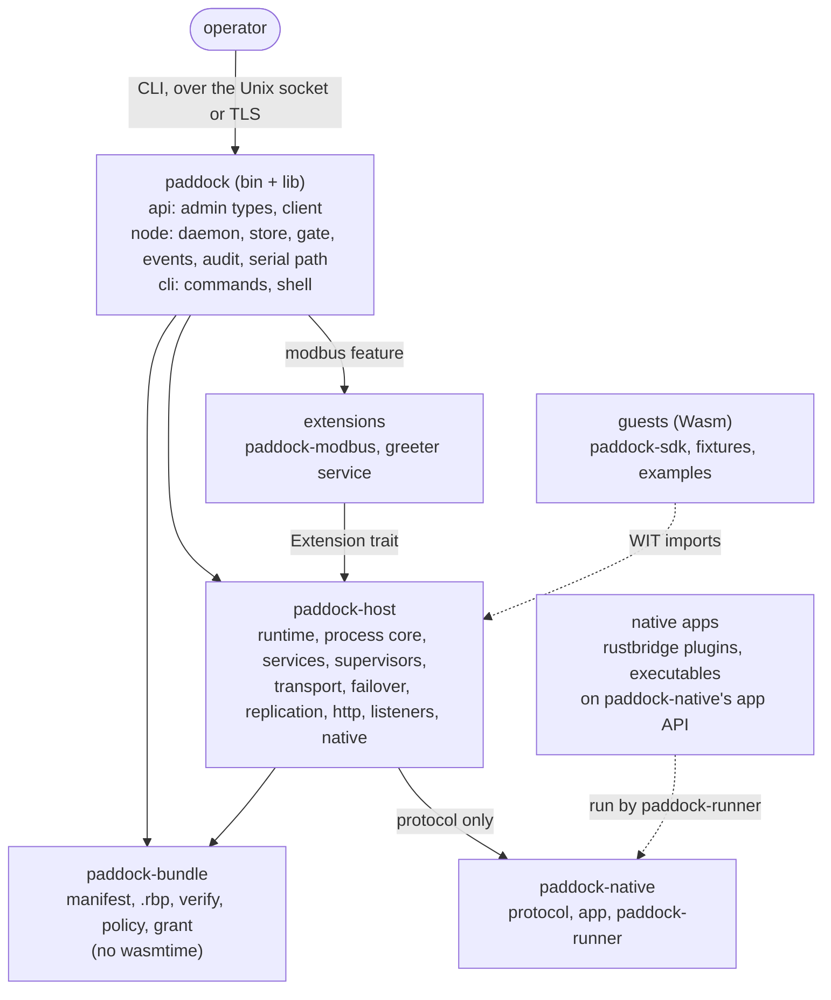
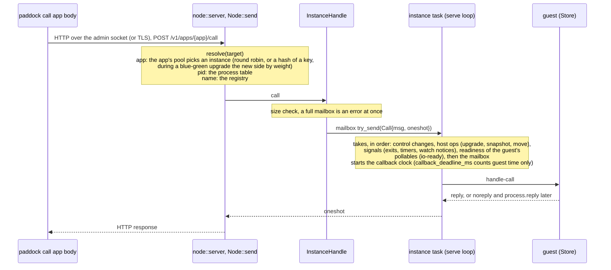
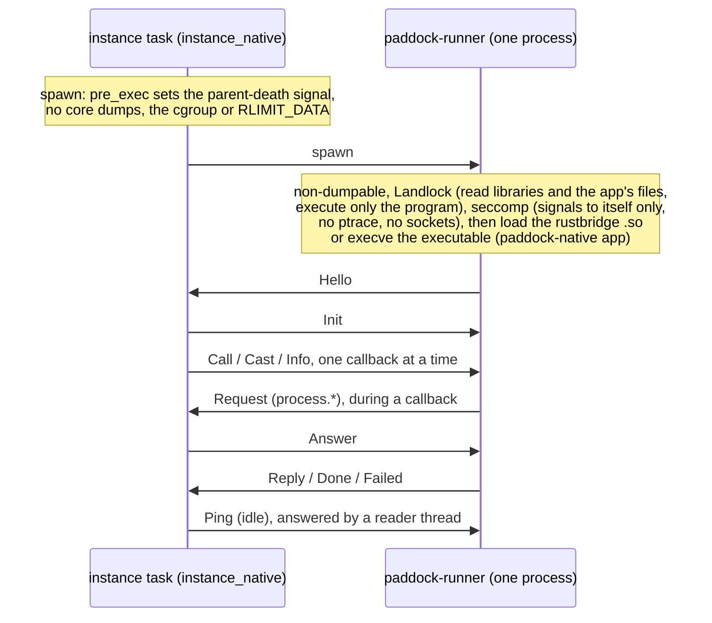
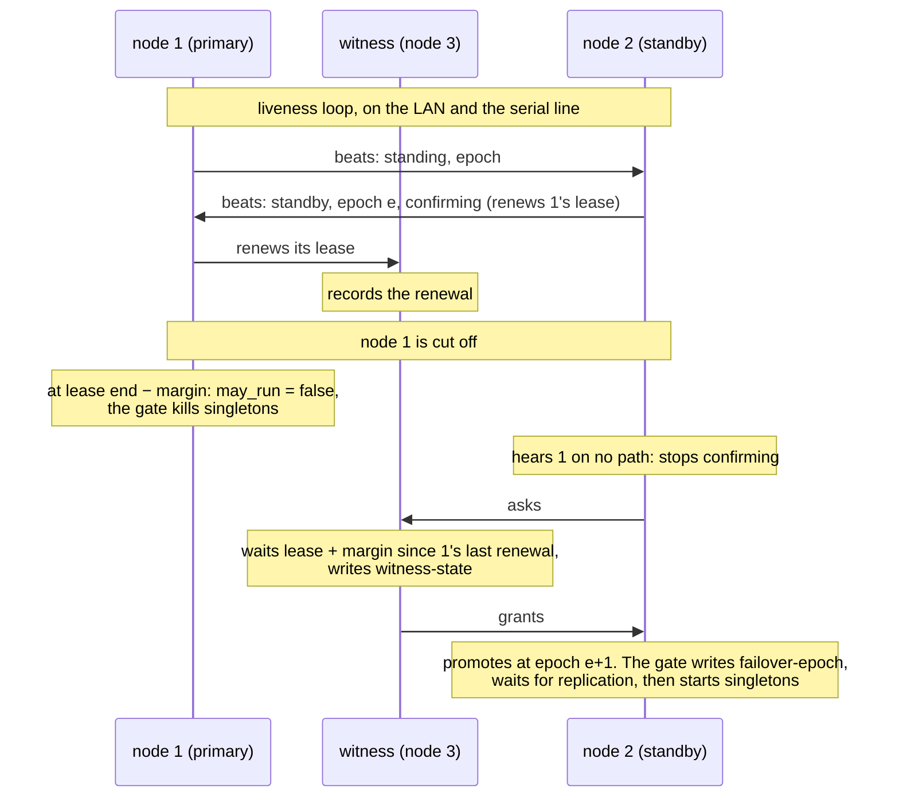
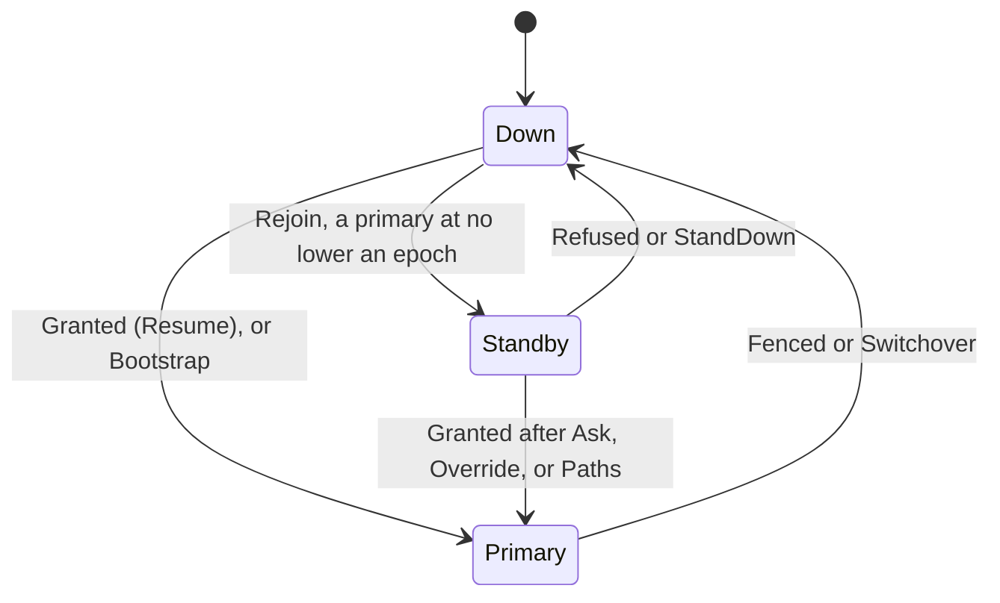
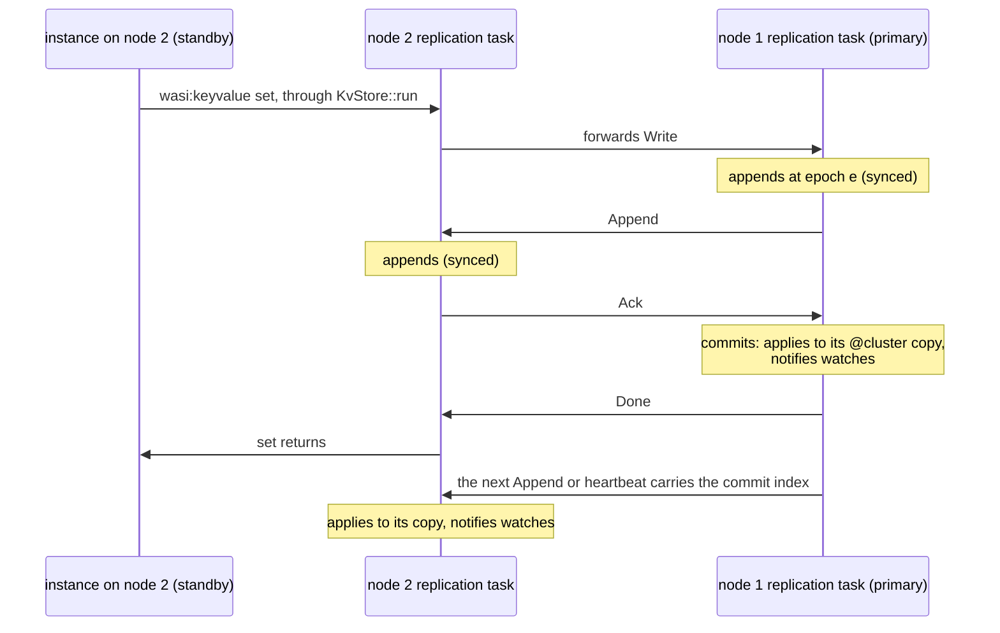

# Paddock: Architecture

2026-10-25 · Companion to [DESIGN.md](DESIGN.md)

A map of the code as built: the crates, the paths a call, a deploy, a failover, a replicated write and a release take through them, the threads and tasks that run, and where state lives. DESIGN.md says why; this file says where.

## Crates



Solid arrows point from a crate to the crates it depends on; dotted arrows are what runs on the host, not Cargo dependencies.

| Crate | Builds | What it holds |
| --- | --- | --- |
| `paddock` | binary and library | `api` (admin API types, and the client over the Unix socket or TLS), `node` (the daemon, feature `node`), `serial` (the tty layer and frames for the failover serial line), `cli` (commands, bundle building, the shell). Without `node` it does not build wasmtime. |
| `paddock-bundle` | library | The app manifest model and validation, `.rbp` opening and signature checks against operator keys (a component, or a native app's platform variant), component import inspection, operator policy and the effective grant. |
| `paddock-host` | library | The runtime: engine, epoch ticker, process table, instances (components and native processes), passivation, links and monitors, supervisors, app sets and pools, host services, the HTTP ingress and handlers, listeners, the cluster transport, liveness, membership, failover, replication, moving singletons and release versions. |
| `paddock-native` | library and `paddock-runner` | The frame protocol between a node and a native app, the app API for native executables (feature `app`), and `paddock-runner` (feature `runner`, default), the launcher that sandboxes itself and loads or executes a native app. `paddock-host` takes the protocol only. |
| `paddock-modbus` | library | The Modbus TCP extension; depends on `paddock-host` alone. |
| `paddock-sdk`, `paddock-sdk-macros` | guest libraries | The Rust guest SDK: the `App` trait, envelopes, snapshots, service wrappers by feature. The SDK owns the generated bindings. |
| `paddock-fixture-*` | guests and native test apps | Components (echo, chaos, counter in three versions, services, sdk, conn, http, net), a native executable (`native`) and a rustbridge plugin (`plugin`). |
| `paddock-soak` | binary | Fault injection against `paddock node` processes (`scripts/soak.sh`): failover, replication and the SCADA release cycle. |
| `examples/*` | guests and scripts | SDK examples, the tutorial's apps, the SCADA reference app, the greeter extension, the failover demo, systemd units. |

The WIT contracts live in `wit/`: `paddock:runtime` (the app world, frozen per version) and separate packages for connections, groups, watch, secrets, metrics, SQL and I/O readiness. `wit/vendor/` holds the WASI interfaces bound against.

Code areas and their interfaces are listed in ROADMAP.md, "Code areas".

## Inside `paddock-host`

| Area | Modules | Role |
| --- | --- | --- |
| Engine | `runtime`, `config`, `bindings`, `deny`, `compiled` | `Runtime` and its `RuntimeInner`: the wasmtime engine with a pooling allocator sized by `max_instances` (a freed slot keeps up to `keep_resident` of its written pages for the next instance), the epoch ticker, the linker (WASI p2 with the socket functions redefined, `paddock:runtime`, `paddock:io`, services, extensions), deny stubs for ungranted imports, compiled components kept on disk |
| Process core | `pid`, `table`, `registry`, `links`, `message`, `instance`, `instance_native`, `state`, `process`, `ready`, `delivery`, `acl`, `lifecycle`, `output`, `health` | Instances, their mailboxes and callback loop (a Store, or a native process), passivation, the per-instance host state and `process` functions, readiness waits, pid routing, messaging ACLs (checked on the target's node), links and monitors, health checks |
| Orchestration | `apps`, `pool`, `supervisor`, `upgrade`, `spec` | App sets in dependency order, a root supervisor per app, pools with routing and a blue-green second side, snapshot, restart and blue-green upgrades |
| Services | `services::{config, keyvalue, groups, logging, secrets, metrics, egress, sockets, sql, extension}`, `metrics` | Guest-facing interfaces on the `Service` pattern; extensions from other crates |
| I/O | `http` (`http::tls`, `http::handler`), `listener` | The HTTP ingress (a request is a call to a pool), HTTP handlers (an instance per request) and listeners (an instance per connection) |
| Native apps | `native::{port, cgroup, convert}` | A native instance's process through `paddock-runner`, its limits, and the conversions to the protocol's types |
| Cluster | `transport::{liveness, membership, wire, quic, memory, lane}`, `failover::{node, witness}`, `replication::{core, log}`, `handover`, `formats` | Frames between nodes, heartbeats and sessions, joining, QUIC with pinned keys, the in-memory mesh for tests, the HA pair and witness, replicated buckets, singletons moved with their state, the pair's version for what is kept |
| Observability | `probe`, `metrics` | USDT probes on the message path; Prometheus text |

`delivery` is the one place a pid is routed: a live local instance, a dead local pid (`noproc`), or another node (a frame on the transport, or `noconnection`). Process-core code goes through it, never the process table directly.

`LoadedApp` holds what an app runs: a component linked and ready to instantiate (`Runtime::load`, `load_cached`), or a native program (`Runtime::load_native`). The instance task takes the same channels and handle either way and branches once, at the start of its lifecycle.

## A call

### From the operator



The caller waits with its timeout; a reply after the timeout is dropped. A guest that exceeds its deadline traps at an epoch tick, and the instance exits with a reason its supervisor acts on. Guest time excludes host time: the Store's call hook stops the callback clock while a host function runs (`CallHook::CallingHost`) and starts it again on return, so a guest waiting in `process.call` or a keyvalue read is not charged for it.

### Between instances

A guest calls `process.call`. The host function (`process`) hands it to `delivery::call`, and the time the caller waits counts as host time.

- **Local:** the target's mailbox, as above.
- **Remote:** a `Frame::Call` with an id goes to the target's node over the transport, and the caller waits on `pending_calls`. The receiving node runs `delivery::call` in a task of its own and answers with `Frame::Reply`. A session that ends meanwhile fails the call with `noconnection`. Calls from one peer handled at once are capped (`[cluster] incoming_calls_max`, `RuntimeConfig::incoming_calls_per_peer`); past it they are answered `overloaded`.

Casts follow the same routes without a reply; a full mailbox drops the cast and counts it. A congested link drops casts and fails calls with `overloaded` past `send_buffer_bytes`, as a full mailbox does.

### From HTTP

The ingress (`http`; in the node, `daemon/ingress.rs`, behind the `http` and `tls` features) accepts on several tasks per address, matches a route by host and longest path prefix, and reads the body up to the route's limit.

- **To an app:** the request becomes a CBOR envelope, encoded straight from the borrowed request, and a call to the owning app's pool; the reply envelope becomes the response. On a standby, a singleton's route redirects to the primary (`partner_url`) or forwards the call over the cluster (`standby = "forward"`, `Frame::AppCall`).
- **To an HTTP handler** (`http::handler`; the node's `daemon/handlers.rs`): a `wasi:http/proxy` component gets a new instance per request, with streaming bodies. The route's timeout runs until the response headers, then again as an idle timer while either body moves; past it the stream is cut. The instance takes a Store slot for the request's life (`503` with `Retry-After` when none is free) and has no mailbox.

Listeners (`listener`) are like HTTP handlers for raw TCP: each accepted connection gets a new instance of a connection-handler component, which reads and writes the socket through `wasi:io` streams.

### Out of an app

- **HTTP egress** (`services::egress`): wasmtime-wasi-http's send hook is the filter. A request goes out only if it matches the manifest's `allow` (inside node config's `[egress] allow`), through the node's connection pool, at most `max_concurrent` per app at once. Its resolver refuses names that resolve only to loopback or link-local addresses unless `allow_loopback`.
- **Guest sockets** (`services::sockets`): wasmtime-wasi implements `wasi:sockets`; the service narrows it with an address check on every use (the manifest's `connect` and `bind` rules, `listen`, and the guard on loopback, link-local and unspecified destinations). The count per app (`max_sockets`) has no hook in wasmtime-wasi, so `shadow` redefines `create-tcp-socket`, `create-udp-socket`, `accept` and both socket destructors on the linker, taking a semaphore permit per socket.
- **Waiting on a socket** (`ready`, `paddock:io`): a guest hands the host a pollable and a tag with `ready.notify`; the serve loop polls the instance's pollables beside its mailbox and delivers the host event `io-ready` once one is ready. The `wasi:io/poll` pollable destructor is redefined to forget waits on a dropped pollable.
- **SQL** (`services::sql`, feature `sql`): a Postgres pool per datasource, with a connection cap per app.

## Passivation

An app with `instances.passivate_after_ms` lets an idle instance give up its Store (spike S11). After that long with nothing to do, the instance runs `save-snapshot`, drops its Store and keeps its data (`InstanceState`: timers, waiting callers, services' state); its pid, mailbox, links, monitors and names live outside the Store and stay. Its state is `Passive`.

Stores are bounded by `RuntimeInner::slots`, a semaphore of `max_instances` permits, while `max_processes` bounds instances. The next message, signal or operation for a passive instance takes a slot, builds a Store on the kept data and runs `load-snapshot`. An instance that finds no free slot signals `slot_wanted`, and idle instances that may passivate do so early to free one. A snapshot operation on a passive instance is answered from the kept bytes without waking it.

## Native-process apps

A native app (`kind = "native-process"`) runs as a process, one per instance, through `paddock-runner`:



- **The port** (`native::port`) holds the child and three tasks: a writer (frames queued without blocking the instance task), a reader (decoding frames), and stderr copied into log lines as a component's stderr is.
- **The lifecycle** (`instance_native`, a child module of `instance`) uses the instance's own channels, so pids, links, monitors, supervision and exit reasons work as for a component. Requests are answered by the same `process::Host` functions a component's imports run, on an `InstanceState` the task holds without a Store. A callback's deadline is wall time less the time spent answering requests; past it, or past a ping's deadline while idle, the process is killed (`timeout`). Its exit is a crash with its status or signal, a panic is a crash with the panic's message, and an OOM kill in its cgroup is `memory_limit`.
- **Limits** (`native::cgroup`): with node config `[native] cgroup`, the node moves itself into `<cgroup>/node` at start and gives each instance `<cgroup>/native/<pid>` with `memory.max`, no swap and `pids.max`; the child is placed there between fork and exec. Without it, `memory_max` is the process's `RLIMIT_DATA`.

No snapshots, so no passivation, snapshot upgrades or moves; upgrade operations are refused.

## A deploy

`paddock deploy app.rbp` sends the bundle (`POST /v1/apps`). The node holds the change lock for the whole deploy; reads do not wait for it.

1. The upload is written to `<data_dir>/tmp`.
2. `VerifiedBundle::open`, on the blocking pool: the signature against `trusted_keys`, the `appserver` section, checksums, and the `wasm32-wasip2` variant and its world, or a native app's platform variant.
3. The effective grant: manifest ∩ operator policy. A native program declares its capabilities but has no imports to inspect.
4. The ceilings: `[egress] allow`, `[sockets]`, datasources bound.
5. `Runtime::load_cached`, on the blocking pool: compile with Cranelift, inspect imports, link deny stubs, and keep the compiled code under `compiled/`. A native app's program is written under `compiled/` (mode 0500) and loaded with `Runtime::load_native`.
6. The `InstanceSpec`, from the manifest, narrowed by the grant.
7. The store: `priv/` extracted, the bundle kept as `bundles/<app>/<version>.rbp`.
8. Run: HTTP routes, if granted (an HTTP handler only routes). A singleton on a failover node goes to `gate.hold` and starts only while `may_run`; anything else goes to `Apps::add`: the dependency check, the root supervisor and a pool of instances, each instantiated in a new Store (or spawned as a native process), then `init`, then serving.
9. `state.json` saved, and an `audit.log` record.

On restart a node re-verifies every stored bundle and starts the apps `state.json` marks running, in deploy order, reading compiled components from `compiled/` instead of compiling them.

### Upgrades

An upgrade takes the same verify and compile steps, then one of three modes, as the new version's manifest says:

- **`snapshot`:** each instance in place: save-snapshot in the old Store, a new Store from the new component, load-snapshot; a failure reverts that instance with its state intact.
- **`restart`:** the instances stop and start again from `init` at the new version.
- **`blue-green`:** the new version's instances start beside the old under a root supervisor of their own, as a second side of the app's pool (`pool`), with a weight: the percentage of messages routed to the new side. `paddock upgrade --steps` moves the weight in steps, and `paddock traffic` sets it, retires the old side or stops the new one. A watcher in `apps` follows the new side's supervisor. The node's `daemon/blue_green.rs` keeps the deploy store in step, so a restart brings back both sides at the same weight.

Rollback goes to the previous version the same way.

## A failover



Each node's failover task moves between three standings. The transitions are named after the actions in `docs/tla/FailoverL2.tla`:



A standby asks the witness once its partner is silent on every path, or at once when the partner yields in a switchover. `Override` promotes on an operator's confirmation, when the witness cannot be reached either; `Paths` promotes on silence alone, for a pair without a witness. `Bootstrap` is the start of a pair: with both nodes down, the lower node id leads.

- **Liveness** (`transport::liveness`) beats every peer each heartbeat interval, on the cluster link and any extra path, with a payload failover sets (standing, epoch, whether it confirms). A path silent for `node_timeout` raises an event; a peer that stops being reachable ends its session.
- **The serial path** (`node/serial_path.rs`, on `paddock::serial`): one task per configured device writes this node's beats as serial frames and reports the partner's to the runtime as a heartbeat path. A device that fails is reopened a second later, the path silent meanwhile; frames from or for another node are dropped. The tty layer is Paddock's own, on `rustix`.
- **The failover task** (`failover::node::run`) is a state machine, one type per standing, stepping on node events, witness messages, each heartbeat tick, and the moment its lease would end. It sees liveness and the transport through the `Env` trait, which unit tests fake to drive one transition at a time. It publishes a `Leadership` (standing, epoch, `may_run`) on a watch channel. Its transitions are named after the actions in `docs/tla/FailoverL2.tla`.
- **The witness** (`failover::witness`) answers one request at a time under a lock, and writes its epoch, promoted node and record of a partner out of date to disk before a grant or record change leaves. A primary yielding in a planned switchover releases its lease there (`Release`), so the standby need not wait it out.
- **The gate** (`node::gate`) follows the leadership on the node: it writes the epoch to `failover-epoch` before acting on it, and starts the held singletons when `may_run` is set, from a moved snapshot if one waits, else from `init`. A singleton with replicated buckets (its own or a cluster bucket it uses) waits until `ReplicationStatus::ready` at the current epoch. It checks held singletons as a start would and retries failed starts. When `may_run` drops it kills them without `terminate`. It logs `singleton starting` and `singleton killed`, which the soak's checker reads.
- **Out of lease, in the instance:** an instance bound to the lease checks it before each callback and at each epoch tick (`failover::RunUntil`), so the window between the leadership and the gate's kill runs no guest code.

The rules are R1 to R14 in `docs/tla/VERIFICATION.md`; the assumptions the model makes, and which the code does not meet (A8: process pauses), are listed there.

### A planned switchover, with state

`paddock failover switchover` on the primary hands its singletons to the standby. A singleton in `snapshot` upgrade mode, on a pair with `[failover] replication = true`, is moved with its state (`handover`): the instance takes its snapshot (the `MoveOut` operation; afterwards it handles nothing more), and the old primary writes it to the reserved replicated bucket `@handover`, one key per app, through the pair's log. Every start of a singleton that moves takes the record first (`Runtime::take_handover`): it deletes the record, waits for the delete to commit, and loads the snapshot in place of `init`. The gate's `hand_over` and `start` do the two halves; `RuntimeInner::handovers` holds what was taken until the instance starts.

## A replicated write



- **What replicates:** `cluster` buckets from node config, apps' buckets declared `replicated` (kept as `<app>/<bucket>` in the `@cluster` namespace), and the reserved records `@handover` and `@release`. Replication runs on a pair with `[failover] replication = true`.
- **`KvStore`** sends a write to a replicated bucket (`Durability::Replicated`) to the replication task and waits for its answer; reads are local, from this node's copy. `get-linearizable` goes to the task too, which serves it on the primary (or forwards it).
- **The replication task** (`replication::Task`) owns the replica, a state machine named after spike S20's actions (`replication::core`), over the log (`replication::log`), which lives in the same redb file as the disk buckets: entries, and the commit index applied with the data in one transaction. It follows the failover leadership, takes frames from the partner (`Frame::Replication`), forwards the standby's writes and linearizable reads to the primary, asks the failover task to set or clear the witness's record (`failover::record_partner`), and ticks each heartbeat interval to resend, send the commit index and compact. It publishes `ReplicationStatus` for the gate and `paddock failover`. Its redb work runs under `block_in_place`.

The rules are spike S20's R1 to R7, mapped to the code in `docs/tla/VERIFICATION.md` with the witness's record (R13).

## A release across the pair

Each build speaks its own wire protocol version and the one before. A connection agrees on the highest version both speak (`wire::Hello`, `Transport::version`), and a frame is written only on a connection at or above the version that introduced it (`wire::since`), so the two nodes of a pair can run builds one release apart.

What outlives a connection (the replicated log, the `@cluster` records) follows the pair's version instead (`formats`): it is kept in the reserved replicated bucket `@release` (key `formats`), so both nodes apply a change at the same log index, and it rises only by `Runtime::finalize_formats` (`paddock release finalize`), once every node named speaks this build's version. A node refuses to start a build older than the pair's version.

`paddock release` (the CLI, over each node's admin API) shows the versions; `paddock release upgrade` upgrades an app on the standby, then the primary, gating each step on the app running at the new version there; `release rollback` returns both to their common previous version.

## The node's admin side

- **The admin API** (`node::server`) serves JSON over HTTP on the admin socket, and over TLS with pinned keys on `[admin]`. Long answers stream (`server.rs`, `stream`): `paddock events`, `paddock logs --follow`, and long polls such as `GET /v1/failover?after=...&wait_ms=...`.
- **The event hub** (`node/events.rs`) merges audit records as they are written, instance exits and restarts (`Runtime::instance_events`), members heard and lost, and failover changes into one stream of JSON lines (`paddock events`).
- **The shell** (`cli/shell.rs`, `cli/contacts.rs`) runs `paddock` commands against one node at a time, moving between nodes named in a contacts file.

## Threads and tasks

A node runs one tokio multi-threaded runtime, one worker per core by default. Nothing runs guests on a current-thread runtime (CLAUDE.md, spike S1).

| Thread or task | Count | Started by | Ends |
| --- | --- | --- | --- |
| `paddock-epoch` OS thread | 1 per runtime | `Runtime::new` | runtime drop |
| tokio workers | 1 per core | `node::run` | process exit |
| blocking pool | on demand | bundle verify and compile, `disk` bucket transactions (redb), secret file reads | per job |
| Instance task (callback loop) | 1 per instance | `Runtime::spawn` | instance exit |
| Health check | 1 per instance of an app with `health` | the instance task | instance exit |
| Native process tasks: writer, reader, stderr | 3 per native instance | `native::port` | process exit |
| Timer | 1 per pending `process.send-after` | `process` | fires or is cancelled |
| Supervisor | 1 per supervisor, plus 1 per child watching its exit | `supervisor` | supervisor exit |
| App watcher | 1 per app, and 1 per blue-green new side | `apps` | root supervisor exit |
| HTTP accept, connection; HTTP handler instance | several per address; 1 per connection; 1 per request | `http` | stop; connection close; response sent or cut |
| Listener accept, connection instance | several per listener; 1 per connection | `listener` | stop; connection close or idle timeout |
| HTTP egress connections | pooled, per host | `services::egress` | idle timeout |
| Liveness loop | 1, once a node has a peer | `Liveness::add_peer` | runtime drop |
| Serial path | 1 per configured device | `node/serial_path.rs` | stop |
| Failover node loop | 1 on a pair member | `Runtime::start_failover` | runtime drop |
| Replication task; a record request to the failover loop | 1 on a pair member with replication; 1 per request | `Runtime::start_failover` | runtime drop; answer |
| QUIC accept, new-member dialer | 1 each | `QuicTransport` | stop |
| QUIC per connection: 2 writers, 2 readers, close watcher | 5 per peer | connection setup | connection close |
| QUIC redial | 1 per lost peer or seed | connection loss | reconnected or stop |
| Remote call | 1 per incoming `Frame::Call` (capped per peer) | `transport` | reply sent |
| Admin server accept, connection; streams | 1; 1 per connection | `node::server` | stop |
| Event hub | 1 | daemon | stop |
| Metrics endpoint | 1 if configured | daemon | stop |
| Seed join, identity reload, certificate watcher, SIGHUP reload | 1 each if configured | daemon | stop |
| Gate follower | 1 on a pair member | daemon | stop |
| Modbus device, server | 1 per device; 1 per server | `paddock-modbus` | stop |

The epoch ticker is an OS thread so that a node whose workers all run spinning guests still advances the epoch, and the guests still yield.

## Where state lives

### In memory, per node (`RuntimeInner`)

| State | Holder | Lock |
| --- | --- | --- |
| Live instances by id | `table::ProcessTable` | std `RwLock` |
| Store slots, and the wish for one | `RuntimeInner::slots`, `slot_wanted` | semaphore; `Notify` |
| Registered names | `registry::Registry` | std `RwLock` |
| Links and monitors (both local sides of remote ones) | `links::LinkTable` | std `Mutex` |
| App pools, each with a possible blue-green side and weight | `RuntimeInner::pools` | std `RwLock` |
| Remote calls awaiting a reply | `transport::PendingCalls` | std `Mutex` |
| Peers and sessions; paths and this node's payload | `transport::liveness::Liveness` | std `Mutex`; std `RwLock` |
| Members and creations | `transport::membership::Membership` | std `Mutex` |
| Failover inbox; the witness's record and its persistence | `failover::Shared` | std `Mutex` each |
| Services' shared state: buckets (memory, and the redb handle), watches, groups, log rate buckets, metric series, secret sources, the egress pool, socket counts per app, SQL pools | `services::Shared` | per service |
| The replica: role, mode, the partner's match index, writes waiting to commit, a snapshot in transfer | `replication::Task` (owned by its task, no lock) | none |
| A moved singleton's snapshot taken for its start | `RuntimeInner::handovers` (`handover::Pending`) | std `Mutex` |
| Failover role for `hot-standby` instances | `RuntimeInner::failover_role` | std `RwLock` |

No std lock is held across an `.await` (`await_holding_lock` is denied).

### Per instance

| State | Where |
| --- | --- |
| Guest memory and globals | the Store (pooling allocator slot); for a native app, its process |
| WASI context, resource table, timers, pending `noreply` callers, readiness waits, the callback clock, service instance states | `state::InstanceState`, the Store's data (kept while passive; held by the task for a native app) |
| Mailbox | bounded `mpsc` (`limits.mailbox_max`) |
| Signals (exits, timers, watch notices) | unbounded `mpsc` |
| Host ops (upgrade, snapshot, move, announce) | unbounded `mpsc` |
| Run, shutdown or kill | `watch` channel |
| Lifecycle state, exit reason, counters | `InstanceHandle`, shared |

A guest's state lives only in its Store (or its process). A crash or restart starts from `init`; a snapshot upgrade, a passivation and a singleton moved in a planned switchover carry it across. State that must survive anything else goes in a `disk` or replicated bucket.

### In the node daemon (`node::Node`)

| State | Holder |
| --- | --- |
| Desired apps, blue-green sides and deploy info | `NodeState`, behind a `std::sync::Mutex` taken briefly and never across an await; a separate tokio `Mutex`, the change lock, keeps admin changes (deploy, upgrade, stop, start, remove, rollback) to one at a time across their awaits, and reads (`list`, `status`) do not take it |
| Connection apps and their listeners; HTTP handlers | std `Mutex` |
| HTTP route table, TLS certificates | `HttpIngress` |
| Held singletons | `gate::Gate` (std `Mutex`, and a tokio `Mutex` serializing starts and stops) |
| Event subscribers | `node/events.rs` (a broadcast channel) |
| Recent log records | `LogRing` (10,000 records) |

### On disk (`data_dir`)

```
<data_dir>/
├── state.json                 apps, versions, running or stopped, blue-green sides
├── bundles/<app>/<version>.rbp
├── priv/<app>/<version>/...   files the app sees at /priv
├── compiled/<app>/<version>/  compiled components (<checksum>.cwasm) and native programs (.native)
├── kv/                        disk buckets and the replicated log with its replicated buckets (one redb file)
├── tmp/                       uploads being verified
├── creation                   raised on every start; part of every pid
├── failover-epoch             the highest epoch reached; written and synced before acting
├── witness-state              a witness's epoch, promoted node and record; synced before a grant or record change
├── node.lock                  held while a node has the directory open
├── admin.sock                 the admin API, unless admin_socket names another path
└── audit.log                  one JSON object per line
```

Node configuration, the node's cluster key and the peers file live wherever the configuration names them. A compiled component is read back only if it and its directory belong to the node's user and neither is writable by group or others (`paddock_host::compiled`), since deserializing runs its code. [OPERATIONS.md](OPERATIONS.md) lists every path under `data_dir`.
