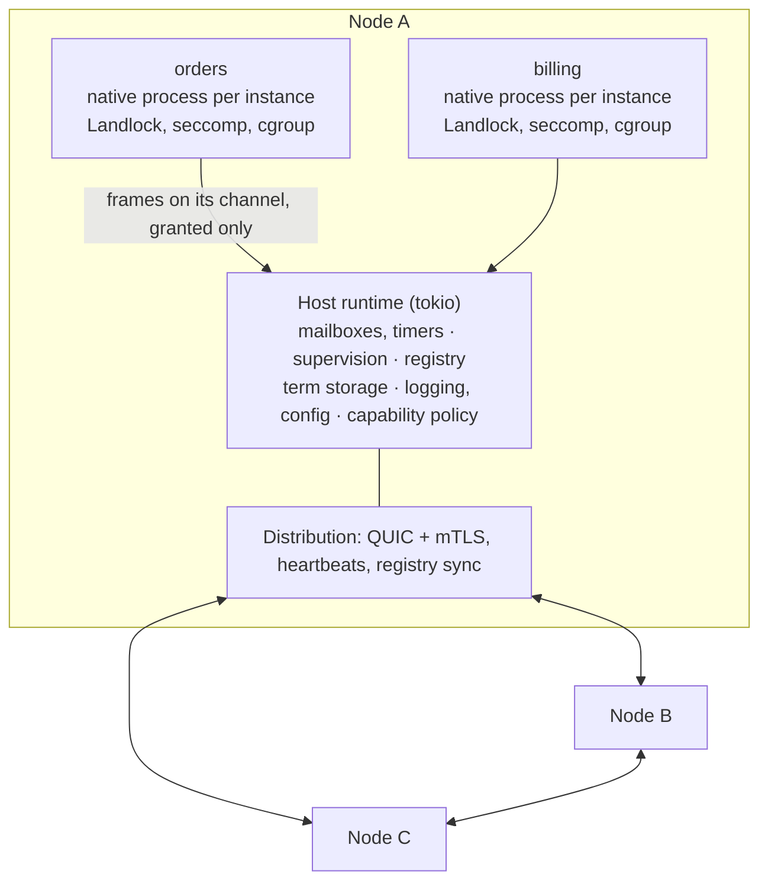

# Bulkhead: Design

2026-10-05 · kept current through Phase 3 (reviewed against the code 2026-10-25) Phase 5's exit (native apps, 2026-11-01) and Phase 5c (native only, 2026-11-08)


## Summary

Bulkhead is a clustered application server that runs apps as native OS processes with OTP-style semantics: mailboxes, call/cast, links, monitors, supervisors, and hot upgrade. Each instance of an app is one long-lived process, restricted by `bulkhead-runner` before the app's code runs, and talks to its node over shared-memory rings; the node keeps the mailboxes, supervision, registry, storage and policy. Nodes connect over QUIC with mutual TLS. Apps see only the capabilities their manifest declares and an operator grants. rustbridge supplies the bundle format and signing.

Bulkhead is a fork of Paddock (2026-10-31), which runs apps as sandboxed WebAssembly components. Native apps reached parity on 2026-11-07 (ROADMAP Z8), and components were removed on 2026-11-08 (Z9). "Instance model" below says why a process per instance, and [PADDOCK.md](PADDOCK.md) how the two differ and what it costs.

The model is coarse-grained: tens to a few thousand long-lived instances per node, not millions of processes spawned and discarded. That keeps BEAM's main strength (fault isolation and supervision) with the OS as the isolation boundary, and suits apps that pass messages and reach a database efficiently over a long life.

## Goals

- Run apps as native processes, one per instance, written in Rust with `bulkhead-sdk` (other languages are not planned, 2026-11-07).
- Give each app enforced limits on memory, CPU time, filesystem, and network.
- Let apps send each other messages with call (request/reply with timeout) and cast (fire and forget), locally or across nodes.
- Detect crashed or unresponsive apps, restart them under supervision, and notify linked and monitoring apps.
- Deploy, upgrade, roll back, and remove apps on a running cluster, with explicit state migration.
- Provide OTP/JBoss-style host services: registry, logging, config, term storage, jailed files, HTTP in and out.
- Keep the manifest and permission data model complete from day one, even where enforcement ships later.

## Non-goals

- Millions of lightweight processes per node.
- Running unmodified Erlang or BEAM bytecode.
- Shared memory between apps, or threads shared across app boundaries.
- Supervision trees beyond the node's own supervision of the instances it starts: apps start no apps (2026-11-10).
- Strong consistency or exactly-once delivery by default. Delivery is at most once, ordered per sender/receiver pair, as in Erlang. Durable delivery, when it comes, is an opt-in capability (a persisted queue, or keyvalue plus a watch), never a change to `process`.
- Distributed transactions (JTA-style).

## Background and prior art

Bulkhead takes the failure model from Erlang/OTP, the deployment model from JBoss/WildFly, and isolation from the operating system's process boundary. No existing project combines all three. Each one below shaped part of the design.

| Project | What it got right | What went wrong or is missing | What Bulkhead takes |
| --- | --- | --- | --- |
| [Erlang/OTP](https://www.erlang.org/doc/system/design_principles.html) | Links, monitors, supervisors; `.app` metadata (deps, registered names, env); appup/relup upgrades with `code_change/3` | One TCP connection per node pair causes head-of-line blocking; cookie auth is weak; `global` struggles in partitions | The failure semantics and the app metadata shape; fix transport and auth |
| [Lunatic](https://github.com/lunatic-solutions/lunatic) | Wasm instance per process; per-process `ProcessConfig` with max memory, max fuel, and spawn/compile permissions, all denied by default | Custom host ABI from before the Component Model; open issues for node authentication (#128), a global registry (#127), hot reload (#150), and socket access control (#99); maintenance stalled (#232) | Deny-by-default config per process; design auth, registry and reload in from day one |
| [wasmCloud](https://wasmcloud.com/docs/ecosystem/wadm/model/) | Declarative manifests (wadm, OAM-based) with scalers and label-based placement; links bind an interface to a provider with per-link config | Dropped stateful actors for stateless components in 1.0; big rewrites while tracking WASI; earlier signed "claims" in modules turned out redundant with WIT imports | Manifest-driven deploy, label placement, per-binding config |
| [Golem](https://learn.golem.cloud/concepts/agents) | Stateful addressable instances; sequential invocation queue; `save_snapshot`/`load_snapshot` upgrades that revert on failure; quotas per instance | Durability via an oplog adds latency and weight; not a supervision model | The upgrade protocol (snapshot when idle, revert on failure) and lifecycle states |
| [JBoss/WildFly](https://docs.wildfly.org/32/Developer_Guide.html) | Isolated deployments by default; explicit module dependencies (`jboss-deployment-structure.xml`); server-managed resources (datasources, JNDI) | The Java SecurityManager tried to sandbox code inside a shared heap and was disabled for good in JDK 24 | Isolation by default, declared dependencies, host-managed resources; enforce sandboxing at a hard boundary (an OS process), never by in-process policy |
| Microkernels ([seL4](https://sel4.systems/About/seL4-whitepaper.pdf), [QNX](https://www.qnx.com/developers/docs/7.1/#com.qnx.doc.neutrino.sys_arch/topic/ipc.html), [Fuchsia](https://fuchsia.dev/fuchsia-src/concepts/components/v2/capabilities)) | Services as isolated processes talking only by IPC; endpoints are capabilities, and the receiver learns a sender's identity from an unforgeable badge; the caller pays for kernel objects it creates; scheduling contexts give each component a CPU budget per period; restartable drivers (MINIX 3) | Shared-memory grants and synchronous-only IPC do not fit isolated apps on a network | Host-stamped sender identity; messaging ACLs by declared routes (Fuchsia's `use` and `expose`); a quota on every host object an instance creates; CPU budgets and priority classes as later work |
| [Mnesia](https://www.erlang.org/doc/apps/mnesia/mnesia_chap1.html), [Khepri](https://github.com/rabbitmq/khepri), [etcd](https://etcd.io/docs/v3.5/learning/api/), [Redis](https://redis.io/docs/latest/operate/oss_and_stack/management/replication/) | Replicated tables read from a local copy, with change subscriptions (Mnesia); Raft with local projections for fast reads (Khepri); revisioned keys, resumable watches and leases (etcd); fast async replicas and keyspace notifications (Redis) | Mnesia has no consensus and handles partitions poorly; Redis can lose acknowledged writes on failover | Shared and replicated buckets owned by the host: revisioned watches and compare-and-swap on revision, reads from the local copy; the replication protocol is chosen in Phase 3 (see "Shared buckets and watches") |
| [rustbridge](https://github.com/jrobhoward/rustbridge) | Signed multi-platform `.rbp` bundles with SBOM and provenance; lifecycle state machine; JSON and binary message transport with schemas | Native libraries can't be unloaded safely in-process; no permission model yet | Bundle format, signing and lifecycle, extended with a permissions section |

## Architecture

Each node is one OS process: a host runtime in Rust that runs many app instances and joins a QUIC mesh with other nodes. Each instance is a process of its own, started through `bulkhead-runner`, and reaches the outside world only through the node, by requests over its channel, and only as the operator granted.



Apps sit inside their restricted processes; mailboxes, supervision, registry, storage, logging and policy all live in the trusted host. The distribution layer carries messages, links and registry updates between nodes.

## Instance model

Decided 2026-10-31 with Phase 5, from spike S30: **a process per instance**, started when the instance starts and kept for its life.

- **What it is.** The node spawns `bulkhead-runner`, which restricts itself (SECURITY.md, "Native-process apps") and executes the app's program; the program serves one instance's callbacks, one at a time, over frames on its channel (CBOR, and the most frequent in fixed layouts: T7): two rings in memory it shares with the node (ROADMAP T1). The instance's pid, mailbox, links, monitors, registered names, timers and supervision stay on the node, so a restart is a new process under the same supervisor.
- **Why.** Bulkhead's aim is long-lived processes with efficient message passing and database access, not Erlang's lightweight processes spawned by the thousand. A process per instance gives each instance the OS's isolation: an abort, a segfault or its memory limit ends that instance only, and the SDK's synchronous API keeps its own stack and thread with no scheduler in the app.
- **What it costs.** About 0.25 to 0.5 MiB per instance once the kernel's share is counted (1.4 to 2.4 MiB on a Raspberry Pi 5, whose glibc gives each malloc arena a 2 MiB huge page) and a few milliseconds to start. With both sides spinning briefly before they sleep (T1, `[native] spin_us`), a call to a busy instance costs 3.7 to 5 µs, a call between instances 5 to 8 µs and a bucket request from the app 1.4 to 3.1 µs (BASELINE.md, T11, 2026-11-06); a call to an instance idle since its last costs 27 to 28 µs, two wake-ups of sleeping threads (2026-11-01). The spinning costs 1.5 to 1.9 times the CPU per call when many instances are busy. The app's own code runs at native speed.
- **Against BEAM** (BASELINE.md, 2026-11-01: C4, and T5 after the shared-memory channel and published buckets; native rows again on 2026-11-06, T11).
  - **Within a node:** a native call costs 3.7 to 5 µs from the node and 5 to 8 µs between instances (T11), against BEAM's 2 to 3. Before T1 they cost 13 to 17 and 41 to 42 µs. A bucket request costs 1.4 to 3.1 µs; a read of a published bucket 0.16 to 0.39 µs, in ETS `set`'s range, and 16 readers read 30.7 million times a second on the 16-core machine.
  - **Between nodes,** the transport dominates. Between two node processes on one host, a native call from the node costs 133 to 148 µs (T11; T5 116 to 124) against Erlang's 53 to 57 over TCP and 94 to 137 over TLS. Between a 16-core machine and a Raspberry Pi 5 (C4, before T1), it cost 299 to 302 µs against Erlang's 188 to 212 over TCP and 276 to 278 over TLS.
  - **What an app does about it:** apps still pay most where calls stay inside one node, so an app keeps chatty work inside one instance, batches requests (`get_many`, scans), and publishes data many instances read.
- **Not chosen.** A process per app, running many instances, starts one in 30 to 110 µs and holds it in 5 to 55 KiB, but an abort, a segfault or the process's memory limit ends every instance in it, and each instance still needs a stack of its own for the synchronous API: on shared workers, a call to an instance on the same worker never returns. It stays an option for density later. A process per connection or per request does not fit the cost of a start.
- **Consequences.** Services the node owns go over the protocol, batched where they are called often (spike S31): an app reads many keys at once with `get_many` or a scan. Files, clocks and random are the OS's. Sockets are made by the node and TCP streams passed over a Unix socket, since Landlock fences TCP by port only (Z8e): the runner's seccomp filter refuses `socket`, `connect`, `accept` and `io_uring`, so a passed, connected stream is all an app can use and it cannot be moved to another address, with no network namespace needed. UDP sockets and listeners stay in the node, which relays datagrams checking each address, since Linux's `sendmsg` sends to a given address even on a connected UDP socket and seccomp cannot read it. HTTP egress is the node's own client (Z8f), and accepted connections are passed to instances of the app's pool (Z8g). Read-heavy bucket data is a published bucket (T4): the node seals each change's snapshot in a memfd and every instance that reads the bucket maps it read-only (a read in about 0.1 to 0.4 µs from the app's API).

## App model

An app implements a `gen_server`-style set of callbacks, as a program over `bulkhead-native`'s protocol, usually through `bulkhead-sdk`. The host drives it one message at a time, so timeouts, crash attribution and upgrades all happen between callbacks.

**Terms**

| Term | Meaning | OTP analogue |
| --- | --- | --- |
| Bundle | Signed, versioned artifact: manifest plus a program per platform | Release package, `.ez` |
| App | A named, versioned unit described by one manifest | Application (`.app`) |
| Instance | One running copy of an app, with its own memory and mailbox: a native process | Process running a `gen_server` |
| Pid | `{node, instance-id, incarnation}`; incarnation changes on every restart so stale pids never reach a new instance | Pid |
| Supervisor | Host-side process that owns child specs and restart policy | `supervisor` |
| Node | One app server process in a cluster | Node |

**Callback, not receive loop.** Lunatic gave each process a blocking `receive()`, which needs async stack switching and makes upgrades hard. Bulkhead uses callbacks: `init`, `handle_call`, `handle_cast`, `handle_info`, `terminate`, and the snapshot pair. The host never interrupts a callback except to kill it.

**Concurrency inside an instance.** An instance handles one callback at a time. While it waits on an outbound `call`, its callback thread waits on its channel for the answer, and it does not process other messages meanwhile, matching `gen_server`. Parallelism comes from running a pool of instances under one supervisor, and within an instance from threads of the app's own: each asks the node through a sender channel of its own (below), at any time, as the instance.

**Sender channels** (ROADMAP AP1, spike S39). A thread other than the callback thread asks the node through a channel of its own: two rings, a door and a bell like the instance's, made by the node on request (`Request::OpenSender`) and passed on the instance's descriptor socket, up to `limits.senders_max` (8 unless the node or manifest says otherwise). S39 compared that with one ring shared by the app's threads (a writer's lock, and each answer handed from the thread that read it to the one that waits) and with a queue the callback thread drains: a channel per thread cost what a callback's request costs (0.8 µs and 2.0 µs of CPU per get on the Pi) and scaled with threads, a shared ring paid 2 to 4 times the CPU and at 8 threads a p99 of 10 to 46 µs, and the queue waited 1 to 2 ms behind busy callbacks. On the node each sender channel has a task of its own, not the instance's, so a sender is answered at any time, never behind the callback that is running or a slow request it made. The task holds no instance state: casts and calls go through delivery as the instance (its pid, its messaging ACLs), a call's reply coming back on the call's own channel; keyvalue and metrics run on state of the channel's own made from the instance's spec and grants. A sender may cast, call (up to 64 requests in flight on one channel, each answered by id), use buckets (not watches) and update metrics; everything else stays the callback thread's, and a request outside that list ends the instance. A process's senders end with it.

**Deferred replies.** `handle_call` may return `noreply` and answer later with `reply(ref, msg)`, so an app can serve a call after its own outbound call finishes.

**Start and stop.** `init` receives the manifest's `lifecycle.start_args` encoded as JSON (an empty list when unset) and must finish within `init_timeout_ms`; overrunning it, returning an error or panicking all end the instance with `crashed`. A graceful stop lets the current callback finish, drops messages still queued (their callers get `exited`), then runs `terminate` within `shutdown_timeout_ms`; overrunning that is a kill. A kill abandons the callback in progress and skips `terminate`.

### The protocol

The contract is `bulkhead_native::protocol`, the source of truth; this section summarizes it, and "Native-process apps" below gives its rules.

- **Types:** `Pid` (`node`, `id`, `incarnation`), `Envelope`, `ExitReason`, `CallError`, `CastError`, `RegisterError`, and `Info` (link `Exit`, monitor `Down`, `Timer`, `KvChanged`, and `HostEvent { name, msg }`, which lets later hosts send new kinds of event; an app ignores names it does not know).
- **Requests** an app makes during a callback: `self`, `cast`, `try_cast`, `cast_timeout`, `call`, `reply`, `link` and `unlink`, `trap_exits`, `monitor` and `demonitor`, `register`, `whereis`, `send_after` and `cancel_timer`, `exit`, and the services under "Host services". From its own threads, at any time, through a sender channel: `self`, the casts, `call`, keyvalue but watches, metrics, and another sender.
- **Callbacks** the node asks for, one at a time: `init`, `handle_call`, `handle_cast`, `handle_info`, `handle_connection`, `terminate`, `save_snapshot` and `load_snapshot`.

`CallError` and `RegisterError` both carry an `AccessDenied` case (messaging ACLs, names missing from the manifest). `CallError` also has `TooLarge`, for a body over the target's `message_max_bytes`; it is separate from `Overloaded` because retrying cannot help.

### Connection handlers

An app can also serve connections on listeners it declares, as a [`connection::Handler`](../crates/bulkhead-sdk/src/connection.rs) in the SDK or `handle_connection` directly (ROADMAP Z8g, decided 2026-11-07).

- **Listeners.** The manifest declares listeners by name (`[[appserver.listeners]]`, with an idle timeout and a connection cap), and the node binds each name to an address in its config (`[listeners.<name>]`), as with volumes. A name the node does not bind refuses the deploy. The host owns the socket and accepts on several tasks (the Ranch pattern); crashes and upgrades never touch it.
- **Connections go to the pool.** Each accepted connection goes to an instance of the app's pool (in turn, or by the peer's address with hash routing) as an operation ahead of its mailbox: the stream is passed on the descriptor socket and `handle_connection` runs, then the app reads it on `io-ready` notices. Not a blocking `serve` per connection: an app's requests to the node come from its callback thread during a callback, so a handler blocked on one connection could neither serve another nor call an app. Not a process per connection either: an instance costs milliseconds and about half a MiB to start.
- **The node keeps the socket.** The listener keeps its own copy of each socket, so `max_connections`, the idle timeout (from `TCP_INFO`, no help from the app) and closing on stop stay the node's.
- **Failures.** An error from the handler closes that connection only, with a warning. A panic crashes the instance and closes every connection it holds; the client reconnects.
- **Rules.** An app with listeners is not a singleton (a listener binds on every node the app is deployed to). A rustbridge plugin takes no connections. Listener names must stay the same across versions.

**Messages are envelopes of bytes.** There is no Erlang-style "any term". An envelope carries a content type (CBOR by default; JSON and rustbridge binary allowed) and an optional schema id. Bytes are already serialized for the network, and the manifest can publish JSON Schemas the way `.rbp` bundles already do.

## App manifest and capability model

The manifest describes everything the server needs to place, limit, wire and upgrade an app. The data model covers more than the node enforces; the last column says which parts it does (MANIFEST.md marks the rest *not enforced*). Field names follow `.rbp` style so the manifest can live in a rustbridge bundle as an extra section.

In a bundle, the `appserver` section holds every section below except three that the `.rbp` manifest already carries: `app` comes from `plugin`, `program` from the platform's variant, and `provenance` from `build_info`, the SBOM and the operator key that verified the signature. `bulkhead_bundle::manifest` models the section (`AppSpec`) and the combined result (`AppManifest`). Unknown fields are rejected with the path of the field, and a node logs a warning for each field a manifest sets that it does not enforce.

| Section | Fields | Enforced |
| --- | --- | --- |
| `app` | name, version (semver), description, authors, license, repository | yes |
| `kind` | `native-process`, the default and the only value run (a rustbridge `.so` or an executable, run out of process through `bulkhead-runner`) | yes, on Linux and FreeBSD (no sandbox on FreeBSD yet, ROADMAP FB2) |
| `program` | path, sha256 | yes |
| `api` | message types: name, content type, request/response schema, call or cast | documentation only |
| `dependencies` | other apps required (name + version range), start order; like OTP `applications` and WildFly module deps | yes |
| `registered_names` | names the app may register, local or global; registration of other names is refused | local names; global names are parked |
| `lifecycle` | restart (permanent, transient, temporary), shutdown timeout, init timeout, start args | yes |
| `supervision` | children (for supervisor apps): strategy, intensity, period | yes |
| `instances` | count or min/max, pool routing (round-robin, hash key) | count and routing; not min/max |
| `limits` | memory_max, callback_deadline_ms, mailbox_max, mailbox_max_bytes, message_max_bytes, timers_max, monitors_max, links_max, pending_calls_max, groups_max, watches_max, storage quota, open files, outbound connections | all but storage quota, open files and outbound connections |
| `capabilities` | requested host services with scopes (table below) | yes |
| `messaging_acl` | which apps may call, cast, link or send exit signals to this app, and which it may | yes |
| `config` | schema for config keys, defaults, secret references (never secret values) | defaults; the schema is documentation; secrets are declared under `bulkhead:secrets` instead |
| `upgrade` | snapshot format version, supported from-versions, upgrade mode (snapshot, restart or blue-green) | yes |
| `placement` | node labels required or preferred, spread label, mode (`any`, `singleton`, `all-nodes`, `hot-standby`) | `any`; `singleton` and `hot-standby` on an HA pair; `all-nodes`, labels and spread are parked |
| `health` | interval and failure threshold of the host's health check calls | yes |
| `observability` | log level default, metrics enabled, trace sampling | the log level (`bulkhead:metrics` exports metrics) |
| `listeners` | for a connection handler: listener names, idle timeout, connection cap | yes |
| `provenance` | inherited from `.rbp`: build info, git commit, SBOM, signature, signer key | the signature, against operator keys |

**Capabilities.** An app reaches only what its manifest declares and the operator's deployment policy grants. Effective permission = manifest request ∩ operator grant. A request for a capability not granted is answered `access-denied`, so an app can degrade instead of failing to load.

| Capability | Key | Scope fields |
| --- | --- | --- |
| Messaging | none | always granted; `messaging_acl` narrows it |
| Logging | `bulkhead:logging` | max level, rate limit |
| Config | `bulkhead:config` | key prefixes |
| Secrets | `bulkhead:secrets` | named secret refs |
| Clocks, random | none | always available: the OS's |
| Stdout and stderr | none | always captured, as tagged logs; the environment holds only what the host sets |
| Term storage | `bulkhead:keyvalue` | buckets, durability (memory, disk, replicated), quota bytes |
| Files | `bulkhead:files` | preopens: guest path → host volume, read-only or read-write |
| HTTP out | `bulkhead:http-egress` | allowed hosts and ports, methods, max concurrent |
| HTTP in | `bulkhead:http-routes` | routes (host, path prefix), max body size |
| Sockets | `bulkhead:sockets` | allowed CIDRs and ports for connect and bind, listen yes/no, `max_sockets` |
| SQL pool | `bulkhead:sql` | named datasource, max connections |
| Metrics | `bulkhead:metrics` | metric name prefix |

Operator policy grants or withholds whole capabilities, and names the shared buckets, secrets and datasources each app may use; other scopes the manifest requests are used as written, inside the node config's ceilings (`[egress] allow`, `[sockets]`).

## Isolation and resource limits

Every instance is its own process, restricted by `bulkhead-runner` before the app's code runs (SECURITY.md, "Native-process apps"), and sees no host resource it was not granted. A violation ends the instance, and the host treats that as a crash.

| Resource | Mechanism | Notes |
| --- | --- | --- |
| Memory | A delegated cgroup's `memory.max`, no swap, or `RLIMIT_DATA` without one: memory_max | Over the cgroup's limit the process is killed; under `RLIMIT_DATA` an allocation fails and the app aborts. |
| CPU, wall clock | A deadline per callback (callback_deadline_ms): wall time less time answering requests, then a kill | A blown deadline ends the instance with reason `timeout`. There is no CPU limit yet. |
| Threads and processes | The cgroup's `pids.max`; an instance handles one callback at a time | Scale with instance pools. |
| Mailbox | mailbox_max messages and mailbox_max_bytes of bodies per instance (64 MiB by default, ROADMAP I6); message_max_bytes | When full: cast is dropped and counted, call fails fast with `overloaded`. |
| Link to another node | `[cluster] send_buffer_bytes` of messages queued per peer (64 MiB by default) | When full: the same rule as a full mailbox. Link and monitor notices are queued past it. |
| Filesystem | Landlock rules per manifest grant; read-only or read-write | No byte quota: a manifest `quota` on a preopen is refused and the operator sets a filesystem quota per volume (SECURITY.md, S6). |
| Network | The seccomp filters refuse `socket`, `connect` and `accept`, and `bind` and `listen` are outside their allow-list; the node makes each socket under the manifest's rules inside node config's `[sockets]`, the address guard and `max_sockets` per app, and sends HTTP through its own filter and connection pool (allow list, address guard, a cap per app) | Default deny. Prefer HTTP egress over raw sockets. |
| Storage | `bulkhead:keyvalue` buckets with byte quotas | Host-owned, so data survives instance crashes. |
| Requests to the node | Every request runs a policy check | Each request type is attack surface; keep the set small. |
| Host objects | A quota per instance on timers, monitors, links, registered names, pending calls, group memberships and watches | These live in host memory, outside `memory_max` (a timer holds its envelope), so the instance that creates them is charged for them, as seL4 charges a caller for kernel objects. The `process` functions that create them return no error, so over quota the instance crashes with `timer_limit`, `monitor_limit`, `link_limit` or `pending_call_limit`; later interfaces (groups, watches) return an error instead. Node config sets each limit's default and ceiling. Registered names need no quota: an instance holds only names its manifest lists. |

**Why a process.** Native code cannot be sandboxed or unloaded safely in the node's process, so it runs as a separate OS process per instance, as Erlang does with ports.

## Failure handling

The host detects every failure, converts it to an exit reason, and propagates it through links and monitors exactly as OTP does. Supervisors restart according to policy. State in instance memory is lost on crash; durable state belongs in term storage.

**Detection**

| Failure | Detected by | Exit reason |
| --- | --- | --- |
| Panic | A `Failed` frame with the panic's message | `crashed("panic: ...")` |
| `init` fails or times out | Return value or init timeout | `crashed(...)`; supervisor counts it as a restart |
| Health check fails N times in a row (manifest `health`: a `bulkhead/health` call, answered by `App::health` in the SDK) | Host timer | `crashed("unhealthy")` |
| Mailbox full | `DROPPED` in `bulkhead ps`, `bulkhead_mailbox_depth`, `bulkhead_mailbox_bytes` and `bulkhead_mailbox_dropped_total` | None: casts are dropped and calls refused, and the instance runs on (an alarm or a kill policy is not built) |
| Native process panics, aborts, exits or is killed by a signal | A `Failed` frame with the panic's message, or the process's exit status | `crashed("panic: ...")`, `crashed("killed by signal N")` or `crashed("exited with status N")` |
| Native process over `memory_max` | The cgroup's OOM kill (or a failed allocation under `RLIMIT_DATA`, which aborts) | `crashed("memory_limit")` (or a signal) |
| Native callback runs too long, or an idle process misses a ping | The instance's deadline timer, the ping timer | `timeout`, by a kill |
| Remote node lost | QUIC idle timeout or connection close | `noconnection` for every remote link and monitor through that node |

This is stronger than BEAM in one way: BEAM cannot stop a NIF stuck in a loop, while a kill of an instance's process always gets control back.

**Links and monitors**

- Links are bidirectional. An abnormal exit kills linked instances unless they trap exits; a trapping instance receives `info::exit`.
- Monitors are one-way and always deliver `info::down`.
- The host owns the link and monitor tables, so they survive app code bugs. Pids carry an incarnation, so a restarted instance never inherits old links.
- Links to remote pids are stored on both nodes and cleared with `noconnection` when the connection drops.
- Only `normal` is a normal exit for links: an instance stopped with `shutdown` takes non-trapping linked instances down with it, as in OTP. Linking to, or monitoring, a dead pid delivers `noproc` at once.
- `process.exit(pid, reason)` follows OTP's exit-signal rules. `killed` is untrappable (the role OTP's `kill` plays). A trapping target receives `info::exit`. A non-trapping target ignores `normal` and stops with any other reason, without `terminate`. An exit signal to oneself stops a non-trapping instance even with `normal`.
- Exit and down notifications travel on their own unbounded queue, ahead of the mailbox, so a full mailbox never drops them. Trapping starts when `trap_exits` is called, usually in `init`; a signal that arrives before then stops the instance.

**Supervisors**

- Supervisors are host-native. They are trusted, cheap, and cannot crash from app bugs.
- Strategies: `one_for_one`, `one_for_all`, `rest_for_one`. A dynamic `simple_one_for_one` covers instance pools.
- Restart types per child: `permanent`, `transient`, `temporary`.
- Intensity and period, for example 5 restarts in 10 s. Past it, the supervisor gives up and escalates to its parent. At the top, the app is marked `failed`, with the reason in `bulkhead status`.
- Restart backoff with jitter is an addition beyond OTP, to avoid hot crash loops against a failing dependency.
- Each app gets a root supervisor, and supervision is flat: the node supervises the instances it starts, and apps do not start, stop or supervise other apps (dynamic children were dropped on 2026-11-10). An app uses threads for concurrency; it may fork inside its own fence, but the SDK offers no API for it.
- Unlike an OTP permanent application, a Bulkhead app whose root supervisor gives up does not stop the node: the app is marked `failed`, its dependents are not started, and other apps keep running. A node-level watchdog (OTP's `heart`) is a separate concern.
- The root supervisor runs `instances.count` instances of the app, then any `supervision.children` (instances of other deployed apps, with optional restart, shutdown and start-argument overrides; to be removed by ROADMAP AP3, as supervision is flat). Under `simple_one_for_one`, `supervision.children[0]` is the pool template and `instances.count` copies start from it.
- A restarted instance keeps its id with the next incarnation. Siblings stopped by a group restart stop gracefully in reverse start order and start again in start order.
- Escalation exits with `crashed`, naming the supervisor, the intensity and the last child exit, so `bulkhead status` shows why an app failed.
- Apps start in dependency order and stop in reverse. An app counts as started once every instance is `Active`. An app that fails to start is marked `failed`, and apps depending on it are not started; unrelated apps still start.

**Instance pools.** An app's running instances form a pool; `whereis` on the app's name, when no instance has registered that name, returns a member round-robin. With `routing = "hash:<key>"`, host-side routing reads the top-level field `<key>` from a JSON or CBOR map body. Strings, integers and byte strings hash to the same member in either encoding. Other bodies, or a missing field, fall back to round-robin. Positions in the pool survive restarts, so a key keeps its member while the pool size is unchanged. Apps address pids, so `whereis` gives them round-robin.

**Calls during failure.** A `call` to a dead or unknown pid returns `noproc` immediately. If the target dies mid-call, the caller gets its exit reason. Otherwise the caller gets `timeout`. A late reply after a timeout is dropped, so callers never see stale replies.

**Messaging details.**
- A `call` to the caller's own pid ends the caller, as `gen_server:call(self())` exits in OTP: the instance cannot read its mailbox until the callback returns.
- A `cast` that cannot be delivered (dead pid, full mailbox, too large) is dropped without telling the sender. An app's `try_cast` is the same cast answered with the reason, at no extra cost (ROADMAP I1, 2026-11-05), and its `cast_timeout` waits for room in a full mailbox, up to a timeout capped at its callback deadline, so `Ok` means the message is in the target's mailbox (I2, 2026-11-05). Between nodes, the target's node grants the sender credit, room reserved in the target's mailbox, after a waited cast is queued; while it lasts, the sender's node answers `Ok` at once and the cast goes on the ordered link, so `Ok` there means reserved and sent: lost only with the session, the target, or an ACL changed since (I11 to I13, 2026-11-10). All of a mailbox's credit holds at most half its room. A cast to the sender's own pid never waits, and a cycle of waiting instances breaks when the first times out. Casts and timer messages dropped for a full mailbox are counted per instance.
- `message_max_bytes` is checked where a message enters the target's mailbox, so it applies to calls and casts from apps and from the host alike. Replies and timer messages are not checked.
- `process.reply` works during `handle_call` as well as after it returns `noreply`; a second reply to the same call is dropped.
- Timers belong to the instance that started them and are cancelled when it exits. `cancel-timer` on a timer that already fired does not remove its message from the mailbox.
- An instance may register several of the names its manifest lists. Its names are released before its exit is published, so the next incarnation can register them again in `init`.

## Hot upgrade and state migration

An upgrade moves an instance to a new process between messages, carrying state through `save_snapshot` and `load_snapshot`. If anything fails, the instance reverts to the old version. This is OTP's `code_change/3` made explicit, using Golem's snapshot-and-revert protocol.

**Per-instance protocol**

1. The controller validates v2: signature, requested capabilities within the current grant (or an operator approves new ones).
2. The host pauses delivery to the instance after its current callback; new messages queue in the mailbox.
3. The host calls `save_snapshot` on v1 under a deadline.
4. The host starts v2's process and calls `load_snapshot("1.4.0", bytes)` under a deadline.
5. On success, delivery resumes against v2. The pid stays the same, so links, monitors and registered names are untouched.
6. On any failure, the host drops v2, resumes v1, and reports the error. No messages are lost.

**Rollout across instances and nodes**

- Canary: upgrade one instance, watch crash rate and health for a set window, then continue.
- Batches: configurable batch size; stop and roll back automatically if restarts exceed a threshold.
- Mixed versions are normal during rollout. Message schemas must stay compatible for one version step: add fields, don't change meanings. The envelope's schema id makes violations visible.
- Order follows `dependencies`: providers upgrade before consumers, the reverse of the order they stop in.

**Upgrade modes per app** (manifest `upgrade.mode`)

| Mode | Behaviour | Use when |
| --- | --- | --- |
| `snapshot` | Protocol above | Stateful apps |
| `restart` | Terminate v1 gracefully, start v2 from `init` | Stateless apps, or state lives in term storage |
| `blue-green` | Start v2 beside v1, move traffic to it in steps, then drain and stop v1 (below) | Pools whose state lives in buckets or a database, serving HTTP or long calls |

**Snapshot and restart details.**
- An instance upgrade runs `save_snapshot` on the old process, then starts the new version's process beside it and calls `load_snapshot`; `init` does not run. The old process ends once the new has loaded.
- What belongs to the instance rather than the process moves across: callers awaiting deferred replies and pending timers. The pid, links, monitors and registered names never change.
- App-held resources (open buckets) do not move; the new version reopens them. Deferred call references survive only if the app puts them in its snapshot.
- The new version's limits and capabilities apply from the swap. Mailbox capacity stays as created.
- A failed `save_snapshot` ends the old instance, and its supervisor restarts it as the old version: the supervisor's child spec changes only after an instance has moved.
- Validation: same app, a different version, the old version inside the new manifest's `upgrade.from_versions`, and new capabilities only with approval. The node verifies the new bundle's signature when it opens it, as for any deploy.
- An app rolls out in batches. A failed instance, or more supervisor restarts than allowed during the rollout (counted after each batch's watch window), stops the rollout. Every instance already moved goes back by snapshot, or, if the old version cannot read the new snapshot, by restart from `init`.
- Rollback returns to the previous version by snapshot when that version's manifest asks for it and accepts the running version, otherwise by restart. If the previous version's `load_snapshot` refuses the newer snapshot, the rollback is refused and the running version stays. `rollback --restart` (and `upgrade --restart`) moves the instances by restart whatever the manifest's mode, discarding in-memory state; losing state is always the operator's explicit choice, and the audit log records it.

**Blue-green upgrades** (decided 2026-10-21). An app whose new manifest says `upgrade.mode = "blue-green"` upgrades by running the new version beside the old and moving traffic between them, instead of moving instances.
- **What.** An app whose root supervisor runs only its own instances (no `supervision.children`), without `registered_names` (both versions would register them), not a singleton (one instance), and with the same HTTP routes in both versions (both serve them at once). HTTP handlers and connection handlers (which give new connections the new version already) may follow. Nothing carries state from one version to the other: state the two share lives in buckets.
- **How.** The new version gets a root supervisor and instances of its own, and the app's pool holds both sides and a weight, the percentage of messages the new side gets. Every message to the app by name goes through the pool (calls and casts, HTTP routes, a standby's forwarded requests, `whereis` of the app's name), so all of them follow the weight; a message to a pid goes to that instance, whatever its version. With hash routing, a key's side comes from its hash (bits other than those that pick the instance), so a key moves to the new side once as the weight rises and stays; without a key, sides take turns in proportion.
- **Steps.** `bulkhead upgrade` of such an app starts the new side at 0, then moves the weight through `--steps` (100 by default; `10,50,100` for a canary), watching each step for `--observe-ms` and counting the new side's restarts against `--max-restarts`. Past 100 the old side drains (its instances finish what they have queued, up to a timeout) and stops, and the new version becomes current, the old one previous. A step that fails, or a new side whose root supervisor gives up, sets the weight back to 0 and stops the new side: the old version never stopped serving. `--steps 0` stops once the new side runs; `bulkhead traffic <app> <percent>` then sets the weight by hand, `--promote` retires the old side and `--drop` the new. `bulkhead rollback` of an app with a new side drops it.
- **Kept.** The deploy store records the new side's version and the weight, so a node that restarts mid-way starts both sides at the same weight.

**Native-process apps** (decided 2026-10-23 after spike S19). A native program runs as a port: a process the node spawns and talks to over a channel of its own, owned and supervised like an instance, rather than a process joining as a cluster node, since only a spawned process can be limited and stopped by the node and a member's stamps are trusted.
- **One launcher.** `bulkhead-runner` (`crates/bulkhead-native`) is the only thing the node executes: it restricts itself (non-dumpable, Landlock, a seccomp filter) while it has one thread, then loads a rustbridge plugin (`native.program = "library"`) or executes the bundle's program (`"executable"`). Landlock covers only the calling thread and those it starts until Linux 7.1, so the order matters; seccomp, not Landlock scopes, stops signals, so Linux 6.8 works.
- **Two shapes.** rustbridge's FFI has no call into the host, so a plugin answers calls and casts only; an executable links `bulkhead-native`'s app API, directly or through `bulkhead-sdk` (`app!` generates `bulkhead_main()`), and gets the process functions and services.
- **Spinning after a callback** (T1b, decided with the user 2026-11-05). After a callback with nothing queued behind it that came longer than the spin after the frame before, neither the app nor the node's task spins: the node says so in a word of the ring's header before it writes the callback's frame, so the protocol's frames and version are unchanged. Many instances each called now and then had spun after every callback for a next one that came milliseconds later, which halved the Raspberry Pi's calls in flight under load; an instance called back to back still spins, and so does every wait for an answer within a callback. A waiter adapting to its own recent waits did not see the harm, since its waits stayed short while 100 apps spun on 4 cores (BASELINE.md, 2026-11-05).
- **Protocol.** Frames with a length prefix (`bulkhead_native::protocol`, version 12): the callbacks one at a time, the app's requests during a callback (the process functions and services), metric updates in one unanswered frame per callback, logs at any time, pings while the instance is idle. The app's callback thread reads the frames itself and the node's instance task writes and reads the channel itself, so a call wakes no thread or task in between (Z1, 2026-10-31). The most frequent frames (keyvalue `get`, `set`, `delete` and `exists`, calls, casts, replies, `done` and their answers) are hot frames in fixed little-endian layouts (`bulkhead_native::hot`, T7, decided with the user 2026-11-01: hand-written layouts, not a faster serde format), told apart from CBOR by a first byte CBOR never starts these types with; the rest stay CBOR. Keyvalue requests name a bucket by a handle the app asks for once (`Request::KvOpen`), so the node resolves a name once per instance instead of building it on every request. A request cost half as much with them (BASELINE.md, 2026-11-04).
- **The protocol as the contract** (decided with the user 2026-11-07, ROADMAP Z9a). The protocol is what an app is built against, so its compatibility is the platform's promise: a node accepts apps on its version and the one before (`protocol::MIN_VERSION`), and an app survives one node upgrade without a rebuild. The rules for a change:
  - Within the window, a change only adds: a new variant of a frame, a request or an answer, or a new field with a default (serde ignores fields it does not know and fills defaulted ones it does not find). Renaming, removing or retyping anything, or changing a hot frame's layout, changes the bytes an old app sends or reads, so it is not allowed within the window; it waits until the version that had the old form leaves it.
  - The version goes up once per release that changes frames. Each frame says the version it came in (`ToApp::since`), and the node sends an app only frames its version has; one newer ends the instance with a reason naming both versions rather than leaving the app to drop it.
  - `bulkhead-native`'s `tests/protocol_versions.rs` holds every frame of the two versions as golden bytes (`tests/protocol/v<N>.txt`): the current version's samples must encode to its file, and the previous version's frames must decode and encode back unchanged. A new version's file starts as the last one's lines plus its new frames.
  - Every frame an app sends was added at or before its version, so an answer to an older app's request is always one it knows.
- **In-process test apps** (decided with the user 2026-11-07, ROADMAP Z9c). The host's tests and the simulation need apps that follow tokio's paused clock; a process cannot. A test-only kind (`bulkhead-host`'s `test-apps` feature) runs an app written as an async Rust value inside its instance's task, speaking the protocol's frames through a port the instance polls while it waits for one, so the native lifecycle and dispatch are what the tests exercise. Not a thread: a task waiting on another thread lets a paused clock jump to its next timer. It cannot stop code that never yields, so what needs a process (deadlines on runaway code, kills, memory limits, the sandbox, the real channel) is tested on processes.
- **Channel** (T1, 2026-11-01, from spike S32). The frames travel through two byte rings in a memfd the app inherits, not pipes: a blocking round trip between processes costs two wake-ups of a sleeping thread whatever carries the bytes (S30), so each side spins for `[native] spin_us` (default 20) before it sleeps, the app with `sched_yield` (a pause instruction starves the other side when busy processes outnumber cores) and the node's instance task by yielding to the runtime. The node's task spins between callbacks too, which keeps its worker awake for the instance's next message. Each side sleeps on a pipe the other writes a byte to, the node's also telling it, at its end of file, that the app has exited: a pipe's writer wakes its reader with the scheduler's sync hint (not measured apart from T1's other fixes). Not chosen: S32's current-thread runtime for native instances, which removed hand-offs between them but made every call from the node's other tasks cross two threads and put every native instance's node-side work on one core (T1 measured a third of the throughput with 16 callers).
- **Descriptors** (T3, 2026-11-01). Descriptors the node passes (a published bucket's snapshot, a socket it opened) go on a `SOCK_SEQPACKET` socket beside the rings, each before the frame that names it by id (`protocol::FdRef`), so frames and descriptors cannot pair wrongly; the app keeps up to 64 that came early. Not on the rings' channel: frames over a socket cost a call 40% more than over pipes (BASELINE.md, 2026-10-31).
- **Calls between instances go through the node** (decided 2026-11-01, kept by spike PB8 on 2026-11-04). The node keeps each message's mailbox, ordering, links, monitors, timeouts, limits and sender identity. A ring pair between two apps would save 0.9 to 1.6 µs a call over a hub that only forwards frames, against about 5 µs of the node's own tasks and hand-offs (ROADMAP T12, 2026-11-05, cut what a call spent noticing its reply, and found the hand-offs' cost unavoidable on stock tokio: removing one needs a wake or a watching task, each costing as much under load; BASELINE.md), and its revocation would rest on the apps' cooperation: the node cannot take back memory another process has mapped. A socketpair, whose `shutdown(2)` the kernel enforces, was no faster than the hub.
- **Limits.** A callback's deadline is wall time less time answering requests, then a kill; pings while idle; `memory_max` as a delegated cgroup's `memory.max` or `RLIMIT_DATA`. A singleton's process is killed when the node's lease ends, idle or not, since it may run threads between callbacks. The node can do that only while it runs, and a native app is not paused with a paused node, so the runner enforces the lease as well (decided with the user 2026-11-07, after the native scada soak found a singleton running 0.75 s past its node's lease during a `SIGSTOP`): for an instance bound to a lease, `bulkhead-runner` forks before it restricts itself, the child becomes the app, and the parent, runner code with no filesystem access and signals only to itself and the child, kills the app once the latest end of the lease the node wrote on a pipe has passed. The deadline is not in the rings' shared memory, which the app can write. Killing the runner kills the app (its parent-death signal).
- **Snapshots** (Z7, 2026-11-01). Frames in protocol version 3: `SaveSnapshot` between callbacks, answered with the state, and `LoadSnapshot` in place of `Init`, answered as `Init` is (an error refuses the snapshot). A process's memory is never carried: a snapshot upgrade starts the new version's process beside the old and ends the old once the new has loaded, keeping the instance's pid, mailbox, names and pending calls on the node; a singleton moved by a switchover starts from the snapshot on the other node. Each process gets a cgroup of its own, so two for one instance during an upgrade. A rustbridge plugin has no snapshot functions, so it takes none.
- **Capabilities.** Logging, keyvalue with watches, process groups, config, secrets, metrics, HTTP routes (each request a call to the app's pool), volumes, SQL, sockets (TCP streams opened by the node under the manifest's rules and passed on the descriptor socket, since Landlock restricts TCP by port, not address, S31; UDP and listeners kept in the node), HTTP egress (sent by the node's egress client), listeners ("Connection handlers" above) and extensions (a function named by a string, `greet#hello`, with CBOR arguments and result, served by `Extension::call`), each request checked against the grant when the node answers it.

**App sockets** (decided 2026-10-23). Apps that speak a protocol themselves (MQTT, OPC UA, a database's wire protocol) use `bulkhead:sockets` under the manifest's rules.
- **Waiting.** An instance does not block between callbacks on a socket: it asks the node with a tag, and the node watches the socket and delivers the host event `io-ready` once it is ready (Erlang's `{active, once}`). The app reads without blocking and asks again. Notices are one-shot so a busy socket does not flood the mailbox; they are taken ahead of the mailbox.
- **Rules.** Separate `connect` and `bind` rules (S4) and `listen`, checked by the node at every use of an address. Loopback, link-local and unspecified destinations need a rule inside their range, so a broad rule does not reach the node or cloud metadata, as HTTP egress refuses names that resolve there. Node config's `[sockets]` is a ceiling, as `[egress] allow` is.
- **Count.** `max_sockets` per app across its instances, taking a permit per socket.
- **Lifetime.** Sockets belong to one process: an upgrade or a restart closes them. HTTP egress stays the preferred path where it fits: pooled, and parsed by the host.

**Releases across the pair** (decided 2026-10-21). `bulkhead release upgrade <app> <bundle> --pair <file>` upgrades an app on both nodes of an HA pair, driven from the operator's machine over each node's admin API (the socket, or the remote admin API with pinned keys); the pair file names each node's id and how to reach it.
- **Order.** The standby first, then the primary, each with the node's own upgrade. A singleton the standby holds is a bundle swap there; on the primary it moves in place by the protocol above, so a version that cannot load the running snapshot is reverted and refused, with the state kept. There is no switchover: moving a singleton by switchover keeps its state only if the new version accepts the snapshot, and otherwise starts it from `init` with nothing reported, while an upgrade in place reverts. Roles are the same after a release as before.
- **Gates.** Before each step both nodes are read: the pair needs a primary that may run and a standby that is not catching up on replicated writes. After each step the app must run at the new version on the node changed (`standby` for a held singleton), in the role it had, within a timeout.
- **Convergent.** Each step does the next thing left, so a run stopped by a node out of reach or a change of roles continues where it stopped when run again; the state of a release is the two nodes' versions. A node that stops answering or changes role during its own step stops the run too, not an abort: its change may have been made, and the next run sees whether. A step refused or a gate failed instead rolls back what the run changed, newest first (`--no-abort` leaves it). `--standby-only` pauses before the primary's step, for a release watched on the standby first. `bulkhead release rollback` returns both nodes to their common previous version the same way, standby first. A node rolled back by an abort has the refused version as its previous one, so a rollback of the pair after an abort finds no common previous version and stops; roll that node forward first.
- **Two versions at once.** Between the steps, a pool runs the old version on one node and the new on the other, and an app's messages cross between them: the rule for mixed versions within a node's rollout applies across the pair (add fields, don't change meanings). A singleton runs only on the primary, so it runs one version at a time.

**SDK support.** `bulkhead-sdk` (Rust) wraps the protocol:
- An app implements the `App` trait. Only `init` and `handle_call` are required; `handle_cast`, `handle_info` and `terminate` default to doing nothing, and the snapshot pair defaults to refusing snapshot upgrades, so `restart` mode works with no extra code. `bulkhead_sdk::app!(Type)` generates `bulkhead_main()` for the binary's `main`.
- `Ctx` exposes every `process` function. `Envelope` encodes and decodes CBOR, JSON and text by content type.
- `#[derive(Snapshot)]` with `#[snapshot(version = N, migrate = path)]` writes state as CBOR `[format_version, state]`. Loading an older format hands the raw CBOR value to `migrate`. The snapshot's own format version is independent of the app version, which `load_snapshot` also receives.

**Upgrade modes.** An executable upgrades in any mode: in `snapshot` mode the SDK writes and reads the state over the protocol, and the new version runs in a new process. A rustbridge plugin upgrades in `restart` or `blue-green` mode only, since the host cannot snapshot a process's memory.

## Scaling and where code runs

**An instance handles one callback at a time.** As in Erlang, parallelism comes from many instances: an app runs as a pool (`instances.count`), and `instances.routing = "hash:<key>"` keeps each key's messages on one instance, in order. Sharding by device, account or session gives per-key state and ordering with parallelism across keys.

**Protocols outside the core; decisions in apps.** Decided on 2026-11-10, reversing the earlier rule (terminate I/O and protocols in the host), which came from components' I/O costs: an instance per HTTP request kept about 15% of native throughput, host-terminated HTTP about 75% (spike S15). A native process does not pay them, and the node is the process whose compromise costs most: it holds every secret, the cluster key and all bucket data. So a protocol that parses input from outside the node runs in a driver app, a process of its own with its own user and sandbox profile, supervised as any instance is (ROADMAP Phase 7). The node keeps what every app relies on. Until Phase 7 lands, HTTP ingress, SQL, HTTP egress and Modbus still run in the node.

| Node (the core) | Driver apps | Apps |
| --- | --- | --- |
| Mailboxes and routing, supervision, keyvalue and replication, logging, failover and the cluster transport, deploys and policy, the admin API | HTTP ingress and TLS, SQL clients, HTTP egress, protocol stacks (Modbus, DNP3, ICCP) | Per-key state machines, rules, alarms, control decisions, calculations, routing between subsystems |
| Listening sockets and the address rules for outgoing connections | The parsing of bytes from outside, with only the descriptors and secrets the job needs | Anything that must be upgraded live or isolated from other apps |

What the node still parses from outside itself, and why each parser stays or leaves, is a table in SECURITY.md ("What the node parses from outside"). Decided there on 2026-11-11: the remote admin API's TLS and the metrics endpoint move to a driver that forwards to the admin socket; the `Extension` trait goes once Modbus is a driver, and drivers take its place; the cluster transport's handshake stays in the node as an accepted risk.

**Getting data in and out.** The host owns listeners: several accept tasks per listener, the Ranch pattern, kept across instance restarts and upgrades. A connection goes to an instance of a pool, or becomes framed messages to a hash-routed pool. Devices such as serial lines are never opened by apps: a node binds a named port to a device path, apps declare the name, and an extension owns the device, a driver app once Phase 7 moves protocol stacks out (the same rule as volumes and datasources).

**Throughput comes from batching and cores, not clock rate.** A message costs about the same whatever it carries, so high-rate data moves in batches (many point updates per cast). Scale up adds cores to tokio's worker pool and instances to pools; past 16 cores this is not yet measured, and two-socket machines may need a runtime per socket or several nodes per machine (ROADMAP G1, tabled until such a machine is available). Until then, designs must not be inherently single-core: no global lock or single task on a message or I/O path that every request crosses, listeners with several accept tasks, and pools rather than single instances for high-rate apps.

**Nodes for availability first.** When nodes are added for availability rather than load, failover comes before a general cluster: `placement.mode = "singleton"` or `"hot-standby"`, with apps recovering state from their sources (a SCADA app re-polls its field devices) or from replicated buckets (below).

**Two nodes cannot break a tie alone.** With a primary and a standby joined only by the network, a partition looks like node loss to both sides, and both promote. Failover does not need consensus (OTP's distributed applications fail over by node-down and a priority list, with no Raft or Paxos); it needs independent evidence that the partner is dead, and one place that orders promotions. Bulkhead uses an HA pair plus a witness, model-checked in TLA+, rather than Raft, whose symmetric quorum makes every write wait on the witness's WAN link while one HA node is down:

- Heartbeats on several independent paths: the cluster link (QUIC) and a serial line between the pair, owned by the node and set in node config. The standby counts the primary as dead only when every path is silent; network lost while serial answers is a partition, and nobody promotes.
- An epoch, raised by every promotion and carried as a fencing token: a node that meets a higher epoch steps down, and frames stamped with a stale epoch are refused.
- A witness on a third site (a disaster-recovery node, or a small machine such as a Raspberry Pi 5 that runs no apps), which grants each epoch increase once. A standby promotes only when every heartbeat path is silent and the witness grants the new epoch.
- A primary keeps running `singleton` apps only while it holds a lease, renewed through its partner or the witness. A primary cut off from both stops its singletons when the lease runs out, and the witness grants the standby's promotion only after that lease has expired. This covers network and serial cut while both nodes live: with only fencing on reconnect, the old primary would keep driving devices until it reconnects. The lease assumes bounded clock drift between nodes.

Spike S16 model-checked this in TLA+: with the lease, no reachable state runs a singleton on two nodes, including with network and serial cut while both live; without it, that case gives two runners. Its README lists the rules the implementation must follow, among them that the standby's serial heartbeat carries its role, epoch and whether it is promoting, so a primary cut off from the network renews its lease over serial. `bulkhead_host::failover` implements it, tested on the in-memory mesh against the failover cases and random fault schedules; a primary that dies hands its singletons over in about node timeout + lease + 2 margins (9 to 10 s with the defaults: 5 s, 3 s, 500 ms). Each layer protects against a different failure: the second heartbeat path against one cut link, the witness against both links cut at once, the lease against a primary that loses everything but keeps running. One failure of any part leaves at most one primary. Losing the witness only stops automatic promotion, which an operator can confirm instead. A pair without a serial line or a witness can run with operator-confirmed promotion only.

On a node, `[failover]` names the partner and the arbiter, and each app is deployed to both nodes through their own admin APIs. The node holds every `singleton` app and runs it only while its leadership says `may_run`: on promotion it starts from `init` (no memory state crosses nodes; apps re-read their sources, or their `replicated` buckets, which hold every write acknowledged on the old primary: the gate starts such a singleton once the new primary's copy is current), and when `may_run` drops it is killed at once, without `terminate`, since the lease may be about to end. `hot-standby` apps run on both nodes and are told the node's role as `host-event("failover-role", …)` after `init` and on every change. Two things are kept on disk, written and synced before they are acted on: a node's highest epoch, so its fencing token never goes back across a restart (the model's `PersistEpoch`), and the witness's epoch and promoted node, written before a grant is answered (a write that fails withholds the grant). The model also keeps the witness's record of renewals across its crashes (R10 in `docs/tla/VERIFICATION.md`). Renewals come every heartbeat, too often to sync each one, so a restarted witness counts the node it promoted as renewed at the moment it restarts instead: no real renewal can be later, so a grant waits at least as long as with the kept record, at the cost of one more lease before a promotion after a witness restart. An app that is not a singleton may not depend on one, since on the standby that dependency never runs.

**A planned switchover** (`bulkhead failover switchover`) hands the singletons over on purpose, for maintenance or to swap roles. The primary stops its singletons gracefully (each runs `terminate`) while its lease still holds, then steps down and beats `Down`, yielding. The standby, hearing the yield, asks the witness at once instead of after a node timeout, and does not stand down for its partner's `Down`; once its step down is published, the old primary sends the witness `Release` at its epoch (rule R14), and the witness grants the standby's request at once instead of waiting the lease and margin out since the standby's last confirmation (R3). The witness takes a release only from the node it last promoted at its epoch, keeps it in memory only, and clears it with every grant, a resume included, so a release cannot outlive the lease it gave up; frames between a node and the witness arrive in order, so a release is never read after a later request of the same node. A release that is lost, or reaches a witness that restarted, leaves the usual wait. The singletons are stopped for a few heartbeats (about 200 ms with 100 ms beats; with the release lost, about a lease and its margins, 3.5 to 4 s with the defaults, against 9 to 10 s for a primary that dies). A yielding node rejoins the new primary as its standby; if nobody takes over (the standby cannot reach the witness), it may ask to resume a lease later than a down node would, which gives the standby's request time to reach the witness first. A switchover is refused, with nothing stopped, unless the node is a primary with a lease, its arbiter is a witness and it hears its partner as a confirming standby. Layer 2 of the TLA+ model has the action (`Switchover`) and a configuration that must reach a handover (`L2_Switchover_Reach`).

**Moving a singleton with its state** (spike S17's questions, settled 2026-10-20). On a pair that runs replication, a singleton in `snapshot` upgrade mode is not stopped but moved in a planned switchover: between callbacks its instance writes its snapshot and handles nothing more, and the old primary writes the snapshot, with the version that wrote it, to a reserved replicated bucket (`@handover`, a key per app) while its lease holds. The node that next starts the singleton loads it with `load_snapshot(version, ...)` in place of `init`, under the same `from_versions` rule as an upgrade; a refusal or a trap ends that instance, and its supervisor's restart runs `init`. Every start of such a singleton first deletes its record, and waits for the delete to commit, so a record that is present was written after the last start: whichever node starts the singleton next, after a switchover, a refused one, a resume or a failover in between, loads the state the singleton last stopped with or none. The record travels in the replicated log rather than straight to the partner because only the log carries that fence: a direct message could be loaded after the old primary had resumed and run on, which only the witness could tell. The singleton waits for replication to have the node's copy current (R5) before it starts, as one with replicated buckets does, so the record it reads is current. No failover rule changes, so the TLA+ models are unchanged. The moved instance has a new pid (pids name their node); the old one exits `normal`, so its links do not carry the exit, and its monitors see `normal`; links, monitors and registered names are not moved, and messages left in its mailbox are dropped (callers get `noproc` or time out). Apps reach the singleton by app name, as before. The singleton is stopped only for the switchover's few heartbeats, since the old primary's `Release` lets the witness grant at once (above). A singleton in `restart` mode, or on a pair without replication, starts from `init` as before.

**Scaling down.** On a small machine (a Raspberry Pi 5: 4 cores, 8 GB) the same node runs fewer, smaller apps with a 4-worker runtime. BASELINE.md has a Raspberry Pi 5's figures beside the 16-core machine's (calls, instances, memory, replicated writes across a LAN).

## Distribution

Nodes form a full mesh over QUIC (quinn + rustls) with mutual TLS. Delivery is at most once and ordered per sender/receiver pair, the same promise Erlang makes. Anything stronger is opt-in.

**Transport: QUIC rather than SCTP**

| Need | QUIC | SCTP |
| --- | --- | --- |
| Independent streams, no head-of-line blocking | Yes | Yes |
| Authentication and encryption | TLS 1.3 built in; mTLS gives node identity | Needs DTLS, awkward |
| OS and network support | Userspace, runs anywhere, passes firewalls | No native macOS or Windows stack; middleboxes drop it |
| Liveness | Keepalive and idle timeout built in | Heartbeats built in |
| Multi-homing | Connection migration | Native multi-homing |

SCTP only wins on controlled telecom networks, so it is not worth a second transport.

**Streams and ordering**

- One QUIC connection per pair of nodes, with two ordered streams: control (heartbeats, membership, failover) and data (messages, links, monitors, replication). Heartbeats never wait behind a large message, and frames between a pair keep their order within each stream.
- A frame is at most 64 MiB; a message is already bounded by the target's `message_max_bytes`, so nothing is chunked.
- Per-pid streams, so that one large message would not delay unrelated ones on the data stream, were planned and not built.

**Discovery and membership**

- A static seed list in node config, like Erlang hostnames. A joining node sends a join to a seed; the seed answers with every member it knows and passes the newcomer on, and each node joins any member it had not met, so every pair is connected (Erlang's `connect_all`). Every ten heartbeats each node also sends every member it knows to each member it reaches, and a join to each peer it watches that is not yet a member, so a lost join or answer is sent again (found by the replication soak, 2026-10-17 and 18: a restarted node that missed either never met its partner, which as the higher id does not dial). Members carry their node id, creation, address and role (`member`, or `witness`: a node that runs no apps and takes part in failover decisions). Membership and liveness are separate: a member that stops answering stays a member, with its session ended, until it answers or leaves.
- Every start of a node has a creation number, kept in its data directory and raised on each start, as Erlang's `creation`. Frames carry the sender's creation and the receiver's creation as the sender knows it, so a peer that restarted ends its old sessions everywhere and frames from or for an earlier start are discarded. The creation is also the high 24 bits of every instance id (the low 40 are a serial number), so a pid an app kept from before a node restarted never names a later instance; pids print as `node.serial.incarnation@creation`.
- Later: DNS SRV and Kubernetes headless services. mDNS for development.
- Node identity is a pinned public key, as WireGuard does, replacing Erlang's shared cookie (decided 2026-10-09, to avoid running a certificate authority). Each node holds an Ed25519 key (`bulkhead cluster keygen`), and a peers file on every node lists each node's public key against its id. The QUIC handshake is TLS 1.3 with raw public keys (RFC 7250): each side proves it holds its key and accepts the other only if its key is listed; after the handshake, each side's hello names its node id and the other checks the key belongs to that node. Nothing expires. Rotating a key lists the new key beside the old at every peer, then switches the node, then drops the old; adding a node adds its key to every peers file. Both files are reloaded on change, SIGHUP or `bulkhead reload-tls`. A certificate authority would make rotation a single step; with a pair and a witness, three peers files are less to run than a CA, and a CA mode can be added if a site needs one.
- The wire format is CBOR, `[version, packet]`, after a hello each way that agrees on the highest protocol version both speak; one connection per pair carries a control stream (heartbeats, membership, failover) and a data stream (messages, links, monitors), so heartbeats never wait behind a large message. A node leaving cleanly sends `Leave` and finishes both streams; the peer closes the connection once it has read both to the end, and the leaving node waits for that close (up to a second) before closing its endpoint, since closing first would discard frames received but not yet read.
- Node-down detection uses heartbeats between every pair of nodes (every `heartbeat_interval`, 1 s by default; a link silent for `node_timeout`, 5 s by default, ends the session, tunable like `net_ticktime`), with QUIC's idle timeout as a backstop.

**Registry**

| Scope | Mechanism | Consistency | Status |
| --- | --- | --- | --- |
| Local names | Per-node map | Strong (single node) | built (Phase 1) |
| Process groups | Each node owns its members and gossips them, like OTP `pg` | Eventual; never blocks | built (Phase 2) |
| Global unique names | Raft (openraft) on a small set of voter nodes | Strong; unavailable in a minority partition | parked; opt-in if built |

Apps should prefer process groups. Erlang's `global` shows that global locks during partitions cause most distribution pain, so unique global names stay opt-in.

**Partitions.** When a partition heals, process groups merge naturally. Global names conflict only if Raft is off; with Raft on, the minority side can't register. Bulkhead does not attempt automatic split-brain resolution for app state; that is the app's concern.

**Delivery seam.** Every process-core operation that names a pid (call, cast, exit signal, link, unlink, monitor, demonitor, exit and down notices) goes through one routing function: a live local pid gets it directly, a dead local pid gets `noproc`, and a pid on another node becomes a frame for that node's transport. Without a transport, or with the node unreachable, the operation gets `noconnection`. Each node keeps its own side of a link or monitor that crosses nodes. Linking or monitoring a remote pid is recorded at once and confirmed by the other node only when it fails: a dead target answers with a `noproc` exit or down. When a node is lost, the transport reports it and every link and monitor with its pids ends with `noconnection`, and calls waiting on it fail. Links lost to a partition stay lost after it heals, as in OTP. An in-memory transport joins runtimes in one process with injected delay, jitter, drops, partitions and stalls, for tests; QUIC implements the same `Transport` trait.

**Sessions.** A node-down is the end of a session between two nodes, and both sides must agree it ended: if one side dropped its half of a link while the other kept it, an exit notice would be lost for good. Erlang gets this from TCP, where a closed connection is seen by both ends. Bulkhead numbers sessions instead. Every frame carries the sender's session number for the pair, and ending a session raises it. A frame from an older session is discarded, so nothing sent before a node-down (a held cast, a late link) is acted on after it; a frame from a newer session makes the receiver end the old one too. Each heartbeat also says whether the sender hears the receiver, so a one-way failure ends the session on both sides: the side that stops hearing ends it, and the other side learns from the heartbeats that still reach it. A peer is reachable while its link is heard and it hears this node; frames to an unreachable peer are refused with `noconnection`. The first frame from a new start of a node (a higher creation, or the first ever heard) resets what was known of it, so a node that restarts, or starts after its peers stopped waiting for it, is reachable at once and gets the answers to its join. Extra heartbeat paths (a serial line) report only whether they are heard: they never end a session, and failover reads them. Every beat carries a small payload (failover puts the node's standing and epoch there), timed by when it arrived, not by when the link was last heard; a heartbeat's payload is read even from an ended session, since it says what its sender is now.

**Agreement on links and monitors.** Sessions alone do not keep the two sides of a link or monitor in step: a TLA+ model of links, monitors and sessions (spike S12) found four ways for one node to keep an entry the other had dropped, after which an exit or down notice never arrives. Four rules close them. A notice (exit, down, unlink, demonitor, or a `noproc` answer) that cannot be sent ends the session with its node, since otherwise it is lost while the session goes on. Every lost connection ends the session on both sides, a connection replaced by a redial included, since frames queued on it are lost with it. Unlinking a remote pid is acknowledged, as in OTP 23, and a link request from the partner crossing the unlink is ignored. Links and monitors with a node wait until a frame from its current start has been heard, since the first frame from a node never heard is adopted without ending anything. With the four rules, TLC found no violation: exhaustively with full send queues and for the liveness properties (exits and downs arrive, nothing leaks), and up to about 840 and 890 million distinct states with closes and timeouts, and with crashes as well (2026-10-15; `spikes/s12/README.md`). The guarantee needs a transport that loses frames only with the connection, as QUIC's streams do; the in-memory transport's random drops are outside it, and tests that drop frames check only what survives loss.

**Backpressure between nodes.** A congested link follows the rule for a full mailbox, so apps handle one rule. Each direction of a link lets in messages (casts, calls and replies) while the bytes of messages already queued are under `[cluster] send_buffer_bytes`; past it, a cast is dropped and counted and a call fails at once with `overloaded`. Senders are never blocked unless they ask (OTP's `busy_dist_port` suspends them, so one slow node can stall every process sending to it): a native app's `cast_timeout` waits, up to its timeout, for room in the mailbox on the other node (`Frame::CastWait`, ROADMAP I3), never for the link, whose budget refuses it at once with `overloaded`. Link and monitor notices are let in past the budget, behind what is queued, so frames between a pair keep their order and congestion never ends a session: only a cap on queued frames (65,536) refuses a notice, and then the session ends, since the peer has stopped reading. `bulkhead_cluster_send_queue_bytes` and `bulkhead_cluster_send_refused_total` show each peer's link.

**Wire format.** A frame carries source pid, destination pid or name, call ref (if any), envelope content type, schema id, and body. Frames are length-prefixed CBOR. Protocol version is negotiated at connect time so nodes can roll.

**Mixed versions during a release (decided and built 2026-10-21).** A release across the pair upgrades one node at a time, so for a while the two nodes, or a node and the witness, run different builds; an abort makes the same mix in reverse. Until 2026-10-21 that mix could not talk: each connection agreed on a version, but the senders did not know it, so every node wrote its newest frames and `MIN_VERSION` had to rise with `VERSION`. Two versions settle what each node may write:

- **A skew of one.** A build speaks its own protocol version and the one before (`MIN_VERSION = VERSION - 1`), and a release raises `VERSION` by at most one, however many features it adds. A rollout then never mixes builds more than one version apart; skipping a release means upgrading through it, as Kubernetes's version skew policy asks.
- **The connection's version, for frames.** Each connection agrees on the highest version both speak, as now. New: the transport answers which version a peer agreed (`Transport::version(node)`), each frame kind and failover message records the version that introduced it (`wire::since`), and the transport refuses one newer than the connection's (`SendError::Unsupported`), so an older node never receives a frame it cannot decode and closes the connection over. A sender whose peer cannot read what it has to say uses an older form or does without: a yielding primary sends `Release` (version 7) to every witness, since from version 8 no witness too old to read it can connect (its guard for one that could not was removed on 2026-11-09, ROADMAP I10); a waited cast (`CastWait`, version 8, ROADMAP I3) to a node one release older fails with `noconnection` rather than going as a plain cast, since a sender that asked to know its cast was queued must not be told `Ok` for less. A field an older reader may ignore, because it only adds, is added with `#[serde(default)]` and no new version; a field the reader must act on comes with a new version, and the sender writes the old form to an older peer. For `Release`, a pair whose witness is one release older is the failover model with `FastHandover = FALSE` (`L2_Switchover_Crashes`, which passes); a run that mixes switchovers with and without a release, as one in which the witness is upgraded midway, is covered only as a release lost, which the model counts as a fault. A frame any later sender does without needs the same argument or a change to `FailoverL2.tla`.
- **The pair's version, for what is kept.** Formats that outlive a connection follow a version of the pair, not of a connection: replication log entries (written by the primary, stored and applied by the standby, read again after a restart), the records in `@cluster` (`@handover` included), and each node's own stores under `data_dir`. It is kept in `@cluster` (the `@release` bucket), starts at 6, the version kept formats had when it was introduced, and rises only by an explicit last step of a release (`bulkhead release finalize`), once both nodes and the witness are connected at the new version, as CockroachDB finalizes a cluster version. Until then every node writes the old formats, so an abort can roll either node back; once it has risen, a node refuses to start a build that does not speak it, checked at start against its own copy in `data_dir`. A node that was cut off while the raise committed with the witness alone, and was then rolled back, passes that check and learns of the raise only from its partner, as a standby, from the log or a snapshot: its replication then stops, so it neither acknowledges nor serves what it may not read, its partner commits without it (R13), and the node shuts down, its next start refused. If the frame that carries the raise also carries an entry the older build cannot decode, the frame is dropped (`malformed replication frame`) and the node stays behind, recorded out of date, never promoted, without stopping. A release that changes a kept format ships the new reader at once and its writer behind the pair's version.
- **Order.** With a skew of one any order works. A release upgrades the witness first: it keeps the least state, rolls back most easily, and the pair's switchover in the middle of the rollout then meets the newer witness.

Not covered by the rules above: an app's snapshot formats and messages while its two versions run on the two nodes (the manifest's `upgrade.from_versions` covers one node today), and the admin API between the operator's CLI and nodes of two builds.

## Host services

The server provides OTP's runtime services and JBoss's managed resources as host services, each a capability an app declares. The last column is the phase that built each (2a and 2b are Phase 2's platform and cluster halves).

| Service | Interface | OTP analogue | JBoss analogue | Built in |
| --- | --- | --- | --- | --- |
| Deploy, start, stop, upgrade, rollback | Admin API (not app-facing) | `application`, `release_handler` | Deployment scanner, management CLI | 1 |
| Messaging, timers | `bulkhead:runtime/process` | `gen_server`, `send_after` | JMS (loosely) | 1 |
| Supervision | Host-native and flat: the node supervises the instances it starts | `supervisor` | — | 1 |
| Failure detection | Host-native | Links, `heart` | Health checks | 1 |
| Registry | `process` (local); groups below; global names parked | `register`, `pg`, `global` | JNDI | 1 |
| Process groups and publish | `bulkhead:groups`: join, leave, members, and `publish`, which the host fans out to every member; members leave when they exit. Each node owns its members and sends a snapshot per session and every join and leave to the others; a publish sends one copy per node with members, which fans it out under the messaging ACLs | `pg`, `gen_event` | JMS topics (loosely) | 2a (local), 2b (cluster) |
| Shared buckets and watches | `bulkhead:keyvalue` buckets bound in node config and granted to several apps; `bulkhead:watch` for revisioned change notices and compare-and-swap on revision | ETS (public tables), `mnesia:subscribe` | Infinispan listeners | 2a |
| Logging | `bulkhead:logging`; host adds app, version, pid, node, trace id | `logger` | Logging subsystem | 1 |
| Config | `bulkhead:config` | `application:get_env` | System properties | 1 |
| Secrets | `bulkhead:secrets`: names granted by policy, bound in node config to files or environment variables (Vault later) | — | Elytron credential store | 2 |
| Clocks, random | The OS's | `erlang:monotonic_time` | — | 1 |
| In-memory term storage | `bulkhead:keyvalue` bucket, durability `memory`; host-owned so it outlives instance crashes | ETS (with `heir`) | Infinispan local cache | 1 |
| Persistent term storage | `bulkhead:keyvalue`, durability `disk` (redb) | DETS | — | 1 |
| Replicated storage | `bulkhead:keyvalue`, durability `replicated`, and `cluster` shared buckets: synchronous within the HA pair (below); every node reads its local copy and delivers watches from it | Mnesia, Khepri | Infinispan distributed | 3 |
| Files | `bulkhead:files`: read-only `/priv` from the bundle, and preopens of volumes the operator binds | `code:priv_dir` | — | 1 |
| HTTP ingress | Node-level ingress delivering each request on an app's routes (`bulkhead:http-routes` scope) as a call; host terminates HTTP and TLS and routes by host/path (see "HTTP ingress") | Cowboy, inets | Undertow web container | 2 |
| HTTP egress | `bulkhead:http-egress` through the host's filter and connection pool | `httpc` | — | 2 |
| Sockets | `bulkhead:sockets` with allow-list; readiness as messages (`bulkhead:io`) | `gen_tcp`, `gen_udp` (`{active, once}`) | — | 3 |
| Database pools | `bulkhead:sql` against named datasources (Postgres) | — | JDBC datasources | 2 |
| Metrics and tracing | `bulkhead:metrics` (per-app counters, gauges, histograms) and host counters, exported as Prometheus text (`[metrics]`, `/v1/metrics`); OTLP push later | `telemetry` | Metrics subsystem | 2 |
| Introspection | Admin API: apps, pids, mailbox depth, memory, restarts; message trace through USDT probes (OBSERVABILITY.md) | `observer`, `recon`, `dbg` | Management console | 1 (probes, `ps`); 2 (cluster-wide) |
| Placement and failover | Singletons and hot standbys on an HA pair with a witness; moved with their state in a switchover | `dist_ac`, takeover | HA singleton | 2b; moves 3 |
| Distributed transactions | Not provided | — | JTA | Never |

**Node and admin API.**
- The node (`bulkhead node`) keeps a deploy store under its data directory: each app's signed bundles by version (the current one and one previous, for rollback), extracted `priv/` files, a desired-state file, the keyvalue database, and an append-only JSON-lines audit log.
- On restart the node verifies every bundle again against its current trusted keys and policy, then starts the apps that were running, in deploy order. An app that no longer verifies is reported as failed.
- The admin API is JSON over HTTP/1.1 on a Unix socket created with mode 0600, where access to the socket is the authorization, and optionally over TLS with pinned operator keys ("Operating a node"). Routes are under `/v1`.
- Besides the planned operations, the API has `call`, which sends a message to an app through its pool's routing, for operators and integration tests. Windows has no Unix sockets, so a node does not run there (a named pipe was deferred); the remote admin API serves operators on any platform.
- A deploy runs the deployment checks in order: signature against trusted keys, checksums (program and `priv/` files), `appserver` section, then the effective grant under operator policy. The resulting grants, denials and unenforced fields are recorded in the audit log and shown by `bulkhead status`.

**Term storage notes.** Keys are strings and values are bytes. Buckets are per app and namespaced by the host, so apps can't read each other's data. Sharing data between apps goes through messages or a shared bucket granted to each ("Shared buckets and watches" below). Atomic increment and compare-and-swap are bucket operations.

**Logging notes.** Apps never write to stdout as a log channel. The host captures stdout and stderr anyway and tags them, so legacy code still produces useful output. Rate limits per app stop one noisy app from flooding the node. The logging service announces each instance's effective level as a `log-level` host event after `init`, after a snapshot upgrade and on every operator change; `bulkhead-sdk` caches it and skips records below it before formatting. The host still filters every record, so an app that ignores the event is capped the same way.

**Denial by capability.** A declared capability the operator does not grant fails softly:
- `bulkhead:logging` drops records.
- `bulkhead:config`, `bulkhead:keyvalue` and the other services answer `access-denied`, as does a bucket the manifest does not list.
- `bulkhead:files` passes no preopens.

**Host service pattern.** Each service other than `process` is a module under `bulkhead-host`'s `services`, with the same shape:
- The capability that grants it.
- A `Spec`: what the manifest asks of the service for one app, in `InstanceSpec::services`.
- `Shared` state, one per runtime (pools, limits, operator overrides), and `Instance` state, one per instance.
- A function for each request, seeing only its own instance state and who the instance is. A service never sees the rest of the instance.

Services from outside `bulkhead-host` are extensions: an object-safe `Extension` trait serving one package outside the reserved `bulkhead` namespace, registered with `Runtime::with_extensions` (or `bulkhead::node::run`). Apps declare the package under `capabilities.extensions`, with a scope table the extension reads; operators grant it by package name. Extensions are native code in the node process: they are trusted like the node itself, and only operators choose which a node runs.

An app reaches an extension through the node: `Extension::call` takes a function's name (by convention `interface#function`, `greet#hello`) and its arguments in CBOR (an array of the parameters), and returns the result in CBOR. The node cannot refuse an undeclared extension at deploy; the extension sees such an app as ungranted, which it already handles.

An extension that works on its own schedule, such as a protocol stack polling devices or serving a port, does it from `Extension::start`, called once the node's apps are up. It gets its own node configuration (`[extensions."<package>"]`, the place for site bindings such as device addresses, as volumes and datasources are bound), a way to cast to an app by name through the app's pool routing, whether the node runs singletons now (so work one node of an HA pair should do, such as polling a device into a `cluster` bucket, runs on the primary under its lease), and a stop signal for shutdown. Messages it sends carry no sender pid; the receiving app is named by the operator, not by the extension's code.

**Modbus TCP.** `crates/bulkhead-modbus` is the first protocol extension and follows "terminate I/O in the host, decide in apps": one task per device owns its connection, polls the configured ranges, and casts one CBOR update per device and scan carrying only the points that changed, so a pool routed by `hash:device` keeps each device on one instance in order and pays one message per scan. Every point is sent again after a connect, after an update that could not be delivered (the app not running, a full mailbox) and, optionally, on an integrity interval, so a receiver that starts late or drops one catches up; a device that stops answering produces one `offline` update per outage. Apps read and write the devices their manifest lists through the same connection, between polls, and can set the registers the node serves to Modbus masters, whose writes are cast to an app. Modbus RTU is parked (ROADMAP, Parked); DNP3 and ICCP are parked on licence review.

Linking happens once per engine, so a host call is a direct call on the service's state, with no dynamic dispatch. A registry in `services/mod.rs` lists the services; adding one is a module plus a line in each registry, with no change to the process core or orchestration. Every service follows these rules:
- An ungranted capability fails softly, as an `access-denied` error value where the interface has one, never a trap.
- Time a callback spends waiting does not count against the callback deadline: waiting for the node's answer to a request (another instance's reply, a sleep, an HTTP response, a disk write). What the app does without waiting counts.
- Named resources (buckets, datasources) are declared in the manifest and bound in node configuration.
- Usage is limited per app (rate limits, quotas, connection caps), and each operation is a probe point.

**Host service details.**
- Log records and the program's captured stdout and stderr (one pipe, logged at warn) go to the `bulkhead::guest` target, each tagged with app, version and pid. Records below the app's level are dropped. A token bucket per app, shared by its instances, enforces `rate_limit_per_sec` and reports how many records it dropped.
- Keyvalue counters (`increment`) are decimal strings. Each batch call is one transaction and passes or fails its quota check as a whole. `keys` pages 256 keys at a time.
- Disk buckets share one redb file under the node's data directory. Writes run on tokio's blocking pool (they fsync); reads run on the calling worker, usually from redb's page cache, because the hop to the blocking pool costs about 20 µs (S14). Either way the time counts as host time, not against the callback deadline.

### Shared buckets and watches

A shared bucket is the bulletin board between apps: the role of a public ETS table on one node, and of a Mnesia table read from a local copy in a cluster. Reading it is a host call (2.4 µs for a 16-byte read from a `disk` bucket on the 16-core development machine, 2026-10-07), not a message to another instance, and a write is seen by every reader at once.

- Shared buckets are named and bound in node configuration (`[buckets.<name>]`), like volumes and datasources. An app's manifest lists the shared buckets it uses (`bulkhead:keyvalue`'s `shared`), each read-only or read-write, and operator policy grants each one (`buckets`). Writes check the bucket's quota as for app buckets; the quota covers every app writing it.
- Each bucket has a `scope`: `node` (one node's copy) or `cluster` (replicated on an HA pair). Apps written against a `node` bucket keep working when the operator moves it to `cluster`; only the consistency and failure rules below change (a bucket that changes scope starts empty).
- Every write gives the key a new revision, a number that increases per bucket. Compare-and-swap takes an expected revision (as etcd's transactions do), so a writer can update a value without a lock and without comparing the value's bytes.
- A watch subscribes an instance to a key or a key prefix. The host delivers `host-event("kv-changed", …)` with the bucket, key and revision, not the value; the subscriber reads the current value. Notices are conflated per key: while a notice for a key is waiting in the subscriber's mailbox, later writes to that key update its revision instead of adding notices. A slow subscriber misses intermediate values but always sees the latest, and watch notices never count as dropped casts.
- A subscriber that restarts can resume from the last revision it handled; if the bucket no longer keeps changes that old, the host says so and the subscriber rereads the keys it watches. Watches end when the instance exits, like monitors.
- Watches answer `access-denied` as other requests do, and count against the instance's host-object quota. They are covered by the `bulkhead:keyvalue` capability and reach the same buckets on the same terms.
- Notices travel on the instance's signal queue, not its mailbox, so a full mailbox never drops one; conflation bounds the queue by the keys a watch matches. A notice reads its key's latest revision when the instance takes it.
- Resuming needs no change log: each key keeps its latest revision and each bucket the revision of its latest delete. A watch resuming after revision R gets a notice for every matching key with a later revision, unless a delete happened after R (or R is ahead of the bucket), in which case it gets `too-old` with the current revision and rereads. A delete anywhere in the bucket counts, even outside a prefix watch's keys.
- A shared bucket may be published (`publish_ms`, ROADMAP T4, from spike S31): the node checks it for changes every interval, reads it whole into a snapshot (records and a hash index) in a sealed memfd after each, and passes the memfd to every instance that lists the bucket, over its descriptor socket. The instance answers `get`, `get_many` and `exists` from its mapping, so reads cost what a hash lookup in memory does and scale with instances (30 to 35 million a second from 16 on the 16-core machine). Not chosen: a snapshot per write, or a mirror kept by watches in every instance (S28: a copy per instance, and 9 µs of CPU per change per mirror). The price is staleness, up to the interval and a build, which an instance's own writes do not see: after one, its reads go to the node until a snapshot holds it. Snapshots are read a page at a time and tagged with the revision before the first page, so every write at or below the tag is in them.
- A memory bucket is a `BTreeMap` behind its own lock, or with `read_concurrency` a concurrent B+-tree with lock-free reads (`scc::TreeIndex`) whose entries swap value and revision in place, writers serialized per bucket (decided 2026-10-30, spike S26). As ETS's option, it is off by default: it triples reads under many readers and costs every single read and write. Readers then do not exclude writers, so a reader may see part of a batch and a scan page holds each entry as of its own revision; a design that relies on a batch being atomic for readers (an outbox written with the state) keeps the default.
- Ordered range scans (ETS `ordered_set`) are `bulkhead:watch`'s `scan`, in each backend's own order (a `BTreeMap` in memory, redb's B-tree on disk): a page of entries in key order with their revisions, read at one revision, by prefix, bounds and direction, resumed from a cursor (decided 2026-10-30). Key expiry is a later addition to the same interface.

This is the platform's job rather than an app's: an app holding the board would serialize every read through one instance on one core, lose the board when it crashes, and turn every subscriber into a message across the network.

For a `cluster` bucket, replication is synchronous between the HA pair, with the witness breaking ties (decided 2026-10-16, modelled in spike S20): the leader is the failover primary at its epoch, so writes stay on the LAN while one node is down, and the model and its leases extend what failover already verified. Raft (openraft) was the alternative; with a pair and a witness across a WAN, every write would wait on the WAN while one HA node is down. Clusters of many nodes are later work. The interface above fits either. Spike S20's model (2026-10-17) fixed the rules: an entry commits once the standby has written it to disk, or on the primary alone once the witness has recorded, at the primary's epoch, that the standby is out of date; the witness then refuses to promote the standby until the primary reports it caught up, which it does only after returning to synchronous mode. A promotion clears the record and the new primary starts in synchronous mode, so a pair that never commits alone never has a record standing, and failover on a pair that does not replicate is unchanged. Replication runs only where configured (`[failover] replication`, or a `cluster` bucket), because a primary running it alone gets its standby recorded out of date even with no data to replicate, and a standby so recorded cannot be promoted until it catches up. One log carries every `cluster` bucket of the pair and every app's own `replicated` bucket (as `<app>/<bucket>`), in the same redb file as the node's disk buckets. A new primary appends a no-op and serves linearizable reads only after committing an entry of its own epoch, and only while it holds its lease. Writes need no lease for safety (a stale primary gets no acks and no record) but are refused without one anyway. A standby catches up from the log, or from a snapshot that keeps the entries after it the standby already holds; how much log to keep is a performance choice. Writes from any node are forwarded to the leader and commit once replicated: a network round trip plus an fsync, so a replicated write costs more than a cast, and the board suits state (point tables, configuration, leadership) rather than streams. Every node applies the log to a full local copy. Reads come from that copy by default (they may trail the leader slightly), and a read can ask to be linearizable (`bulkhead:watch`'s `get-linearizable`), which goes through the leader. Watches are delivered by each node from its own copy as it applies changes, so a notice never crosses the network per subscriber. In a minority partition, reads keep working and writes fail with an `unavailable` error, so apps can degrade. Two later options: keys owned by a pid (etcd leases, ZooKeeper ephemeral nodes), removed when the owner exits or its node is lost, for presence and election; and a `mirrored` durability, replicated asynchronously from the leader like Redis, for high-rate data whose last few updates may be lost on failover because the app re-reads its sources (a SCADA app re-polls its devices).

A bridge to an external Redis or etcd is an extension for sites that run one already, not the platform's board.

**Secrets notes.** A secret is named in the manifest, granted by name in operator policy (as shared buckets are), and bound in node configuration to a source: a file (as Kubernetes and systemd credentials mount them) or an environment variable of the node. The host reads the source on every call, so rotating a file needs no restart, and never logs a value; errors name the secret, not the path. Once read, the value is in the app's memory, so an app should read it when needed rather than keep it in state, which ends up in snapshots, and should not log it. A secret store such as Vault is a later source kind or an extension.

### HTTP ingress

Decided 2026-10-09, from S15's measurements (on components): the host terminates HTTP and delivers each request to an app as a call, the shape that kept about 75% of native throughput.

- **Ingress is node-level.** Node config names addresses (`[http.<name>]`), each with several accept tasks; every address serves every app's routes, as a web container or Cowboy does. Apps claim routes in their manifest (`bulkhead:http-routes`'s `routes`: an optional host and a path prefix). The longest prefix wins, matched on path segments, and a route naming the host beats one that does not. A deploy that claims another app's exact host and prefix is refused.
- **A request is a call.** The request is a CBOR map (`method`, `path`, `query`, `headers`, `body`, and `key`) in an `application/cbor` envelope with schema `bulkhead/http-request`; the app's pool picks the instance by its routing, and a route's `hash_header` copies a header (a tenant or customer id) into `key` for `hash:key` pools. The app answers from `handle_call`, at once or later with `reply`, with a `bulkhead/http-response` envelope (`status`, `headers`, `body`); any other reply is sent as `200` with its content type. An app serves HTTP and ordinary calls from the same instances, with its state, supervision and upgrades unchanged.
- **Limits and failures are the call's.** The callback deadline bounds the app's execution; the route's `timeout_ms` bounds the wait for the reply (504). A full mailbox is 503 with `Retry-After`, an app not running 503, an instance exiting before it replies 502, a body over `max_body` 413 (checked from `content-length` before reading, and while reading). Bodies are buffered whole: no streaming.
- **Slow and abusive clients.** Each ingress address caps its open connections (`max_connections`, more are closed on accept and counted), the time a client may take to send its headers (`header_timeout_ms`, also between requests on a kept-alive connection) and its body (`body_timeout_ms`, then 408), and the size of an app's reply (`max_response`, then 502, checked before the reply is parsed). A route's `hash_header` lets a client choose the instance its requests reach, so one client can concentrate its load on one instance; that is the nature of hash routing, and `max_connections` and the instance's mailbox bound it.
- **The standby sends clients to the primary.** A singleton's routes are in the standby's table too, so the standby can say where the app runs. With `partner_url` on a listener (the partner's address as clients reach it, set by the operator: a listen address such as `0.0.0.0` names nothing a client can use, and NAT, DNS names and certificates are the operator's to know), the standby answers `307 Temporary Redirect` to the same path and query there. 307, not 302 or 303, so a client repeats a `POST` with its body. It redirects only while it is the standby and hears the partner; while it cannot (a takeover under way) it answers 503, so a client is not sent to a node that is gone. Without `partner_url` it answers 503, which a load balancer's health check reads as down. A listener can instead forward (`standby = "forward"`): the standby sends the request envelope it built over the cluster to the app on the primary (`AppCall`, wire version 5), whose pool routes it as one of its own requests (`hash:key` included), and answers with the reply. Either address then works for any client, at the cost of a hop between nodes (about 100 µs on loopback, BASELINE.md 2026-10-15); the forwarded call is the host's, so messaging ACLs, which concern apps, do not apply. Which a listener does is the operator's choice per listener: `refuse`, `redirect` or `forward`; unset, it redirects when `partner_url` is set and refuses otherwise, as before.
- **Granting.** Its routes go live only if operator policy grants `bulkhead:http-routes`; otherwise the deploy reports it denied and the routes stay unrouted.
- **Where the parser runs, and what a parser bug reaches.** With requests as calls, HTTP is parsed by hyper in the node process, and so are the routing and the envelopes around it. The app's own logic runs in its restricted process either way, so a bug in how an app handles a request reaches only that app's grants. A memory-safety bug in the parser or the ingress code is a node compromise (every app's data, the node's keys). Bulkhead accepts this for the default path, as it does for the other host code exposed to untrusted input (redb, `tokio-modbus` in the Modbus extension): hyper is Rust, widely deployed and fuzzed, and its published advisories have been denial of service and request smuggling rather than code execution. For an endpoint where that residual risk matters (exposed to the internet, guarding sensitive data), an app can parse inside its own process instead: a listener passes it the socket and it runs an HTTP parser itself, with TLS in the app if the connection is encrypted (keys in the app's memory). Choosing per endpoint is the operator's and author's decision; the node supports both.
- **Driver apps** (ROADMAP DA1, S37). Phase 7 moves this parsing out of the node: a driver app is an app (a signed bundle, deployed, supervised and upgraded as any) that node config `[drivers.<app>]` gives listening sockets the node binds and keeps, its certificate files and the apps it may call. It accepts, reads and writes its connections itself, with an event loop per thread, and turns each request into a call to the app by name (`call_app`: the node picks the instance by the app's routing, as its ingress does, checking messaging ACLs), with any number in flight on its threads' sender channels; the node sends it the route table (host event `routes`). The ingress below stays the default until a driver replaces it (DA2).
- **TLS** is terminated in the host with rustls on ring: certificates per ingress address, chosen by SNI (exact host or one wildcard label, the first as default), reloaded when their files change, on SIGHUP or on `bulkhead reload-tls`, keeping the old set if a file is broken. Private keys stay in the node process, never in an app; the handshake counts against `header_timeout_ms`. Apps see `scheme` (`http` or `https`) in each request.

## Security model

Security rests on three hard boundaries: the fence around each app (its own process restricted by `bulkhead-runner` with Landlock, seccomp and a cgroup), mutually authenticated TLS between nodes (pinned keys), and signatures on every bundle. Policy narrows what crosses those boundaries; it never substitutes for them.

**Trust levels**

| Principal | Trusted for | Not trusted for |
| --- | --- | --- |
| Operator (admin API, signed by operator key) | Grants, deployments, cluster config | — |
| Node (pinned key in every peers file) | Routing messages, holding link and registry state | Inventing messages from pids it doesn't host |
| Bundle signer (minisign key from `.rbp`) | Authorship and integrity of code | Permissions: signing doesn't grant anything |
| App instance | Its own state and granted capabilities | Anything else |
| Extension (native code built into a node by its operator) | Everything the node is | — |

**Deployment checks**

1. Verify the manifest and program signatures against trusted signer keys, plus checksums.
2. Take the app's capabilities from `capabilities` in the manifest. Each request the app makes is checked against the grant when the node answers it.
3. Intersect with operator policy (for example, "apps from signer X may use HTTP egress to \*.internal only"). A request for a capability not granted is answered `access-denied`.
4. Record the effective grant with the deployment, for audit. An upgrade that asks for more needs explicit approval.

**At runtime**

- Messages are stamped with the sender pid by the host; apps can't forge the source.
- A node accepts frames whose source pid belongs to the sending node only.
- `messaging_acl` is checked on the receiving node, against the sender's app: the local instance's, or the stamp a sending node puts on each call, cast, exit signal and link. A node drops a frame whose sender pid is on another node.
- Secrets are resolved by the host at the moment of use and never written to the manifest, logs or snapshots.
- Every grant check, denial, deploy and upgrade is logged to an audit stream.

**Out of scope for now:** multi-tenant isolation strong enough for mutually hostile customers on shared nodes. A restricted process is not enough on its own: an app reaches the kernel's interface beyond the seccomp filter's list, and side channels (Spectre-class timing) need further mitigation before that claim. The first target is one organization's apps with mixed trust levels.

## Operating a node

Decided in the structure review (2026-10-10); stage 3 carried them out (2026-10-11); [OPERATIONS.md](OPERATIONS.md) is the operator's view.

- **Build features.** A default build has the node, the HTTP ingress with TLS and the remote admin API, HTTP egress, probes and SQL datasources (idle without a datasource in node config). Modbus is a cargo feature, off by default: it adds a network server with no authentication of its own (`docs/SECURITY.md`, S4), and about 0.8 MB and 8 crates, to a node that may never use it. CI builds four sets: the default, all features, the node with no optional features, and the CLI without the node.
- **Layout.** One directory per node holds everything the node writes: `data_dir` (`/var/lib/bulkhead` by convention) with the deploy store, buckets, failover state, the audit log, the admin socket (as now) and the programs of deployed apps under `compiled/`. One directory is simple to back up, move or wipe, and assumes no service manager. Configuration, keys and policy stay where the operator puts them (`/etc/bulkhead` by convention). An upgrade keeps the current and previous bundle of an app and removes older ones, as now.
- **Logging.** A node writes to stderr and leaves keeping and rotating the output to journald or the container runtime; Bulkhead keeps no log files. A JSON format is an option for collectors. Each app's volume is bounded by its logging rate limit, which captured stdout and stderr also count against (S3).
- **Privileges.** A node runs as its own unprivileged user. The example systemd unit grants only `CAP_NET_BIND_SERVICE`, for ingress ports below 1024; serial devices are reached through the `dialout` group; attaching bpftrace to the probes still needs root, for observation only; the virtual-IP agent is a separate process with its own capabilities.
- **Admin access.** Each node is reached through its own Unix socket. The remote admin API (`[admin]`) is HTTP over TCP with TLS 1.3 and the same routes, authenticated as the cluster is: pinned Ed25519 keys both ways, the node's key pinned by the operator and operators' keys listed in an operators file, with no certificate authority (decided 2026-10-14). Logs and events stream over it, and over the socket, as chunked responses of JSON lines (`bulkhead logs --follow`, `bulkhead events`); `bulkhead shell` runs commands against one node at a time and moves between nodes with `connect`, each reached directly with its pinned key from the operator's contacts file, never relayed by another node. Read-only calls (`list`, `status`) do not wait behind a deploy or upgrade in progress.
- **Code structure.** Crates stay as they are; the `Service` and `Extension` patterns hold. The node daemon (`node/daemon.rs`) splits by concern (deploy and upgrade, connection apps, cluster and failover start, queries), and the `process` host functions move out of `state.rs` into a module of their own: these files changed in nearly every feature so far.

## rustbridge integration

Bulkhead reuses rustbridge's bundle format, signing, lifecycle and transport, and extends them. A `.rbp` bundle gains an `appserver` manifest section.

**What maps directly**

| rustbridge today | App server use |
| --- | --- |
| `.rbp` ZIP with `manifest.json`, minisign signatures, SHA-256 checksums | Deployment artifact; signature and checksum checks at deploy |
| `build_info`, git provenance, CycloneDX/SPDX SBOM | Provenance shown in the admin API and audit log |
| `api.messages`: `type_tag`, request/response JSON Schema | Message catalog for the app; envelope schema ids point here |
| JSON transport and binary transport | Envelope content types `application/json` and `application/x-rustbridge-binary` |
| Lifecycle Installed → Starting → Active → Stopping → Stopped / Failed | Instance lifecycle, plus Upgrading and Restarting states |
| `on_start`, `handle_request`, `on_stop`, shutdown timeout | `init`, `handle_call`, `terminate`, shutdown timeout |
| Logging callback | Routed to `bulkhead:logging` |
| Concurrency limits and backpressure | Mailbox limits and `overloaded` |

**Extensions** (bundle format 1.2, on rustbridge's `experiment/wasm` branch until a release includes it)

```json
{
  "bundle_version": "1.2",
  "plugin": { "name": "orders", "version": "1.4.0" },
  "platforms": {
    "linux-x86_64": { "variants": { "release": { "library": "lib/linux-x86_64/release/orders", "checksum": "sha256:..." } } }
  },
  "appserver": {
    "native": { "program": "executable" },
    "dependencies": [{ "app": "billing", "version": "^2" }],
    "registered_names": ["orders"],
    "lifecycle": { "restart": "permanent", "shutdown_timeout_ms": 5000 },
    "instances": { "count": 2, "routing": "hash:customer_id" },
    "limits": { "memory_max": "64MiB", "callback_deadline_ms": 2000, "mailbox_max": 10000 },
    "capabilities": {
      "bulkhead:logging": { "max_level": "info" },
      "bulkhead:keyvalue": { "buckets": { "orders": { "durability": "disk", "quota": "1GiB" } } },
      "bulkhead:http-egress": { "allow": ["https://payments.internal"] },
      "bulkhead:files": { "preopens": { "/data": { "volume": "orders-data", "mode": "rw" } } }
    },
    "messaging_acl": { "accept_from": ["web", "billing"] },
    "upgrade": { "mode": "snapshot", "snapshot_version": 3, "from_versions": [">=1.2 <1.4"] },
    "config": { "schema": "schema/config.json", "secrets": ["payments-api-key"] }
  }
}
```

**Code changes in rustbridge**

- Done on the `experiment/wasm` branch: format 1.2 (extension sections kept, trusted-key verification, a signed checksum map for data files).
- Built in Bulkhead instead: bundling (`bulkhead bundle` takes a native program and an `appserver` section), and the native-process runner (`bulkhead-runner`, which loads a plugin through `rustbridge-consumer` or executes a program; spike S19).

**What stays out of rustbridge.** The server, distribution, registry and supervision live in a separate project. rustbridge remains a packaging and plugin-ABI library with no dependency on the server.

## Spike findings
The spikes that measured WebAssembly components (S1 to S15, S21 to S23) are in `spikes/`, and [PADDOCK.md](PADDOCK.md) has what components cost. These still bear on the design:

- **S6 (bundles): reusable with upstream changes.** `rustbridge-bundle` drops unknown sections such as `appserver` and its signature check defaults to a key carried inside the bundle; Bulkhead always verifies against operator-trusted keys. Details: `spikes/s6/README.md`.
- **S16 (failover): a lease keeps one runner.** A TLA+ model of an HA pair and a witness: with a lease renewed through the partner or the witness (only at the witness's epoch), and promotions granted only once the old primary's lease is gone, no reachable state runs a singleton on two nodes under crashes, restarts, and network, serial, WAN and witness failures. Without the lease, network and serial cut together while both nodes live gives two runners; with a serial line that fails only with a node, the lease is not needed. Each of the four lease guards is needed. Details: `spikes/s16/README.md`.
- **S20 (replication within the pair): a Raft-shaped log plus a record at the witness.** A TLA+ model of a replicated bucket on the failover pair, on S16's layer: with seven rules (commit on the standby's ack, or alone once the witness records the standby out of date; back to sync before clearing the record; disk before ack; a no-op per epoch; a read barrier and the lease for reads; catch-up by entries or a snapshot, resent on a timeout; a snapshot that keeps the suffix it matches), no committed write is lost or replaced and every linearizable read sees exactly the committed history, with one failure at a time and planned switchovers, exhaustive to about 2.2 billion states. Each rule switched off gives a counterexample, two of them with no failure at all. Writes need no lease; reads do, once three links fail at once. The log's length is a performance choice. The implementation changed two rules for availability, both checked in the model: a promotion clears the record and the new primary starts in sync mode, and an alone primary returns to sync mode while writes continue. Details: `spikes/s20/README.md`.
- **S19 (ports or nodes for native processes): a port.** A rustbridge plugin run by a runner the node spawns, over stdin and stdout, answers a call in about 37 µs at p50 (a call between nodes over QUIC takes 106 µs, within a node 3.5 µs), reaches about 400,000 calls/s with calls in flight on one thread, starts in 1.9 ms and holds 3.8 MiB; the node sees a crash through the pipe in about 0.3 ms once the runner is non-dumpable (a core dump piped to apport held it for a second). Only a process the node spawns can be limited and stopped by it (Landlock in the runner before the plugin loads, a cgroup with `memory.max` and `pids.max` under a delegated subtree, rlimits, the parent-death signal), and a cluster member's stamps are trusted, so a plugin joined as a node would pass the messaging ACLs on its own word. Gaps: Landlock restricts TCP by port, not address, and before Linux 6.12 cannot stop signals to the node. Details: `spikes/s19/README.md`.
- **S30 (what an instance is): a process per instance.** About 0.25 to 0.5 MiB once the kernel's share is counted, 0.7 to 1.2 ms to start bare and 5.7 to 14 ms through the runner as it was then, and about 50 µs per call (70 µs through that runner); a process per app starts an instance in 30 to 110 µs and holds it in 5 to 55 KiB, but one abort ends every instance in it and each still needs its own stack. The pipe is not the cost (11 to 20 µs a round trip; a ring in shared memory woken by an eventfd no faster); the hand-offs are. "Instance model" above; details: `spikes/s30/README.md`.
- **S31 (host services for native apps): over the protocol, batched.** A request costs about 18 to 19 µs before Z1, so services go over the protocol batched where called often; read-heavy data can be a sealed memfd snapshot mapped read-only (21 to 31 ns a read on the 16-core machine, 69 ns on the Pi). Landlock fences TCP by port only, so the node opens sockets and passes them over a Unix socket (3 to 20 µs more per connection). Files, clocks and random stay the OS's. Details: `spikes/s31/README.md`.
- **S32 (a channel that spins, then sleeps): below the wake-up floor.** Shared-memory rings between node and app, each waiting side spinning with `sched_yield` for up to 20 µs before it sleeps. A request costs 2.7 µs on the 16-core machine and 1.0 µs on the Pi, and a call between instances 4.9 and 2.2 µs, against 19 / 7 and 41 / 15 µs with blocking waits. Spinning costs less CPU per operation than a wake-up, and nothing while idle. Every hand-off to a sleeping tokio worker costs 2 to 13 µs. T1 built the channel but kept the native instances' tasks on the multi-threaded runtime, spinning there: S32's current-thread runtime made every call from the node's other tasks cross two threads (BASELINE.md, 2026-11-01). Details: `spikes/s32/README.md`.

## Risks

| Risk | Impact | Mitigation |
| --- | --- | --- |
| Distributed semantics (partitions, false node-down, name conflicts) | Hard bugs, lost trust | Erlang-level guarantees only; failover and replication model-checked in TLA+; deterministic simulation with random faults in CI and nightly; fault-injection soaks against node processes; global names parked |
| Upgrade developer experience | Teams avoid upgrades or ship broken snapshots | SDK-derived snapshots, automatic revert, canary rollouts, `restart` mode as the easy default |
| Small-team maintenance (Lunatic stalled) | Project dies | Build on quinn, rustls, redb; minimal custom runtime code; keep scope phased |
| Host API attack surface | Escape through a request to the node | Small set of requests, fuzz them, policy check on every call |
| Split brain with two nodes | Primary and standby both promote during a partition and act on the same devices | Independent heartbeat paths (network and serial), witness-granted epochs as fencing tokens, a lease for singletons, or operator-confirmed promotion |
| Host objects outside the memory cap | An app creates timers, monitors or watches until the node runs out of memory | A quota per instance on every host object: timers, monitors, links, pending calls, group memberships and watches |

## Open questions

- [ ] Default envelope encoding: CBOR, or rustbridge JSON for familiarity?
- [ ] Is selective receive needed, or are call refs plus deferred reply enough?
- [x] Messaging ACL by app name, by registered name, or by capability token? By app name, through routes declared in the manifest (`messaging_acl.may_call`, `accept_from`), checked against the sender identity the host stamps on every message, which an app cannot forge. This follows Fuchsia's declared `use` and `expose` routes. Capability tokens (endpoint handles passed in messages, as seL4 does) are parked.
- [x] Ship the server as a library (embedded in another binary) as well as a daemon? Yes, for host services: `bulkhead::node::run` and `Node::open_with` take extensions.
- [x] How far to go with native-process plugins? A port, not a node (spike S19): one restricted process per instance through `bulkhead-runner`, with the process functions over its pipe (Phase 3, N2).
- [ ] Should a node that is still `Down` promote itself when its partner is lost? A node starts `Down` and becomes standby only once it hears a primary; a `Down` node rejoins a primary or resumes a role the witness gave it, and never asks to be promoted (FailoverL2.tla, `StepDownNode`). If the primary dies before its partner has become standby (both starting together, or the partner restarting just then), nobody runs the singletons until the primary returns, even with the witness up. Found with the tutorial's chapter 2 (`examples/tutorial`), by killing the primary 0.2 s after it was promoted. A change belongs in the model first: for example, a `Down` node that hears no primary for a lease could ask the witness as a standby would.
- [ ] Should a member that stays silent be dropped from membership after a while? Today it stays a member, with its session ended, until it answers or leaves ("Membership"), so a node that crashed and never returns is listed forever and redialed (by the lower node id, or as a seed). Dropping it after a timeout would tidy the list and stop the redials, but a node back from a long outage would then have to rejoin through a seed instead of being redialed, and a too-short timeout would turn a network cut into a membership change. A clean leave is delivered reliably since 2026-10-09, so only crashed or retired nodes linger; an operator command to forget a node is the other option.

## Phases

Phases 1 to 3 are done: a single node, then the platform on one node and a cluster with an HA pair and a witness, then replicated state and releases across the pair. Phase 5's exit, native apps, was met on 2026-11-01: the board app built as a native program passes its node tests. [ROADMAP.md](ROADMAP.md) has each phase's scope and exit, what is left, and what is parked.

## Sources

- [Erlang/OTP design principles](https://www.erlang.org/doc/system/design_principles.html)
- [Lunatic repository](https://github.com/lunatic-solutions/lunatic) and [open issues](https://github.com/lunatic-solutions/lunatic/issues)
- [Lunatic ProcessConfig](https://docs.rs/lunatic/latest/lunatic/struct.ProcessConfig.html)
- [wasmCloud application manifest](https://wasmcloud.com/docs/ecosystem/wadm/model/)
- [Golem agents](https://learn.golem.cloud/concepts/agents) and [updating running agents](https://learn.golem.cloud/how-to-guides/common/golem-update-running-agents)
- [WildFly developer guide](https://docs.wildfly.org/32/Developer_Guide.html)
- [rustbridge](https://github.com/jrobhoward/rustbridge): bundle format, plugin lifecycle, transport and architecture docs
- HAppliance, an earlier private project by the same author: its TLA+ failover specifications were the starting point of spike S16
- [seL4 whitepaper](https://sel4.systems/About/seL4-whitepaper.pdf), [QNX message passing](https://www.qnx.com/developers/docs/7.1/#com.qnx.doc.neutrino.sys_arch/topic/ipc.html), [Fuchsia capabilities](https://fuchsia.dev/fuchsia-src/concepts/components/v2/capabilities)
- [Mnesia](https://www.erlang.org/doc/apps/mnesia/mnesia_chap1.html), [Khepri](https://github.com/rabbitmq/khepri), [etcd API and watches](https://etcd.io/docs/v3.5/learning/api/), [Redis replication](https://redis.io/docs/latest/operate/oss_and_stack/management/replication/)
