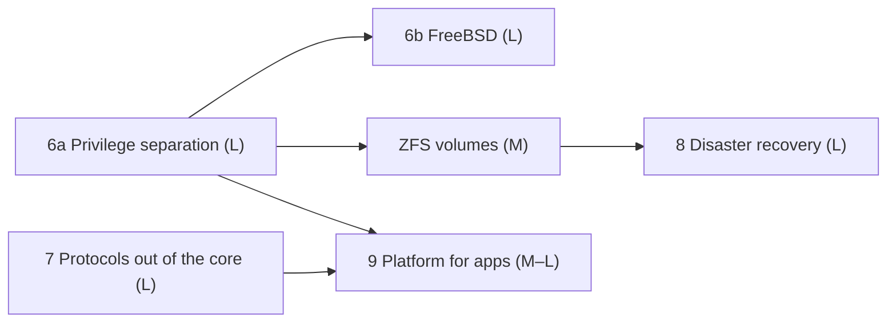

# Bulkhead: Roadmap

2026-10-16, rewritten 2026-11-10, revised 2026-11-12 · Companion to [DESIGN.md](DESIGN.md)

The single plan for remaining work: what is left, in what order, and which part of the code each piece touches. Finished work is not tracked here: [CHANGELOG.md](../CHANGELOG.md) records what landed and DESIGN.md why. The plan was rewritten on 2026-11-10 around the goals below; the plan before that, with every finished phase's narrative, is in git history (`git log -- docs/ROADMAP.md`, commit 107aab2 and earlier).

## How to use this plan

- **Phases** run in the order under "Order". Items inside a phase can run in parallel unless one names another. An item found while working on another goes into the phase where it fits, not into the current change.
- **Finishing an item** removes it from this file, adds a CHANGELOG entry, and updates DESIGN.md if a decision changed. A partly done item keeps only what is left.
- **Spikes come first** where an item says so: each answers its questions in `spikes/s<n>/README.md`, and the items after it are sized from its answer.
- **Checks** are one command, `scripts/check.sh` (`--quick` while working); CLAUDE.md's Definition of Done lists what it runs.
- **Interface docs** change with the code: CHANGELOG.md, MANIFEST.md (manifest and node config), OBSERVABILITY.md (probe and metric names), OPERATIONS.md (paths, variables, signals) and GUEST_FORMATS.md (message bodies beyond the frames). Narrative docs (README, GETTING_STARTED, WRITING_APPS, DESIGN prose, ARCHITECTURE, the tutorial) may fall behind: a change that leaves one wrong adds a line to "Doc debt" below.
- **Failover and replication changes** follow V1 (below): the TLA+ model changes first and its configurations are rerun.
- **Benchmarks** run on an idle machine only, and every new boundary (a helper, a driver app, a thread's sends) is measured against the path it replaces before it becomes the default.
- **Platforms:** an item is done when it works on Linux and FreeBSD, or says plainly what is left on the other.
- **Test machines** (set up 2026-11-11; `CLAUDE.local.md` names them): work that needs root (the helper, users, cgroups, namespaces, jails, ZFS, service units) runs on a FreeBSD 15 VM, an Ubuntu 26.04 x86-64 VM and the Raspberry Pi 5, never on the development machine. The VMs share the 16-core machine's cores, so they are for function checks only; benchmarks stay on the 16-core machine and the Pi (FreeBSD's wait for FB4). A VM is snapshotted before root experiments. Three cluster VMs follow when DR5, FO1 and FB5 need real links between nodes.
- **Sizes** are relative: S = days, M = about a week, L = more than a week.

## Goals

Set with the user on 2026-11-10. Bulkhead takes its failure model from Erlang/OTP and its shape from microkernels: a small trusted core, and everything else in processes of its own, talking by messages.

1. **Security first.** The core (the node) does as little as it can, parses as little untrusted input as it can, and runs without root. A compromised app must still escape its process's fence before it can do much damage, and the core kills and restarts an app that misbehaves. Apps differ in what they may do.
2. **Compartmentalization second.** Each app, each driver and the helper is a process of its own with only the rights its job needs, and what passes between them goes through the node, which checks it.
3. **Performance third.** IPC and data paths are spiked and replaced when something measures better; the project is not production software, so the implementation changes when the numbers say so. A faster path that takes the node's checks out of the way (a direct channel between two apps, a fence turned off) is not a default: it is an opt-in per profile, and only once the checked path has been measured and missed a stated target.
4. **Redundancy, fault tolerance and observability.**
5. **A common platform:** the SDK's traits and macros for writing an app, node and cluster configuration, keyvalue buckets (memory, disk, replicated; Bulkhead's ETS, DETS and Mnesia) and common logging.

Decided with them:

- **Platforms:** Linux and FreeBSD, both first-class, on x86-64 and aarch64. macOS and Windows are not targets (the CLI may still build there; CI does not test it).
- **Topology:** an HA pair at one site, whose standby takes over almost at once when the primary fails, and a third node at a remote site for disaster recovery, activated by hand when the first site is lost, with at most about 5 minutes of data lost (Phase 8). Bigger machines rather than more nodes; clusters of dozens of nodes stay possible, not the target.
- **Privileges:** a small root helper is acceptable; the node and every app run unprivileged, each app under a user of its own (Phase 6).
- **Protocols leave the core:** HTTP first, then SQL, HTTP egress and Modbus, each as a driver app (Phase 7).
- **The order of the goals** (2026-11-11): security, then compartmentalization, then performance.
- **Instances are long-lived processes:** passivation was removed on 2026-11-11 (CHANGELOG.md); density is not an aim.

Non-goals:

- **Supervision trees.** The node supervises the instances it starts, and that is all: apps do not start, stop or supervise other apps, and the SDK has no API for it (E8, dynamic children, removed 2026-11-10; AP3 removes `supervision.children`). An app uses threads of its own for concurrency. It may fork a process inside its own fence (the child inherits the sandbox and counts against `pids.max`; PS7 makes it end with the instance), but that is not a pattern the SDK supports or the docs recommend.
- **A large platform in the core.** Keyvalue and logging stay in the node; protocol stacks move out where that serves security, at some cost in latency.

## Where things stand

| Phase | Exit | Status |
| --- | --- | --- |
| 1: single node | Nine exit criteria (`crates/bulkhead/tests/exit_criteria.rs`) | Met 2026-10-06 |
| 2a: platform on one node | HTTP, secrets, logs, metrics, tracing, Modbus into a shared bucket; baselines on the 16-core machine and the Pi | Met 2026-10-18 |
| 2b: cluster | Failover on node loss, no promotion with the network cut, at most one singleton with network and serial cut, three-node partitions | Met 2026-10-16 |
| 3: application server | The SCADA app's release cycle with zero downtime under faults | Met 2026-10-22 |
| 5, 5b: native apps, native parity | Every example as a native program, the scada soak natively | Met 2026-11-01 and 2026-11-07 |
| 5c: native only (Z9) | No WebAssembly in the workspace; soaks an hour each on both machines; CI green on the pushed commits | Met 2026-11-09 (CI 2026-11-11) |

Measured against the goals on 2026-11-10:

| Goal | Fit | What is missing |
| --- | --- | --- |
| Fault tolerance, the pair | Strong: TLA+-checked failover and replication, leases, serial heartbeat, releases without downtime, soaks | A faster takeover profile, measured (FO1) |
| Compartmentalization between apps | Strong: a process per instance, Landlock, seccomp, node-made sockets, messaging ACLs, grants | Apps share the node's user (PS2) |
| Performance | Good: a request 1.3 to 4.3 µs, a call between instances 5 to 8 µs, a published read 0.16 to 0.39 µs | Each new boundary's cost (one client through a driver, DA1b); large bodies (PF1) |
| Platform: SDK, keyvalue, logging | Good | Client libraries that open their own sockets (S40) |
| Observability | Good: probes, metrics, audit, events, `ps`, `state` | A trace id across calls and nodes (O1) |
| A small, protected core | Weak: the node parses HTTP and TLS, Postgres replies, egress responses and Modbus in the process holding every secret, the cluster key and all bucket data; the remote admin API and the metrics endpoint too (SECURITY.md, "What the node parses from outside") | Phase 7 |
| No root; apps unprivileged | Half: nothing runs as root, but apps run as the node's user (their system calls are an allow-list since 2026-11-11) | Phase 6a |
| FreeBSD, jails, ZFS | Missing: native apps are Linux only; PB5 (`paddock-b/spikes/pb5`) showed jails and Capsicum working | Phase 6b, ZFS volumes |
| A disaster-recovery site | Partial: the third node is a witness and holds no data | Phase 8 |

## Order



- **Security before features.** Phases 6 and 7 come before new platform features, and before tuning that is not measuring a new boundary.
- **Next:** PS2 and FB2 on the helper; DA2 (the HTTP ingress as a driver, on DA1's driver apps), with DA1b alongside.
- **The helper before the FreeBSD runner and ZFS**, since jails, a uid per app and datasets all need it, and one helper does all three.
- **Driver apps do not wait for the helper:** a driver runs under the node's user until PS2 gives it one of its own.
- **Disaster recovery in parallel** with Phases 6 and 7: it touches replication, failover and the transport, which they do not. Its model (S38) comes first, under V1. Shipping volumes (DR6) waits for ZFS volumes.
- **Phase 9 after 6a and 7**, since own sockets lean on the helper and the driver profiles. Sends from an app's own threads (AP1) went ahead of DA1 into Phase 7 and landed on 2026-11-12.

### Verification of failover

- **V1 The rule for failover and replication changes.** A change to a transition in `failover/` updates the matching action in `FailoverL2.tla`, and one in `replication/` the matching action in `spikes/s20/PairReplication.tla` (CLAUDE.md). Before it lands, rerun the configurations it can affect: `L2_Crashes_Fixed1` (about 20 minutes) for anything touching restarts, epochs or the witness, and `L2_Links_Fixed_holds1` (about 2.5 hours) for heartbeats, leases or links. Random simulation of the two-fault configurations runs for at least 20 minutes. The vacuity checks, `L2_Vacuity` and `L2_Switchover_Reach`, must still fail (seconds each): a model in which nothing runs on a lease passes every safety property (VERIFICATION.md, bug 5). Record the results in VERIFICATION.md.
- **V2 The two-fault runs.** `L2_NoSerial` (about 1 hour), `L2_Links_Fixed_loss2` (about 12 hours) and `L2_Crashes_Fixed` (about 18 hours, 250 GB of disk), exhaustive, on an idle machine, each with a fingerprint polynomial (`-fp`) not used before. Rerun after Phase 8 changes failover, and before a release.

## Phase 6: a hardened core

Exit: on Linux and FreeBSD, every app's instances run under a user of their own, started by the privileged helper, with the node unprivileged, holding no capabilities and not dumpable; Linux apps run under a seccomp allow-list (done 2026-11-11) and FreeBSD apps in a jail in capability mode; an app past the misbehaviour policy is killed and then quarantined; CPU is limited per app; the board, scada and failover node tests pass on both systems in CI, and the scada soak passes an hour on the 16-core machine, the Raspberry Pi 5 and a FreeBSD machine.

### 6a: privilege separation

The helper is built (PS1, 2026-11-11; OPERATIONS.md, "The privileged helper"; SECURITY.md): `bulkhead-priv`, started as root by systemd or rc, starts the node under its user and, with node config `[priv]`, each instance under its app's user, picked and kept by the helper; on Linux in a cgroup, five namespaces and a minimal root, ended by the node through `cgroup.kill`; on FreeBSD in a process group with `RLIMIT_AS` and per-process `rctl` rules. Its checks are its own configuration's; its wire format is a crate that forbids `unsafe` and is fuzzed; its `unsafe` is one module, on rustix where rustix has the call (PS1 chose rustix over `libc` alone: safe wrappers for credentials, mounts, `pivot_root`, pidfds, capabilities, at the cost of one dependency in root code). It keeps nine capabilities and `no_new_privs` after starting the node. Measured on the Pi: a start about 1.3 ms more, a call 2.7 µs more (BASELINE.md, 2026-11-11). What S36 decided and PS1 did not build yet is in the items below: the helper's seccomp filter (PS1b), jails on FreeBSD (FB2), ownership by the app's user (PS2), ports through the helper (PS3b), ZFS (S35) and network rules (S40). Without `[priv]` a node works as before, every app under the node's user; `bulkhead status` says which.

Items:

- [ ] **PS1b The helper's own seccomp allow-list** (S). After it has started the node, the helper installs an allow-list of the calls its requests make (fork and `clone3`, the credential and mount calls, `pivot_root`, the cgroup and share files' calls, `pidfd`s, `poll`, the socket's `recvmsg` and `sendmsg`), as the runner does for apps (PS4), refusing the rest with `SIGSYS`; checked against the helper's tests on both Linux machines. S36 planned it as part of PS1's fence. Areas: helper.
- [ ] **PS1c A call under the helper, measured further** (S; benchmark). A native call costs 2.7 µs more under the helper on the Pi (BASELINE.md, 2026-11-11), against S36's 0.7 to 1.0 µs for a cgroup: rerun with the `cpu` controller off, without the namespaces, and with `[native] cgroup` and no helper, to attribute it; `cluster_throughput` under the helper; and the 16-core machine, which needs its owner's `sudo` (the helper runs as root). Areas: benchmarks, BASELINE.md.
- [ ] **PS2 A user per app** (M). Since PS1 the helper gives an instance's program directory and `priv/` files to its app's group at each start (a walk of what the node owns, through descriptors), and a read-write volume's top directory; the node still owns them, and files it wrote into a volume before stay its own. PS2: volumes, `priv/` files and `data_dir/compiled/<app>` owned or readable by the app's user only, made so once rather than at each start; everything else under `data_dir` the node's alone (0700). The node cannot write into an app's 0700 directory (S36), so the files it installs for an app (`priv/`, the program) go through the helper, or are the node's with the app's group, which only the helper can set. A driver app (Phase 7) gets a user as an app does. Areas: deploy store, runner, helper.
- [ ] **PS3b The node without capabilities** (S). The helper answers `Bind` since PS1 (a port in its configuration's `ports`, the listener passed back); the node does not ask yet. The node is not dumpable and sets `no_new_privs` since 2026-11-11 (on FreeBSD through `procctl`, FB1). Ports below 1024 come bound from the helper, so `CAP_NET_BIND_SERVICE` goes and the node holds none. Areas: node, helper, OPERATIONS.md.
- [ ] **PS5 A misbehaviour policy** (M). Counted per instance: `access-denied` answers, messaging ACL refusals, frames the node refuses (malformed, over a limit), and requests per second. Past a threshold (node config's `[limits]` defaults and ceilings, a lower one in the manifest), the node kills the instance (`crashed: policy(<reason>)`) with an audit record; an app killed that way `quarantine_after` times within a period is marked `quarantined` and not restarted until `bulkhead start`. Metrics in OBSERVABILITY.md, the reasons in MANIFEST.md. Areas: host services, instance, supervisor, node.
- [ ] **PS6 CPU limits** (S). `limits.cpu` in the manifest (a share of one core), capped by node config: the cgroup's `cpu.max` on Linux, `rctl`'s `pcpu` on FreeBSD. Closes "no CPU limit" in SECURITY.md. Areas: manifest, runner or helper, host.
- [ ] **PS7 An instance's processes end with it** (S). Under the helper on Linux, done by PS1: the node ends an instance with its cgroup's `cgroup.kill`, which ends what it forked; on FreeBSD the helper signals its process group. Left: without the helper, and on FreeBSD what leaves the group. Without the helper the node kills only the instance's own process (`native/port.rs`, `kill`), so a process the app forked outlives it, and under another uid the node could not reach it (S36). On an instance's exit or kill, every process it started ends too: `cgroup.kill` on its cgroup on Linux (S36: the node may write it, chowned by the helper), or a signal to its process group without a cgroup; on FreeBSD the jail's removal (S36), or without a jail the runner as reaper (`procctl(PROC_REAP_ACQUIRE)`, then `PROC_REAP_KILL`). A test forks a child that ignores `SIGTERM`. Areas: host (`native/`), runner, helper.
- [ ] **CR2 `unsafe` kept where it is** (S). `#![forbid(unsafe_code)]` in each crate that has none today (`bulkhead-bundle`, `bulkhead-sdk`, `bulkhead-sdk-macros`, `bulkhead-modbus`, `bulkhead-modbus-client`, `bulkhead-soak`, the fixtures but `bulkhead-fixture-native`), and `undocumented_unsafe_blocks` raised from `warn` to `deny`. Production code has about 35 blocks, nearly all in `bulkhead-native`'s `channel` and `runner/watchdog`; the watchdog's `kill` and `waitpid` move to `rustix`'s. The rings' copies read memory the app can change while they run: bounds hold whatever it writes, and the node decodes from its own copy, which the module's docs should say next to the copy. Areas: every crate's `lib.rs`, `Cargo.toml`, `bulkhead-native`.
- [ ] **T1b The ring reader's fuzz target** (S). A fuzz target for the node's reader of the ring an app writes (`fuzz/`): positions and lengths an app can write, against `Ring::read`'s checks and the port's frame parsing. Areas: fuzz.

### 6b: FreeBSD

Since FB1 (2026-11-11) the node runs native apps on FreeBSD: the port, the rings and published snapshots (sealed memfds, which FreeBSD makes as anonymous shared memory objects), the parent-death signal, the lease watchdog, the node's fence and the listener's idle timeout, with what differs in `native/os`. Checked on the FreeBSD 15 VM: the native conformance suite (42 cases), the listener tests, and every other `bulkhead-host` integration test once its gate is widened, but the six that test the runner's sandbox. What is still Linux-only: the runner's sandbox (an app runs unfenced on FreeBSD, and only with `[native] landlock_optional`), cgroups, bundle platforms, the test gates and CI. PB5 ran apps in jails with Capsicum on FreeBSD 15 (2026-10-31) and found: PB5 ran apps in jails with Capsicum on FreeBSD 15 (2026-10-31) and found:
- Capsicum rights survive an fdescfs reopen.
- Jails that share a root path share POSIX shared memory, so each app needs a root of its own.
- kvmclock needs `/dev/pvclock`, or clock reads become system calls.
- Rust's std opens `/dev/null` when stdio lacks `CAP_EVENT`.
- A dying jail frees asynchronously, so nullfs unmounts retry on `EBUSY`.

Items:

- [ ] **FB6 Bundle platforms for FreeBSD** (S; before FB3's node tests). rustbridge's `Platform` has no FreeBSD variant, so a bundle carries no FreeBSD program and a FreeBSD node refuses every bundle: `freebsd-x86_64` and `freebsd-aarch64` added on rustbridge's `experiment/wasm` branch, then `bulkhead-bundle`'s `NATIVE_PLATFORMS` and ELF check (`EI_OSABI`, so a Linux program is not taken for a FreeBSD one), `bulkhead bundle --program` and its messages. Until then FB1's checks run through `bulkhead-host` (`load_native` on a program path), not `bulkhead node`. Areas: rustbridge, `bulkhead-bundle`, CLI.
- [ ] **FB2 The runner on FreeBSD** (L). Since PS1 the helper starts each FreeBSD instance under its app's user in a process group of its own, with `RLIMIT_AS` and per-process `rctl` rules (`memoryuse`, `nthr`). FB2: the helper puts each instance in its jail (S36: a nullfs view of a shared root per instance, `rctl` rules on the jail added before the child attaches, the jail made non-persistent after). Two fixes S36 found: mount the app's directory at a fixed path inside the jail, since a mount point at its host path shows every app's directory name in the shared root; and give each instance a writable `/tmp` of its own (the shared root is read-only). `rctl`'s limits driven to their ends in a test; the runner takes its descriptors and enters capability mode (`cap_enter`) before the app's code runs, with rights limited per descriptor. Capability mode refuses opening by absolute path, so `bulkhead_sdk::files` gains opens relative to a volume's directory descriptor on both systems (`BULKHEAD_PREOPENS`' paths stay for Linux). The network fence matches Linux's: only sockets the node passed; checked against what capability mode allows. Since FB1 the runner builds on FreeBSD and refuses to start an app unless `[native] landlock_optional` (then runs it unfenced); this item makes the fence the default there, and the tests FB1 found to need it (`native.rs`: the allow-list, `sandboxed`, `user_namespace`, `shrinks_its_channel`, `volumes`; `services.rs`: `exit_criterion_8`) pass on FreeBSD by its own means. Published snapshots may also get `cap_rights_limit` (read and map only) on top of their seals. Areas: runner, SDK, helper.
- [ ] **FB3 Tests and CI on FreeBSD** (M). The Linux gates reviewed: most become "a system with a runner" (FB1 widened `conformance.rs` and `listener.rs`, and `common::NO_SANDBOX` sets `landlock_optional` for FreeBSD; widening the rest and setting it in each test's `NativeConfig` passed all but the sandbox's tests, FB2); CI gains a FreeBSD job (a FreeBSD VM on GitHub's runners) running `scripts/check.sh test`, and drops macOS from the matrix. Areas: tests, CI.
- [ ] **FB4 A FreeBSD machine for benchmarks and soaks** (S; hardware). The VM shares the 16-core machine's cores and is for function checks only. First-class needs an idle bare-metal FreeBSD machine (amd64; whether FreeBSD runs well enough on a Raspberry Pi 5 to be the aarch64 one, to be checked) for BASELINE.md and the hour-long soaks.
- [ ] **FB5 The rest on FreeBSD** (S). The serial heartbeat (the tty layer is on `rustix`), probes through DTrace (anyprobe's USDT), a cluster mixing a Linux and a FreeBSD node, the tutorial's scripts. Areas: tests, docs.

## Phase 7: protocols out of the core

Decided with the user on 2026-11-10, reversing DESIGN.md's earlier rule ("terminate I/O and protocols in the host"). That rule came from components' costs: an instance per HTTP request kept about 15% of native throughput (S15). A native process does not pay them. A protocol that parses input from outside the node now runs in a driver app: a process of its own, under its own user and sandbox profile, holding only the descriptors and secrets its job needs, supervised and restarted by the node as any instance is.

The node keeps mailboxes and routing, supervision, keyvalue and replication, logging, failover and the cluster transport (whose peers are authenticated before any frame is parsed), deploys and policy, and the admin API. That is a small core with its drivers outside it, not a microkernel: storage, replication and the transport share the node's address space, by the non-goal above. What of it still reads bytes from outside is listed in SECURITY.md, "What the node parses from outside".

Confirmed by S37 (2026-11-11, `spikes/s37/README.md`), with what it changed:
- **A driver app** is a native program the operator configures in node config (`[drivers.<name>]`), not one a bundle's manifest can make itself. Its profile adds narrow rights: listening sockets passed to it with `accept4` allowed on them only; certificate and key files, read-only; a datasource's credentials; calls only to the apps whose routes it serves.
- **Its messages** go through the node as any app's do, stamped with its own app name, so messaging ACLs apply to it: a compromised ingress driver can send what its ACL allows and nothing else.
- **Listening sockets stay the node's** (bound by the helper for low ports), so a driver's restart or upgrade does not close the port; connections in flight in a crashed driver are lost.
- **The driver accepts, reads and writes its connections itself** (S37): with the node accepting each connection and sending a notice for each read, as it does for an app's listeners, getting the bytes to the driver cost as much as a whole request in the node's own ingress.
- **A driver keeps many calls in flight**, from its own threads, answered by id (S37): with one blocking call per instance, 4 drivers held 4 requests and served 39 to 52% of the node's own requests a second at 32 connections; 8 served 83% on the 16-core machine.
- **The target:** a request through a driver costs at most 1.5 times the node's own ingress's CPU, and serves at least two thirds of its requests a second at 32 connections, HTTP and HTTPS, on both machines; one connection's p50 no more than 20% above the node's (S37; the prototype missed it, at 2.4 to 3.1 times the CPU).

Exit: the node parses no ingress client's bytes and holds no ingress TLS key; every parser of outside input left in the node is listed in SECURITY.md with the reason it stays ("What the node parses from outside"); the node's dependency tree is checked for what has left (CR1); HTTP ingress runs as a driver app, with its node tests (`http.rs`, `board.rs`, the scada HMI) and the scada soak passing; SQL, egress and Modbus each decided by DA6 and either moved or kept in the node with the reason in DESIGN.md.

Items:

- [ ] **AP1b What sender channels left** (S). AP1 landed 2026-11-12 (CHANGELOG.md; DESIGN.md, "App model"): measured on the Pi only, a request and a bucket get from a sender cost what a callback's do and 800 idle senders cost nothing (BASELINE.md, 2026-11-12). Left: `native_cost` on the 16-core machine (two VMs were running) with and without idle senders; `cluster_throughput` with senders open; a sender's call, and calls in flight from one sender, against a callback's; a sender's reads of a published bucket from its snapshot, as the callback thread's are (a sender's go to the node today). Areas: benchmarks, `bulkhead-native`'s `sender`.
- [ ] **DA1b One client through a driver** (S; benchmark). DA1 landed 2026-11-12 (CHANGELOG.md; DESIGN.md, "HTTP ingress"; SECURITY.md, "Driver apps"). Its driver met S37's target under load on the Pi (BASELINE.md, 2026-11-12: 85 to 88% of the node's own requests a second at 32 connections, HTTP and HTTPS, at 1.2 to 1.3 times its CPU) but not for one connection: p50 39 to 48% above the node's (28 to 41% with the driver polling 20 to 50 µs before it sleeps), 20 to 30 µs a request, two or three wake-ups by S32's costs. Find which waits a single sequential client pays (the sender task's, the driver's wait for its answer) and change them, rerunning `native_cost` and `cluster_throughput` as CLAUDE.md asks for any change to the waits; S37's harness (`DRIVER=s37-driver-da1 S37_DRIVER=da1`) on both machines, the 16-core machine's DA1 run included (two VMs were running). Areas: `native/sender.rs`, `native/link.rs`, `spikes/s37`.
- [ ] **DA2 The HTTP ingress driver** (L; on DA1, landed 2026-11-12: `spikes/s37/driver-da1` is its shape). `http.rs` out of the node into a driver program (`bulkhead-ingress`); routes, limits, timeouts, TLS and certificate reload, the standby's redirect and forward (`partner_url`, `standby = "forward"`), and blue-green weights kept; the `http` and `tls` features no longer pull hyper's server and the ingress TLS into the node. With it, the open ingress items: `bulkhead status` listing routes, HTTP/2, client certificates (mTLS), OCSP stapling. Areas: host, new crate, node, docs.
- [ ] **DA3 SQL as a driver** (M). `tokio-postgres` and `deadpool-postgres` in a driver per datasource; the credentials only there; apps name the datasource as now, and the node passes the caller's identity so the connection cap per app holds. Areas: services (`sql`), new driver.
- [ ] **DA4 HTTP egress as a driver** (M). The policy stays in the core and the parsing leaves it: the node resolves and checks each destination (allow list, address guard) and passes the connected socket to the egress driver, which runs TLS and HTTP. With it, the open egress items: HTTP/2, an outbound proxy (`CONNECT`), client certificates, a deny list of private ranges per CIDR, a cap on response bodies, fewer task hand-offs per request. Areas: services (`http_egress`), new driver.
- [ ] **DA5 Modbus as a driver** (M). `bulkhead-modbus`'s polling and server in a driver, updates into buckets and casts as now, devices reached on sockets the node passes. Measured with `modbus_load` against the in-node figures (BASELINE.md, 2026-10-16). With it, deadbands, scaling and data types beyond raw registers. Areas: `bulkhead-modbus`, new driver.
- [ ] **DA6 What else leaves** (S; review after DA2). SECURITY.md's table ("What the node parses from outside") read again with DA2's measured costs: each entry it left open (the UDP relay, listeners' accept, bundle parsing) kept or moved, with its reason in DESIGN.md, and a moved one becomes an item here. Areas: docs.
- [ ] **DA7 The remote admin API and metrics as a driver** (M; on DA1). A driver holding the admin TLS key and the operators file, terminating TLS and forwarding each request to the admin Unix socket with the operator's name for the audit log; the metrics endpoint served from the same driver or one of its own. The node then listens for operators on the Unix socket only. Areas: node (`daemon/remote.rs`), new driver, SECURITY.md, OPERATIONS.md.
- [ ] **DA8 The `Extension` trait removed** (S; after DA5). `services/extension.rs`, `examples/greeter` and the `extensions` capability go, or the capability stays as a name for calls to a driver; MANIFEST.md and WRITING_APPS.md follow. Areas: host services, examples, docs.
- [ ] **CR1 Crates along trust boundaries** (M; with DA2, then each driver). `bulkhead-host` is one crate of about 56,000 lines with HTTP, SQL and egress behind cargo features, so nothing but review keeps a protocol stack out of the node. As each driver moves, its code leaves `bulkhead-host` for the driver's crate, and `scripts/check.sh` gains a check that the node's dependency tree (`cargo tree -p bulkhead`) holds none of what left (hyper's server, the ingress TLS, `tokio-postgres`, the egress client, `tokio-modbus`). `bulkhead-native` is split the same way when the helper's crate lands: the protocol and channel (shared by the node, apps and drivers) apart from the runner (the sandbox). Areas: `bulkhead-host`, `bulkhead-native`, new crates, scripts.

## Phase 8: disaster recovery

The target topology: the HA pair at site 1 and a third node at site 2. Today the third node is a witness only and holds no data.

Goal: the site-2 node keeps a copy of the pair's replicated state and deployments, at most about 5 minutes behind (best effort and asynchronous: the pair never waits for it), and an operator can activate it when site 1 is lost.

Decided with the user (2026-11-10): asynchronous, with a target of 5 minutes of data lost at most; activation by hand.

Proposed, for S38 to confirm:
- **The DR node** is the witness as well (one machine at site 2), or a node beside a witness elsewhere; both are configurations.
- **Shipping:** the pair ships the replication log of `cluster` and `replicated` buckets in batches, from the standby so the primary does no extra work, or from the primary while it has no standby; the DR node catches up from a snapshot when it falls behind the log's retention. Deployments (bundles and grants) are shipped too, so activation needs no redeploy. Node config, secrets and keys are the operator's to keep at site 2 (OPERATIONS.md).
- **Lag:** `bulkhead_dr_lag_seconds`, and a warning past `[dr] rpo_target` (default 5 minutes).
- **Activation:** `bulkhead dr activate` on the DR node. As the witness, it first refuses the pair every grant and renewal and waits out a lease and its margin, so a site 1 that is alive but cut off stops its singletons, as a primary does today at its lease's end. It then takes a new epoch and starts the singletons from its copy. A DR node that is not the witness needs the operator to confirm site 1 is down, as A9's rule asks today.
- **Failback:** site 1's nodes rejoin as standbys of the DR node and catch up from it, then a planned switchover moves the primary back.

Items:

- [ ] **S38 The disaster-recovery model** (M; spike, first). `FailoverL2.tla` and S20's `PairReplication.tla` extended with a DR replica and activation. It must show that no singleton runs at two sites after activation, site 1 alive and cut off included, and that an acknowledged write is lost only if it came after the DR node's last applied entry. Vacuity checks as V1 asks. Areas: `docs/tla`, spikes.
- [ ] **DR2 Shipping the log** (L; after S38). Asynchronous batches over the cluster transport, snapshot catch-up, the lag metric and warning; WAN delay and loss tested on the in-memory mesh. Areas: replication, transport.
- [ ] **DR3 Shipping deployments** (M). Bundles and grants to the DR node as they change on the pair; the DR node holds them deployed and not started. Areas: node, deploy store.
- [ ] **DR4 Activation and failback** (L; after S38). `bulkhead dr activate`, fencing as above, failback through a switchover; `bulkhead failover` and `bulkhead events` show both. Areas: failover, node, CLI.
- [ ] **DR5 A drill and a soak** (M). `bulkhead-soak dr`: the pair and the DR node behind proxies, delay and loss on the DR link, site 1 lost while writes flow, activation and failback. It checks the data lost against the lag reported, that no singleton runs at both sites, and that failback loses no acknowledged write. Also a tutorial chapter. Areas: soak, examples.
- [ ] **DR6 Volumes to the DR site** (M; after ZV1, with ZV4). Incremental `zfs send` of each replicated volume to the DR node on an interval within `rpo_target`. Areas: replication, helper.
- [ ] **FO1 A fast takeover profile** (S–M). A crashed primary hands over in about 9 to 10 s with the defaults (5 s node timeout, 3 s lease, margins); a planned switchover takes about 200 ms. Measure a profile for a pair with a serial line (for example 100 ms beats, a 1 s node timeout, a 1 s lease): the takeover time and any false promotion under load on both machines (the Pi with every core busy) and on FreeBSD. Then document it in OPERATIONS.md. Only parameters change, so the model's rules stand; its `Lease` constant is rechecked at the new ratio. Areas: tests, soak, docs.

## ZFS volumes

Planned on 2026-11-06, with the user. A volume today is a host directory the operator names in `[volumes]`, granted read-only or read-write; Bulkhead enforces no byte quota and refuses a manifest `quota` on one (S6), so a writable volume is bounded only by a filesystem quota the operator sets up (SECURITY.md). With ZFS, the operator hands the node one parent dataset and the node cuts it into a dataset per app volume, with the quota the manifest asks for, capped by node config:

```toml
# node config
[volumes.zfs]
parent = "tank/bulkhead/volumes"   # the node creates datasets under this one only
max_quota = "50G"                  # the largest quota a manifest may ask for

# app manifest
[preopens]
"/data" = { volume = "orders-data", mode = "rw", quota = "10G" }
```

- **Apps see no difference:** a native app gets a Landlock rule (Linux) or a directory descriptor in its jail (FreeBSD) on the dataset's mountpoint, and its path in `BULKHEAD_PREOPENS`; at the quota, writes fail with `EDQUOT` or `ENOSPC`. Plain directories stay the default provider; ZFS is optional, for nodes on Linux with OpenZFS or on FreeBSD.
- **Privilege:** the ZFS operations are requests to the helper (Phase 6a), confined to children of the configured parent, with names checked; there is no separate `bulkhead-zfs` helper. With PS2 a dataset is owned by its app's user.
- **The `zfs` command, not libzfs, first:** `zfs ... -H -p` is meant for scripts and stable across releases and between Linux and FreeBSD, needs nothing at build time (CI, cross-builds to the Pi), and volume operations happen at deploy, upgrade or quota change, never per message, so a subprocess's few milliseconds do not matter. libzfs and `libzfs_core` are CDDL; `deny.toml` is permissive-only by the project's own rule. If a reason to link appears, the helper alone would carry it (an optional crate, with a scoped and explained `deny.toml` change), never the node.
- **Proposed, for S35 to confirm:** a dataset per app volume, shared by all of an app's instances as a directory volume is now; `refquota` (snapshots not counted against the app), the parent's own quota bounding the total; an undeploy keeps the dataset, and only an explicit `bulkhead volume destroy` removes it; zvols (block devices) not offered.

Items, in order:

- [ ] **S35 ZFS-backed volumes** (M; spike; with S36). On Linux (16-core machine, Raspberry Pi 5) and FreeBSD: the helper's ZFS requests (create, destroy, set `refquota` and `reservation`, snapshot, roll back); the `zfs` command's output parsed (`-H -p`); the time to create a dataset with a quota, to change it and to snapshot it; what an app sees at its quota; a dataset reached through a Landlock rule and through a jail. Decides the dataset layout and lifecycle above. Areas: spikes.
- [ ] **ZV1 The ZFS volume provider** (M; after S35 and PS1). Volumes behind a provider: directories (today) and ZFS datasets made and sized on deploy, under `[volumes.zfs]`; the manifest's `quota` accepted where ZFS backs the volume (refused elsewhere, as now) and checked against `max_quota`; `bulkhead volume list` and `destroy`; SECURITY.md's gap closed for ZFS-backed volumes. Areas: node config, deploy, host, runner, helper, docs.
- [ ] **ZV2 Volume usage as metrics** (S). Each volume's `used` and `refquota` as host metrics (OBSERVABILITY.md), so an operator is warned before an app meets `EDQUOT`. Areas: metrics, node.
- [ ] **ZV3 A snapshot around an upgrade** (S). Before an upgrade's state migration, the node snapshots the app's ZFS volumes; an upgrade that fails and reverts rolls them back with its state. Areas: upgrade, helper.
- [ ] **ZV4 Replicated volumes on a pair** (L; later). A volume with `durability = "replicated"` kept on the standby by incremental `zfs send` and `receive`: a copy as of one instant, not `cluster` buckets' per-write guarantee, so its loss window on failover is the send interval; checked against V1's rules before it ships. With it, the node's data directory on a dataset (snapshots for backups and for seeding a standby's buckets). DR6 sends the same increments to the DR site. Areas: replication, failover, helper.

## Phase 9: the platform for apps

- [ ] **S40 Client libraries that open their own sockets** (M; spike; after PS1). Libraries such as rdkafka and AMQP clients open sockets themselves, which the seccomp filter refuses. On Linux: cgroup BPF programs (`connect4`, `connect6`, `sendmsg4`, `sendmsg6`, `bind4`, `bind6`) attached per app's cgroup by the helper, enforcing the manifest's `connect` and `bind` rules with `socket` allowed. On FreeBSD: a jail's own addresses with packet filter rules per jail, or a vnet jail. Measures the cost per connect and per datagram. Decides whether `bulkhead:sockets` keeps node-made sockets as the default with own sockets as an opt-in profile. Areas: spikes.
- [ ] **AP2 Own sockets** (M; after S40). The profile S40 chooses, on both systems; SECURITY.md's socket boundary updated. Areas: runner, helper, manifest.
- [ ] **AP3 Flat supervision** (M). `supervision.children` goes: an app's manifest no longer starts other deployed apps under its root supervisor (no example uses it). Each app's root supervisor runs its own instances only, with the strategies, intensity and backoff as now; `dependencies` keeps start and stop order between apps. Links and monitors between instances stay as built and model-checked, with no new features. MANIFEST.md, DESIGN.md ("Supervisors"), GLOSSARY.md, `tests/apps.rs`, `tests/supervisor.rs`. Areas: manifest, orchestration.
- [ ] **O1 Trace context across calls** (M). A trace id and span id carried in frames (protocol and wire additions) and log records, so one request can be followed from a driver through apps and across nodes; exported with E4b. Areas: protocol, transport, host, SDK.
- [ ] **E4b OTLP push** beside the Prometheus endpoint, when a site needs push. Review the opentelemetry crates with cargo-deny first.

### Keyvalue: faster reads and writes

From the comparison with ETS (BASELINE.md, 2026-10-30) and spikes S25 to S28. Goal: a point read of a shared bucket within twice `ordered_set`'s time, readers that scale with cores, and a zero-copy path for read-only data many instances share, without shared mutable memory between apps: writes stay with the node, and readers get published versions. Published buckets (T4) already read in 0.16 to 0.39 µs.

- [ ] **H6 Cheaper bucket operations: what is left.** `watch::next` as a cursor rather than a one-entry scan per step (14 to 20 times ETS's `next`); a faster hasher for the bucket map (about 4% of a read); and a batch read returning one buffer, only if an app reads many keys per call. Areas: `crates/bulkhead-host/src/services/keyvalue/`, SDK.
- [ ] **H7 Concurrent writers** (from S26; only if an app needs it). Writers to one memory bucket serialize on its lock, so a hot key or a write-heavy mix does not scale (0.5 to 0.6 million operations per second at 50 writes in 100), and `read_concurrency` halves one hot key's writes. ETS's `write_concurrency` would need each write's revision and the quota check without the bucket's lock. Areas: keyvalue service.
- [ ] **H8 A watched mirror in the SDK** (S28 done, 2026-10-31). `bulkhead_sdk::watch::Mirror`: a bucket or prefix kept in the instance by a watch started first and a scan after it, a hash map for point reads and a B-tree only for ordered ones, read without requests; with WRITING_APPS guidance on when one pays (reads well above ten times the writes; an instance that stays live). A conformance case. First, the notice path, about 9 µs per change per mirror: a notice that carries the value and revision, a watch's pending changes as one event per callback, and an index of prefix watches for the writer's 0.6 to 0.9 µs per mirror; keep what pays. Areas: SDK, conformance, protocol, keyvalue service.
- [ ] **H11 Filters pushed into scans** (when an app scans for a few matches in many). `scan` with simple predicates on the key and counts, as ETS's `select` and `select_count`. Areas: protocol, keyvalue service, SDK.
- [ ] **H12 Docs.** WRITING_APPS.md: which read path for which data (bucket, batch, scan, mirror, a published bucket, an owner pool), with the numbers; DESIGN.md's keyvalue section updated.

## Performance

Alongside the phases, measuring every new boundary first (S36, S37, S39, S40); otherwise behind Phases 6 and 7.

- [ ] **PF1 Large messages** (M). A 1 MiB HTTP request costs 7 to 9.5 ms of CPU in the node's own ingress (32 ms each on the Pi with 32 connections; S37, 2026-11-11): the body crosses each ring in 64 KiB pieces, with a wake-up each time one fills, and the envelope is built and parsed whole as CBOR. A body over a size passed out of the ring instead, as a sealed memfd named in the frame (as published snapshots are), measured against it for calls between apps, the node's ingress and a driver, at 64 KiB and 1 MiB. Areas: `bulkhead-native` (protocol, channel), host (`native/`), SDK.

- [ ] **T2 Requests answered without the instance task** (M; deferred by S32). The node answers a request that needs no instance state itself: the app's own pid, names, and bucket and watch operations. One hand-off fewer per request, two per call between instances. T11 (2026-11-06) left one request above the goal: one that is not a hot frame, 4.3 µs on the 16-core machine (2.8 on the Pi). Only if that request matters. Areas: host.
- [ ] **Cluster calls without a hand-off.** Writing frames from the sender's task when the stream is free would save a hand-off each way (B8 measured about 25 to 50 µs of hand-offs over the QUIC floor). It touches the ordering the failover and remote-link rules rely on, for about 10 to 25 µs on an idle runtime; only for a site with a latency target between nodes.
- [ ] **G5 Dedicated workers and CPU budgets** for latency-critical instances: priority classes mapped to separate worker sets, a CPU budget per period per app, and a rule for priority inversion. Measure first.
- [ ] **G1 Large machine** (tabled 2026-10-07: none with more than 16 cores or several sockets is available). `scripts/bench.sh` at 32 to 80 workers; watch the process table, registry and pool round robin for contention. Scale-up is the target, so no design may assume one core or one socket.
- [ ] **CPU placement** (with G5 and G1). cgroup cpusets (Linux) or `cpuset` (FreeBSD) giving the node's workers cores of their own apart from the apps, and an app on the core cluster of the worker serving it: S32 saw each frame cross the Threadripper's dies at a cost of several cache lines. `isolcpus` or `nohz_full` for a dedicated machine's latency. Measured on a machine with several core clusters or sockets.

## Smaller open items

- **Casts under the seccomp allow-list on the 16-core machine** (PS4, 2026-11-11): the Pi, idle, showed no change; the 16-core machine was not idle and its casts read 3 to 10% lower in two rounds of three (BASELINE.md). Run `native_cost 4` with both runners again on it idle.
- **Test timing.**
  - `gate____start_fails_at_promotion____tried_again_until_it_starts` (`crates/bulkhead/tests/failover.rs`, 2026-11-09) failed once in the whole suite while the machine transcoded video: `stop("base")` was refused because the node had already promoted and started the dependent singleton. The test should hold the promotion back until `base` is stopped. On the Raspberry Pi 5 it failed in every one of eight runs on 2026-11-11, at commit c9b6f85 and with PS4's changes alike, with the same refusal, so the Pi's test run is not clean until this is fixed.
  - `switchover____on_the_primary____standby_runs_the_singleton_old_primary_rejoins` (2026-10-30) asserts the handover under 800 ms and took 833 ms once in the whole suite. Widen the bound or measure it from the release at the witness if it recurs.
  - `peer____restarts____monitor_gets_noconnection_then_the_lower_node_redials` (`tests/quic.rs`, 2026-11-07) failed twice in 26 runs on the Z8 work in progress, none in 30 at commit 3bcdadc; likely the replacing-connection race under "Cluster connections". Rerun it in a loop; if it recurs, trace the session's end.
  - `node____leaves_then_restarts____rejoins_through_the_seed` (`tests/quic.rs`, 2026-11-07) failed once in the whole suite (`(2, 3)` for `(2, 2)`). The test assumes every peer has read the leave when `shutdown_gracefully` returns; if it recurs, check whether a peer can still be reading it then.
- **Cluster connections** (2026-10-29): with the accepting side's setup of a replacing connection delayed by 900 ms, one round in six still ended the session three times (the old connection closed as `closed`, not `replaced`). Not seen without the delay.
- **Native frames over 16 MiB** (C1, 2026-11-01): a request larger than a frame (`set_many` of 1,000 values of 64 KiB) crashes its instance with `protocol: frame of ... bytes is over ...`. The app's side should refuse it as an error.
- **Lease watchdog's last deadline** (2026-11-08): `drain` in `runner/watchdog.rs` returns `Closed` when a read finds the node's end closed, dropping a deadline read earlier in the same call, so the watchdog kills at once. The early side is the safe one; keep it, and have the test check the time.
- **Native connection handlers** (Z8g): a write blocks the callback until the kernel takes the bytes, so a peer that stops reading holds the instance until `callback_deadline_ms` kills it with every connection it holds; a non-blocking write with a writable notice would confine a slow peer to its own connection. A drain timeout for connections open across an upgrade, `log-level` announcements to handlers, and host framing into messages for a pool.
- **Secrets:** Vault or another store (a source kind or a driver), caching with a TTL.
- **Groups:** probes for join and publish.
- **Shell:** completing app names and pids; a follow across every app's logs, or across nodes.
- **B6 A node watchdog:** a wedged node restarted by its service manager (`sd_notify` watchdog on Linux; the rc.d equivalent on FreeBSD).
- **Blue-green** (U2): apps with `registered_names` (move the names at promotion); a version whose HTTP routes change; a weight shared by the two nodes of a pair.
- **Releases** (U1): a version for a node's own stores without replication, once one of their formats changes; stopping a node whose older build cannot decode the frame that carries a raise of the pair's version.
- **`max_instances` and `max_processes`** (found finishing Z9k, 2026-11-11): with the pooling allocator gone, node config's `max_instances` only sets `max_processes`' default, so two keys say one thing. Keep `max_processes` and refuse `max_instances` with a message, as other removed keys are. Areas: node config, host config, MANIFEST.md.
- **rustix's FreeBSD `set_dumpable_behavior`** (found in FB1, 2026-11-11): rustix 1.1.6 passes the value where `procctl(PROC_TRACE_CTL)` wants a pointer to it, so it fails with `EFAULT`; `bulkhead_native::freebsd::set_not_traceable` calls `procctl` instead. Report it upstream, and drop ours once a fixed rustix is in the lock.
- **syn 3 for `bulkhead-sdk-macros`** (2026-10-25): wait until the proc-macros the workspace builds on syn 2 move to it.

## Doc debt

Narrative docs a change left out of date, to fix in a later docs pass:

- README.md, CLAUDE.md and DESIGN.md ("Instance model", "Isolation", "Operating a node") describe native apps as Linux only and every app under the node's user: true as built, and to be rewritten as Phase 6 lands, not before.
- ARCHITECTURE.md ("Native-process apps", "Threads and tasks") does not describe sender channels (AP1): the node's task per sender channel, and the port's `Link` it shares with the instance's task.

## Investigations

Questions for later, each a spike with a time-box when scheduled.

- **S18 Checking hot-standby instances follow the primary.** Compare the primary's and the standby's sequences of requests (from probes), allowing for timestamps, to find a standby that has diverged.
- **Debugging native apps.** A development node's option to leave an app dumpable and traceable (`[native] debuggable`, refused with the helper's user per app unless also set there), so gdb or lldb can attach; what the seccomp allow-list and capability mode must allow for it.

## Parked

- **DNP3 and ICCP drivers.** The mature DNP3 implementations in Rust found so far are source-available with commercial terms; no permissively licensed ICCP stack in Rust is known.
- **Redis or etcd bridge** as a driver, for sites that already run one. Not the platform's shared buckets.
- **Capability tokens for messaging** (seL4-style endpoint handles), after messaging ACLs.
- **Handing a connection to another instance** (`gen_tcp:controlling_process`).
- **Persistent timers** (cron, the EJB timer service) that survive restarts.
- **A finer timer:** an OS thread with a deadline heap for `send_after`, about 55 µs late against tokio's 1 to 2 ms (BASELINE.md, 2026-10-24). Only if an app needs sub-millisecond timers.
- **Node alarms** (OTP `os_mon`): memory, disk and storage errors as host events and in the admin API.
- **Key expiry** in keyvalue: a TTL per bucket or per `set`.
- **rustbridge release.** Switch `rustbridge-bundle` from the `experiment/wasm` branch to a crates.io release with bundle format 1.2; required before the repository goes public or a crate is published.
- **`gen_statem` support in the SDK**: state timeouts and `postpone` on the existing callbacks and timers.
- **Serial ports for apps** (no user yet): a port bound like a listener, served by a driver.
- **Placement across many nodes:** node labels required or preferred, `spread`, `all-nodes`; the pair needs none of them.
- **Opt-in global names:** a cluster-wide registry on Raft; cluster-wide groups cover lookups across nodes meanwhile.
- **Native start time and memory per process** (S30, Z1): `bulkhead-runner` takes 4 to 14 ms to start an app against a bare process's 0.7 to 1.2 ms (not attributed); glibc 2.43 (the Pi) gives each malloc arena a 2 MiB huge page, which `GLIBC_TUNABLES=glibc.malloc.hugetlb=0` would remove. S36 measured the helper's share (0.1 to 1.8 ms on the Pi, by fence), not the runner's.
- **A process per app** (Z10, parked 2026-10-31: the aim is long-lived processes): many instances in one app process, each on a stack of its own, chosen per app, with its isolation caveat.
- **Memory locked and prefaulted:** `mlockall` for the node, `MAP_POPULATE` for the rings; only if a benchmark shows it.
- **Huge pages for published snapshots:** only if a large snapshot's reads show TLB misses.
- **A scheduler that knows about spinning** (`sched_ext`, Linux): research, on kernels that have it.
- **Modbus RTU** (likely never): an RTU master over the tty layer, in the Modbus driver.

## Code areas

An area is a set of modules with a narrow interface to the rest: modules in crates with `pub(crate)` and a small `pub` surface, rather than a crate each. New crates (the helper, drivers) are added only where a separate process or a separate trust level needs one; CR1 moves what leaves the node into them and checks the node's dependencies.

| Area | Where | Interface to the rest |
| --- | --- | --- |
| Contract | `bulkhead-native`: `protocol`, `hot`; `tests/protocol/v<N>.txt`, `tests/protocol_versions.rs` | The frames between node and app; additive within the two versions a node accepts |
| Runner and sandbox | `bulkhead-native`: `runner` (Landlock, seccomp, Capsicum), `app`, `channel`, `lease` | The runner's command line and inherited descriptors; the app API |
| Privileged helper | `bulkhead-priv`, `bulkhead-priv-wire`; the node's side `bulkhead-host::native::helper` | Its requests from the node (`bulkhead-priv-wire`), checked against its own configuration |
| Manifest and bundle | `bulkhead-bundle` | `AppSpec`, `VerifiedBundle`, the effective grant |
| Process core | `bulkhead-host`: `pid`, `table`, `registry`, `links`, `message`, `mailbox`, `instance`, `runtime`, `state`, `process`, `delivery`, `native/` | Spawn, call, cast, link, monitor, exit; `delivery` routes every pid |
| Host services | `bulkhead-host::services`, one module each; `metrics` | The `Service` trait; extensions through `Extension` |
| Drivers | `http.rs` and the services named in Phase 7 today; driver crates after it | Calls to apps through the node; the driver profile |
| Orchestration | `bulkhead-host`: `apps`, `pool`, `supervisor`, `upgrade`, `lifecycle`, `spec` | `Apps`, `AppHandle`, `UpgradeOptions` |
| Cluster | `bulkhead-host`: `transport` (`liveness`, `membership`, `memory`, `quic`, `wire`), `failover`, `replication`, `credit` | The `Transport` trait, node events, `FailoverHandle`, `ReplicationStatus`; replicated buckets reach the keyvalue service through `KvStore` |
| I/O and protocols | `bulkhead-host`: `listener`; `bulkhead-modbus` | Listeners, connection handlers |
| Observability | `bulkhead-host::probe`, `metrics` | Probe functions called from the other areas |
| Node and admin | `bulkhead` (`node`, `api`, `cli`, `serial`) | Admin API routes under `/v1`, the CLI, node config |
| SDK | `bulkhead-sdk`, `bulkhead-sdk-macros` | `App`, `Ctx`, envelopes, snapshots; services by cargo feature |
| Fixtures and examples | `crates/bulkhead-fixture-*`, `examples/`, `bulkhead-host`'s `in_process` (feature `test-apps`) | Test apps and demos |
| Soak | `bulkhead-soak`, `scripts/soak.sh` | `bulkhead node` processes through their config, admin API and logs; reads the gate's `singleton starting` and `singleton killed` records |

Crates meant for publishing (all `publish = false` while the project is private): `bulkhead-sdk`, `bulkhead-sdk-macros`, `bulkhead-bundle`, `bulkhead-host`, `bulkhead` and `bulkhead-modbus`. App developers depend on the SDK only; extension developers on `bulkhead-host` only.

## Settled decisions

| Decision | Choice |
| --- | --- |
| Name | `bulkhead`: crates `bulkhead-*`, capability keys `bulkhead:*`, CLI `bulkhead` |
| License | MIT OR Apache-2.0, no copyleft in the dependency graph |
| Platforms | Linux and FreeBSD, first-class, x86-64 and aarch64; not macOS or Windows (2026-11-10) |
| Priorities | Security, then compartmentalization, then performance; a path around the node's checks is an opt-in, never a default (2026-11-11) |
| Instance | A native process per instance, long-lived, never passivated; Rust apps on `bulkhead-sdk` or `bulkhead-native` (2026-10-31, 2026-11-07, 2026-11-11) |
| App contract | `bulkhead_native::protocol`: a node accepts its version and the one before; frames change only by adding (2026-11-07) |
| Messaging between apps | Through the node, which owns mailboxes, ordering, links, monitors and sender identity (2026-11-01, kept by PB8) |
| Supervision | Flat: the node supervises the instances it starts; apps start no apps (2026-11-10) |
| The core | Mailboxes, routing, supervision, keyvalue and replication, logging, failover and transport, deploys, policy, admin; protocol stacks in driver apps (2026-11-10) |
| Async runtime | tokio, multi-threaded (in the node; the helper has none) |
| Persistent store | redb |
| Default envelope encoding | CBOR, with JSON and text allowed |
| Admin API transport | JSON over HTTP on a Unix socket, and over TCP with TLS and pinned keys (`[admin]`, 2026-10-14) |
| Node identity | Pinned Ed25519 keys and peers files, not a CA (2026-10-09) |
| Failover | Epochs, heartbeat paths, a witness and a lease; no Raft (2026-10-08) |
| Disaster recovery | An asynchronous copy at a remote site, best effort within about 5 minutes, activated by hand (2026-11-10) |
| HTTP requests | Calls to a pooled instance (2026-10-09), from an ingress driver app (2026-11-10) |
| Metrics export | Prometheus text, metrics per app (2026-10-09) |
| Build features | Modbus off by default; HTTP, TLS, probes, SQL on (2026-10-10) |
| Node layout | Everything a node writes under `data_dir`, admin socket and app programs included (2026-10-10) |
| Logging | stderr only; journald, syslog or the container runtime rotates (2026-10-10) |
| Privileges | A small root helper starts instances under a user per app, binds low ports and runs ZFS operations; the node runs unprivileged with no capabilities (2026-11-10; the helper since PS1, 2026-11-11, with node config `[priv]`; without it, the node's own user with `CAP_NET_BIND_SERVICE` only) |
| The helper's code | rustix where it has the call, `libc` for the rest (`fork`, `clone3`, `pdfork`, `execve`, `rctl`, kqueue on process descriptors), all `unsafe` in one module; no async runtime; a wire crate of its own with `forbid(unsafe_code)` (PS1, 2026-11-11) |
| Memory limits off Linux | On FreeBSD, `memory_max` without the helper is `RLIMIT_AS` (FreeBSD's `RLIMIT_DATA` does not count `mmap`); `rctl` needs root, so it comes with the helper, and `[native] cgroup` is refused there (FB1, 2026-11-11) |
| FreeBSD before its sandbox | The runner refuses to start an app on FreeBSD unless node config sets `[native] landlock_optional`, so an unfenced app is the operator's explicit choice until FB2 (2026-11-11) |
| Moving a singleton | Its snapshot through the replicated log, taken by every start; a new pid; links, monitors, names and the mailbox not carried; the old instance exits `normal` (2026-10-20) |

## Spikes

Each spike's README is its record. Spikes S1 to S29 ran on Paddock's WebAssembly components (S30 on is native); their findings stand where DESIGN.md cites them. Spikes PB1 to PB5 are in `paddock-b/spikes/` (outside this repository); PB8 is here.

| # | Question | Outcome |
| --- | --- | --- |
| S1 | Callback model with async host imports | Passed ([spikes/s1](../spikes/s1/README.md)) |
| S2 | Cost of an instance | About 35 µs and 30–40 KiB; address space is the limit ([spikes/s2](../spikes/s2/README.md)) |
| S3 | WASI 0.2 or 0.3 | 0.2 ([spikes/S3-wasi-target.md](../spikes/S3-wasi-target.md)) |
| S4 | Import inspection and deny stubs | Passed, with Bulkhead's own typed stubs ([spikes/s4](../spikes/s4/README.md)) |
| S5 | Snapshot upgrade | Passed ([spikes/s5](../spikes/s5/README.md)) |
| S6 | rustbridge as a library | Reusable; seven upstream changes, all done ([spikes/s6](../spikes/s6/README.md)) |
| S7 | Off-the-shelf WASI hosts | Bulkhead writes its own keyvalue, logging and config hosts ([spikes/S7-wasi-host-crates.md](../spikes/S7-wasi-host-crates.md)) |
| S8 | Guest versus native speed | 1.0x to 2.4x for compute, about 2 µs per call ([spikes/s8](../spikes/s8/README.md)) |
| S9 | Debugging guests | Parked (Investigations) |
| S10 | New `info` cases and old guests | Done; `host-event` reserved ([spikes/s10](../spikes/s10/README.md)) |
| S11 | Passivation | Works, off by default; 100,000 instances on 1,000 Store slots, wakes in about 64 to 101 µs; apps opted in since E7; removed 2026-11-11, since instances are long-lived processes ([spikes/s11](../spikes/s11/README.md)) |
| S12 | TLA+ model of remote links and monitors | Four ways for the nodes to disagree, each fixed by a rule (done in C6); with them no violation found: full queues and liveness exhaustive, closes and crashes up to about 840 and 890 million states ([spikes/s12](../spikes/s12/README.md)) |
| S13 | Host-owned TCP listeners and guest streams | Guest streams at native throughput with an instance per connection ([spikes/s13](../spikes/s13/README.md)) |
| S14 | Storage in the guest versus host services | About 140 ns per host import; keyvalue reads 1.2 µs over native ([spikes/s14](../spikes/s14/README.md)) |
| S15 | HTTP in the guest versus the host | Host HTTP plus an instance call keeps about 75% of native; an instance per request about 15% ([spikes/s15](../spikes/s15/README.md)) |
| S16 | TLA+ model of failover | Done; now layer 1 of [docs/tla](tla/VERIFICATION.md) ([spikes/s16](../spikes/s16/README.md)) |
| S17 | Moving a running instance to another node | Settled without a spike program (M1, 2026-10-20): the snapshot through the replicated log, a new pid, nothing else carried (DESIGN.md, "Moving a singleton with its state") |
| S18 | Hot-standby instances following the primary | Investigation |
| S19 | Ports or nodes for external processes | A port: only a process the node spawns can be limited and stopped, and a cluster member's stamps are trusted; about 37 µs a call, 1.9 ms to start, 3.8 MiB; Landlock and a cgroup limit it ([spikes/s19](../spikes/s19/README.md)) |
| S20 | TLA+ model of replication within the HA pair | Done (K1): rules R1 to R7; no committed write lost with one failure at a time, exhaustive to about 2.2 billion states, and each rule's absence gives a counterexample ([spikes/s20](../spikes/s20/README.md)) |
| S21 | An app in Go (TinyGo) on an unmodified node | Runs, with two guest-side fixes: free each envelope (TinyGo's `cabi_realloc` blocks stay live, so every message leaked until `memory_limit`) and `-scheduler=none` (asyncify cost GC pauses of 1 to 7 ms and 3 times the start); then within a few µs of the Rust counter, at 2.8 MiB ([spikes/s21](../spikes/s21/README.md)) |
| S22 | An app in Python (componentize-py) | Fails to load on an unmodified node: 14 core module instances against the pooling limit of 8. With the limit at 16 (now node config's `max_core_instances_per_component`), runs as S21's Go app does, with no guest-side fix; 18 MiB, 12.4 MiB of memory and 1.6 ms of start per instance, calls within 1.5 times Rust's ([spikes/s22](../spikes/s22/README.md)) |
| S23 | An app in JavaScript (jco componentize) | Runs on an unmodified node with no guest-side fix, once `memory_max` is about 80 MiB or more (the heap settles near 75 MiB; the 64 MiB default ends it with `memory_limit`); 12 MiB, 0.65 ms of start, calls about 6 times Rust's ([spikes/s23](../spikes/s23/README.md)) |
| S24 | MMU-based interruption from wasmtime PR #12990, against epoch checks | Most of the checks' cost on app code removed (1.18–1.72 to 1.00–1.15 times; the Pi's tight loop 1.50 to 1.03), at least as fair; wasmtime's timing wheel loses a third of empty-call throughput at 16 workers, a page per thread matches epochs ([spikes/s24](../spikes/s24/README.md)) |
| S25 | Where a bucket operation's microsecond goes | About 40% of a read was Bulkhead's own overhead (copies, the node-wide bucket map, async import machinery), removed: reads 18 to 51% and writes 9 to 41% cheaper; left are the guest, the canonical ABI and the ordered map ([spikes/s25](../spikes/s25/README.md)) |
| S26 | Reads of shared buckets without a lock | `scc::TreeIndex` with values swapped in place: about three times the reads under 4 to 16 readers, 0 to 22% more per read, 13 to 54% per write; every lock-based map starved its writer, and `SkipMap` hid keys during overwrites. Shipped as `read_concurrency`, off by default ([spikes/s26](../spikes/s26/README.md)) |
| S27 | Read-only reference data inside the component | Done 2026-10-31: data segments stay shared between instances; reads below `persistent_term`'s with a hash index; found Q15, fixed |
| S28 | A guest-side mirror kept by watches | Done 2026-10-31: reads 5 to 7 times faster than the bucket, about 9 µs per change per mirror; owner shards slower than the bucket; found Q16, fixed |
| S29 | Read-only snapshots mapped into instances (wasmtime patch) | Dropped 2026-10-31: S31's snapshot in a memfd needs no patch for native apps |
| S30 | What an instance is: a process per instance or per app | Done 2026-10-31: a process per instance for Phase 5 (about 0.25 to 0.5 MiB, 1 to 14 ms to start, 50 to 70 µs a call); a process per app later for density (5 to 55 KiB), with a stack per instance; the pipe is not the cost; found Q17, fixed |
| S31 | Host services for native apps: over the protocol or the OS directly | Done 2026-10-31: node-owned services over the protocol (about 19 µs a request), read-heavy data as mapped snapshots (21 to 69 ns a read), sockets opened by the node and passed (Landlock fences TCP ports only) |
| S32 | A channel between node and native app that spins, then sleeps | Done 2026-11-01: shared-memory rings, waiting sides spinning with `sched_yield` for up to 20 µs; a request 2.7 / 1.0 µs and a call between instances 4.9 / 2.2 µs (16-core machine / Pi), against 19 / 7 and 41 / 15 blocking; idle costs nothing. Its current-thread runtime for native instances was dropped by T1 (calls from the node's other tasks crossed two threads) |
| PB8 | A direct channel between two native apps, against a call through the node | Done 2026-11-04: a call through the node 8.1 / 7.1 µs (16-core machine / Pi), a hub that only forwards 3.3 / 1.6, a ring pair between the apps 1.6 / 0.67 (revocation by the apps' cooperation only), a socketpair 3.0 / 3.3; calls stay mediated, and T12 takes on the node's own 5 µs ([spikes/pb8](../spikes/pb8/README.md)) |
| S33 | Waiting on the ring's cache line (`WFE`, `MWAITX`) instead of spinning | Done 2026-11-06: no faster alone on the 16-core machine (1.36 against 1.0 µs a round trip), 2.8 times on the Pi (0.20 against 0.56); a pure line wait collapses with more threads than cores; in the node the app's line wait made no request cheaper on either machine (eight rounds) and cost 9 to 24% more CPU per call under load on the 16-core machine. T10 (the wait inside a callback only) tried and not kept |
| S34 | A waker for a native task's rings, against yielding and T9's watch | Done 2026-11-05: none beats yielding on stock tokio (a watcher thread wakes in 8.8 µs and starves for a core under load; a park hook strands tasks); T8's waker dropped ([spikes/s34](../spikes/s34/README.md)) |
| S35 | ZFS-backed volumes: a dataset per app volume with a quota, made through the helper under one parent | Planned 2026-11-06, revised 2026-11-10 (the helper is Phase 6a's) |
| S36 | The privileged helper: a user per app, jails and namespaces, its API | Done 2026-11-11 on the Pi, a FreeBSD VM and an x86-64 Ubuntu VM: a helper of about 1,000 lines; the uid alone fences an app from other apps' and the node's files, signals and `/proc` secrets; a start costs 0.1 ms more through the helper, 1.8 ms more with a cgroup, namespaces and a minimal root (Pi); a blocking round trip nothing more but a cgroup's 0.7 to 1.0 µs; the node ends instances by `cgroup.kill` (Linux) or through the helper (FreeBSD), not by pidfd; the helper owns the uid-to-app binding ([spikes/s36](../spikes/s36/README.md)) |
| S37 | HTTP ingress as a driver app, against the in-node ingress | Done 2026-11-11 on the 16-core machine and the Pi: a connection handler driver (the node accepting, notices per read, one blocking call per instance) cost 2.4 to 3.1 times the in-node ingress's CPU per request and served 39 to 52% of its requests at 32 to 256 connections (83% with 8 drivers on 16 cores); one connection's latency the same or lower. Decided: the driver accepts its own connections, keeps many calls in flight by id, calls apps by name through the node; the target for DA1 (1.5 times the CPU, two thirds of the requests); large bodies are the node's own cost first (PF1) ([spikes/s37](../spikes/s37/README.md)) |
| S38 | TLA+ model of a disaster-recovery copy and its activation | Planned 2026-11-10 (Phase 8) |
| S39 | Sends from an app's own threads | Done 2026-11-12 on the 16-core machine and the Pi: a channel per sending thread, made by the node on request, costs what a callback's request does (0.8 µs and 2.0 µs of CPU per get on the Pi) and scales with threads; one shared ring paid 2 to 4 times the CPU for the hand-off of each answer and, at 8 threads, a p99 of 10 to 46 µs on its writer's lock; a queue drained by the callback thread waited 1 to 2 ms behind busy callbacks ([spikes/s39](../spikes/s39/README.md)) |
| S40 | Client libraries that open their own sockets, fenced per app | Planned 2026-11-10 (Phase 9) |
